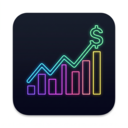
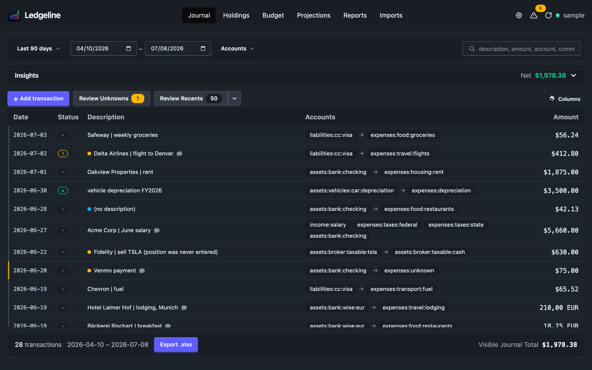
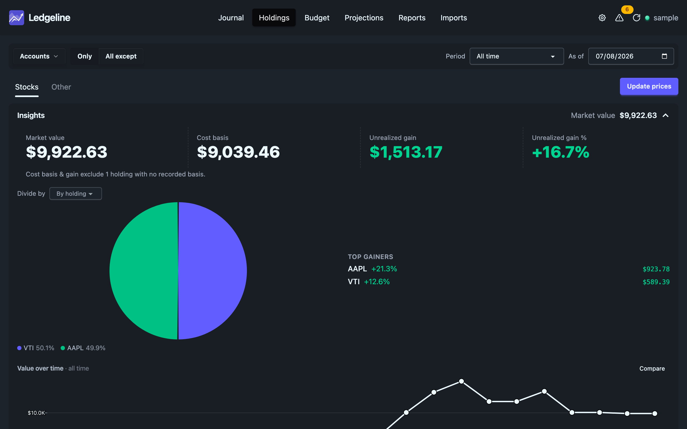

<div align="center">



# Ledgeline (hledger GUI)

[](https://github.com/zmre/ledgeline/actions/workflows/ci.yml)
[](https://github.com/zmre/ledgeline/actions/workflows/audit.yml)
[](https://zmre.github.io/ledgeline/)
[](https://github.com/zmre/ledgeline/releases/latest)
[](https://crates.io/crates/ledgeline)
[](https://zmre.github.io/ledgeline/)
[](LICENSE)

</div>

A fast, local, privacy-centric desktop app for [hledger](https://hledger.org) / [ledger](https://ledger-cli.org) plain-text accounting. It is 100% compatible with hledger, but adds graphical views, enhanced reports, forecasts, and expanded import capabilities in a keyboard-first UI.

## Why

I built this because I was dissatisfied with existing GUIs. They often hard code expectations for where files are and how they link. Or they're ugly. They rarely handle stocks well. If they allow editing, it's limited and buggy. 

I love the command line and editing in the terminal, but sometimes I want graphs, something pretty, and something my wife (in personal context) and coworkers (in business context) can use. 

Ledgeline scratches that itch.

> [!Note]
> I built this for myself and based it on patterns I've built by hand in the past (see [mbr](https://github.com/zmre/mbr-markdown-browser/)), but this project heavily leveraged AI for development.


## Features

In most cases, changes to files in a separate editor show up right away in the UI across all interfaces.

There are no preconceived notions on how accounts are setup or where things live or are organized.  If it works in hledger, it should work in Ledgeline.

### The [Journal](https://zmre.github.io/ledgeline/journal/) Tab



A quick way to browse or find transactions, with some graphics to summarize what's loaded.  Frankly, the command line does much of this (minus the graphs) as well or better.

Where the journal gets interesting is the editor and the review system.  I want categorizing and reviewing to be fast and efficient.

Ledgeline recommends accounts based on previous transactions. And it gives you a chance to apply changes to description or account to similar transactions so you can operate in batch. And you can make such changes into rules for the next import.

Other Journal features:

* [Live filtering](https://zmre.github.io/ledgeline/journal/filtering/)
* [Export](https://zmre.github.io/ledgeline/journal/export/) filtered journal entries to Excel
* Background checks for [problems](https://zmre.github.io/ledgeline/journal/problems/)
* Quick [balances](https://zmre.github.io/ledgeline/journal/) for cash accounts


### The [Holdings](https://zmre.github.io/ledgeline/holdings/) Tab



Contains two sub tabs: Stocks and Other.

* Stocks: track value over time, download [updated prices](https://zmre.github.io/ledgeline/holdings/prices/), view graphs showing [allocation](https://zmre.github.io/ledgeline/holdings/allocation/) by holding, asset class, sector, and more. Also shows top gainers and losers.
* Lets you [compare](https://zmre.github.io/ledgeline/holdings/benchmarks/) to the markets.
* Other: other investments and assets including property, vehicles, partnerships, etc. In a business context, tracks equipment, inventory, and so on.  Tracks value over time.

### The [Budget](https://zmre.github.io/ledgeline/budget/) Tab

Edit periodic rules (hledger `~` rules) as budgets then compare how you're doing compared to your goals. Visual progress bars.

### The [Projections](https://zmre.github.io/ledgeline/projections/) Tab

Lets you create files of periodic rules similar to budgets, but used to project transactions into the future for scenario modeling and forecasting.

It agrees with hledger's `--forecast` projections in most ways, but has one extra trick: you can set a compounding rate and time period to model increases in asset values, expenses, or whatever, over time.

Reports that project into the future:

* Runway (useful for businesses / startups)
* Balance sheet
* Income statement
* Cash flow
* Accounts (balances and sums)
* Journal (projected transactions)

### The [Reports](https://zmre.github.io/ledgeline/reports/) Tab

Most of these reproduce what you can do with hledger in the terminal. Subscriptions is an analysis finding where you have recurring payments and that's unique. Each of the reports has a graphical aspect and an ability to customize groupings using account tags. This lets you make more sophisticated reports that align with different types of businesses and needs.

* **[Insights](https://zmre.github.io/ledgeline/reports/insights/)** is a dashboard showing useful stats and summaries like total revenue, expenses, net worth, investment performance, biggest changes, top transactions, etc., for a chosen timeframe and compared to the prior timeframe.
* **[Balance sheet](https://zmre.github.io/ledgeline/reports/balance-sheet/)** lines up with hledger by default. However, there are tags that can be added to group accounts so they better line up with existing balance sheets from other tools like Quickbooks. Supports export to Excel.
* **[Profit and Loss](https://zmre.github.io/ledgeline/reports/income-statement/)** shows sources of revenue and expenses, rolled up and compared to previous periods, either as one total or split into monthly, quarterly or yearly columns with % change. Sankey diagrams visualize inflows and outflows.  You can tag accounts to customize how they show up in the P&L to make things prettier or to make more sophisticated business statements. Supports export Excel.
* **[Cash Flow](https://zmre.github.io/ledgeline/reports/cash-flow/)** captures net income, adjusted by the change in receivables, payables, deferred revenue, equipment, loans and every other non-cash balance-sheet account, sorted into operating, investing and financing, and reconciled to cash balances. Customizable with tags on accounts. Exportable to Excel.
* **[Net Worth](https://zmre.github.io/ledgeline/reports/net-worth/)** uses shows assets and liabilities over time, with relevant values. A chart above the table stacks the accounts.
* **[Subscriptions](https://zmre.github.io/ledgeline/reports/subscriptions/)** looks through journal entries to find recurring entries of similar description and price that happen monthly or annually to sum up what you're getting charged for on a recurring basis. Variable cost items like utility bills may not be caught, but for the things it detects, it says when the next charge is and how much it costs annually.

### The [Imports](https://zmre.github.io/ledgeline/imports/) Tab

This is where Ledgeline deviates from hledger the most.  Ledgeline actually calls out to hledger for most imports, but it adds a few tricks.

For example, in hledger, you can't import a binary file even if you have a script that can transform it from, say, Excel to CSV.  hledger also doesn't work with QuickBooks exports or QFX format (both XML), which I find superior to CSV since they have transaction IDs that make for better duplicate checks. hledger uses a simple date assumptions that can lead to issues.  

So the import tab will take a much wider set of file types and will then try to find an existing rules file that lines up.  User chooses from options or makes a new one. User gets a preview of what's going to happen, can sort after writing, and then, to make scripting easier, is told the command line arguments to ledgeline that would reproduce the import and all the choices that were made.

QuickBooks Online Journal exports have [their own importer](https://zmre.github.io/ledgeline/imports/quickbooks/) in case you're moving over from QuickBooks or keeping a plaintext accounting copy of what you have there.  These files can't be simplified down to simple CSVs because they can get quite complicated.

### Keyboard Driven

I abhor having to use the mouse, even in GUIs.  Which is why you can navigate everything in Ledgeline (hopefully... file an issue if you spot something I missed) just with the keyboard.  I'm a vim user so expect <kbd>j</kbd>/<kbd>k</kbd> type options to help you move up and down lists and <kbd>/</kbd> to trigger a search field. And like vim, we sometimes use sequences. For example, <kbd>gb</kbd> (`g` followed by `b`) will switch to the budget tab.

The most important thing to know though is that <kbd>?</kbd> will show you the currently relevant keyboard shortcuts, which will change depending on the tab you're in. The full list is in the [keyboard shortcuts docs](https://zmre.github.io/ledgeline/journal/keyboard/).

## Documentation

The user manual is published at **<https://zmre.github.io/ledgeline/>**. The same pages are in [`docs/`](docs/index.md) in this repository, so you can also read them on GitHub.


It is a local app, but it uses a web UI for cross-platform reasons that also let us bring in good charting libraries. It serves a same-origin API that is hledger-web compatible for everything that hledger-web does (ie, `/version`, `/transactions`, `/prices`), but then adds a bunch of endpoints under `/api` for reports, budget, and editing capabilities. A special token is needed so the API stays private, but you could still, if desired, expose it for a remote view.

## Install

The [install section of the manual](https://zmre.github.io/ledgeline/) has detailed instructions.

**macOS.** Download the `.dmg` for your Mac from the [latest GitHub release](https://github.com/zmre/ledgeline/releases/latest): `arm64` for Apple silicon, `x86_64` for Intel. The app is signed and notarized and bundles its own `hledger`. Drag it to Applications.

**Nix (macOS and Linux).** Point at the flake (details below).

**Cargo (anywhere Rust builds).** Install from [crates.io](https://crates.io/crates/ledgeline):

```sh
cargo install ledgeline                                                       # desktop window; on Linux needs webkitgtk-4.1, gtk3, libsoup-3 and libxdo
cargo install ledgeline --no-default-features --features watcher,external-tools  # no window; serves the UI to your browser
```

The headless build prints a `http://127.0.0.1:PORT/#token=…` address to open in your browser. Imports need hledger 1.40 or newer on your `PATH` (or point Ledgeline at one in settings).

If there's demand, I can add homebrew support and possibly support for other Linux repos (eg, AUR).

**To run it directly in Nix**:

```sh
nix run --accept-flake-config github:zmre/ledgeline -- ~/finance/2026.journal   # opens the desktop window on the specified journal (or don't specify and you can open from inside the app)
```

`--accept-flake-config` opts you into our [binary cache](#nix-binary-cache-skip-the-build) so this
downloads rather than compiles. Drop it if you'd rather build everything yourself.

### Linux notes

The window opens with **no title bar and no menu bar**: the app draws its own header, and an in-window GTK menu bar is out of place under a tiling Wayland
compositor. Press <kbd>F10</kbd> to bring both back (and again to dismiss them). You'll need the menu bar if you want to use the mouse to open a file. Alternately just use <kbd>Ctrl</kbd>+<kbd>O</kbd> to pick a ledger file to open.

The Linux package wraps the binary so that nixpkgs' Mesa is available as a **last-resort** EGL driver, appended to the search path and never substituted for it, so your host driver still wins wherever there is one. Without it, WebKitGTK aborts its web process on any non-NixOS host and you get a blank window. This is also why `.#ledgeline` (the bare, unwrapped binary that CI builds) is not the thing to install.

### Mac Nix Notes

**Build the macOS app bundle** to open or drag into `/Applications`:

```sh
nix build github:zmre/ledgeline        # or, in a local checkout: nix build
open result/Applications/Ledgeline.app # macOS — real UI embedded
```

### Nix binary cache (skip the build)

Every push to `main` uploads its build products to [`zmre.cachix.org`](https://app.cachix.org/cache/zmre), so the commands above can **download** the Rust engine and the wry/tao GUI stack instead of compiling them. `flake.nix` already declares the cache and its public key, but Nix ignores substituters coming from a flake it doesn't trust unless you pass `--accept-flake-config` (or answer yes when it asks interactively).

To trust the cache permanently instead, put this in `~/.config/nix/nix.conf`:

```
extra-substituters = https://zmre.cachix.org
extra-trusted-public-keys = zmre.cachix.org-1:WIE1U2a16UyaUVr+Wind0JM6pEXBe43PQezdPKoDWLE=
```

or, on NixOS / nix-darwin, the equivalent `nix.settings.{extra-substituters,extra-trusted-public-keys}`.

> [!NOTE]
> `substituters` is a trusted setting: on a multi-user Nix install your user has to be in
> `trusted-users` for either method to take effect. Otherwise Nix prints
> `ignoring untrusted flake configuration setting 'extra-substituters'` and builds from source,
> which is fine, but slower.

CI pushes the Linux and macOS `ledgeline` binaries, the macOS distributable (`.#macDist` → `Ledgeline.app`) and the crane dependency layer. Coverage is best-effort.  Cachix garbage-collects, so an older revision will be evicted.

## Development (or if you don't have nix)

```sh
direnv allow          # or: nix develop path:.
just --list           # available tasks
just engine-test      # cargo test over the workspace
just check            # SPA type-check + unit tests
just pre-push         # everything CI gates on; the git pre-push hook runs it
just docs             # live preview of the manual
cd web && bun run build && cd .. && cargo build --release && ./target/release/ledgeline ~/.../Ledger/main.journal
```

The [development section of the manual](https://zmre.github.io/ledgeline/development/) covers the internals:

- **[Architecture](https://zmre.github.io/ledgeline/development/architecture/)**: how core, the server and the hosts fit together, and where a native UI would plug in.
- **[Building](https://zmre.github.io/ledgeline/development/building/)**: the Nix + Crane build cache, the `nix build .#{ledgeline,clippy,tests,fmt,macApp}` outputs, CI, and how the SPA is built and embedded.
- **[Releasing](https://zmre.github.io/ledgeline/development/releasing/)**: `scripts/release.sh`, the signed and notarized DMGs, and crates.io publishing.
- **[Imports internals](https://zmre.github.io/ledgeline/development/imports-internals/)**: the CSV rules-file editor — the format-preserving model, what it will and won't edit, and the guards on its write path.
- **[Docs site](https://zmre.github.io/ledgeline/development/docs-site/)**: how this manual is built with mbr and published.

## Architecture

Three layers:

- **`ledgeline-core`**: the product. Journal storage behind a `Vault` trait, parsing, safe in-place edits, and every report and view (exact decimals throughout). No platform code, no HTTP.
- **`ledgeline-server`**: a tokio/axum API over core, with immutable journal snapshots and injected app directories. Cargo features add the desktop window (`gui`), a file watcher (`watcher`) and the `hledger` subprocess (`external-tools`).
- **Hosts**: the desktop app opens the native OS webview (via wry, part of the tauri project) on a loopback port and shows the embedded Svelte app; `--server` runs the same API headless; `ledgeline-ffi` runs the router in-process for a future iOS app.

The Svelte app only presents what the API computes. All assets are built into the single binary, which is pretty snappy. See [Architecture](https://zmre.github.io/ledgeline/development/architecture/) in the manual for the details.

## License

[MIT](LICENSE)
