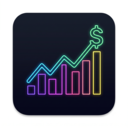
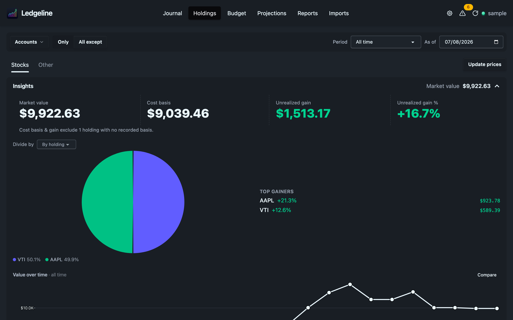

<div align="center">



# Ledgeline (hledger GUI)

[](https://github.com/zmre/ledgeline/actions/workflows/ci.yml)
[](https://github.com/zmre/ledgeline/actions/workflows/audit.yml)
[](https://zmre.github.io/ledgeline/)
[](https://github.com/zmre/ledgeline/releases/latest)
[](https://crates.io/crates/ledgeline)
[](https://zmre.github.io/ledgeline/)
[](LICENSE)

</div>

A fast, local, privacy-centric desktop app for [hledger](https://hledger.org) plain-text accounting. Ledgeline is a **single binary** that opens a native window showing a modern, fast UI. It parses your journal file directly and reproduces hledger's numbers exactly.


I built this because I was dissatisfied with existing GUIs. They often hard code expectations for where files are and how they link. Or they're old and ugly. They rarely handle stocks well. If they even allow editing, it's problematic and buggy. I love the command line and editing in the terminal, but sometimes I want graphs, something pretty, and something my wife (in personal context) and coworkers (in business context) can use. Ledgeline scratches that itch.

> [!WARNING]
> Disclaimer: I built this for myself and based it on patterns I've built by hand in the past (see [mbr](https://github.com/zmre/mbr-markdown-browser/)), but this project heavily leveraged AI for development.

As this project has evolved, I've worked to fix issues that I have with hledger, particularly around import limitations. For example, you can't import a binary file even if you have a script that can transform it from, say, Excel to CSV.  It can't work with QuickBooks exports or QFX format, which I find superior to CSV since it usually has transaction IDs that make for better and more granular duplicate checks vs. simple date assumptions.  And the way stocks are handled, which is basically the same as currency, makes sense in a lot of ways, but makes a lot of reports hard to read if you don't filter appropriately.

Finally, I have very different needs for my business as I do for my personal stuff, yet there is also broad overlap.  The balance sheet and P&L needs to be more granular with more categories in business, tracking things like shareholder equity, but the basics are the same.  Managing Journal entries and subscriptions is the same.  To some extent, budgeting is the same.  But future forecasting is very different.  My goal is to accommodate all these needs in one flexible tool, just as hledger and double-entry accounting are themselves super flexible.  But with lots of insights, charts, graphs, and planning helpers.

## Documentation

The user manual is published at **<https://zmre.github.io/ledgeline/>**. The same pages are in [`docs/`](docs/index.md) in this repository, so you can also read them on GitHub.

## What it does so far

- **[Journal](https://zmre.github.io/ledgeline/journal/)** with live [filtering](https://zmre.github.io/ledgeline/journal/filtering/) and a flexible editor. Background checks flag [problems](https://zmre.github.io/ledgeline/journal/problems/): mistakes hledger would reject, and things it accepts that probably aren't what you meant. The filtered journal can be [exported to XLSX](https://zmre.github.io/ledgeline/journal/export/) in a QuickBooks-style layout.
- **Quick insights** in the journal view reflect the selected time range and show visually where money is going.
- **Balances** is the second tab of that same insights box, answering the other basic question: how much cash do I have right now, and where is it.  Cash on hand, short-term liabilities and net cash across the top, then each bank and card account with its balance and the date it last moved — marked *checked* where a balance assertion in the journal confirms the figure, so you can see at a glance what needs updating.  It reads the whole journal as of today whatever the filter bar says, one currency at a time, and no price directive is involved.  An overdrawn cash account shows red here and turns up in Problems.  Membership follows the same `type:` and `bsterm:` tags the balance sheet uses — cash and *current* liabilities only, so a mortgage stays out of your short-term picture.  If you haven't tagged anything, a short list of words (`mortgage`, `heloc`, `student`, `pension`) is guessed as long-term; the guess never overrides a tag, and the view names whatever it excluded that way so you can correct it.  See [the insights panel docs](https://zmre.github.io/ledgeline/journal/).
- **[Holdings](https://zmre.github.io/ledgeline/holdings/)** allows for visual exploration of all non-cash assets split into two groups: Stocks and Other. Other has things like your home and car (or for business: inventory, equipment, etc.) and stocks get their own thing that shows top gainers, losers, value over time, [allocation](https://zmre.github.io/ledgeline/holdings/allocation/), [benchmarks](https://zmre.github.io/ledgeline/holdings/benchmarks/), and a quick way to [fetch updated market prices](https://zmre.github.io/ledgeline/holdings/prices/). And export to xlsx, too. While Ledgeline attempts to be smart about classifying things for the Holdings tabs, you can use the [`holdings` tag](https://zmre.github.io/ledgeline/holdings/tags/) to force things to show up in particular places or not at all.  And because you may use accounts to capture unrealized gains, you can hint about that with tags, too. This allows for fancier investments tracked using multiple subaccounts (think partnerships) to roll up and get summarized appropriately.
- **[Budget](https://zmre.github.io/ledgeline/budget/)** edits goals that live in your journal as ordinary hledger `~` periodic rules, then shows how you're pacing against each one.
- **[Projections](https://zmre.github.io/ledgeline/projections/)** runs what-if scenarios for cash runway and net worth, driven by a plain-text [scenario file](https://zmre.github.io/ledgeline/projections/file-format/) with [asset rows](https://zmre.github.io/ledgeline/projections/asset-rows/) that compound a balance at a rate.
- **[Reports](https://zmre.github.io/ledgeline/reports/)** starts with more [insights](https://zmre.github.io/ledgeline/reports/insights/) including year over year (or any period) comparisons highlighting biggest changes, transactions, revenue, expenses and net worth at a glance.  Then use the sub tabs (or the keyboard shortcuts) to navigate to the balance sheet, income statement, cash flow, net worth, and subscriptions reports. Each can be exported as XLSX. The end date you pick carries across the report tabs.
  - **Balance sheet** is built with flexibility. Tag accounts to customize the balance sheet.  The in-app experience rolls things up intelligently with drill downs at each line while the XLSX export is a more standard view to share. See **[the balance sheet docs](https://zmre.github.io/ledgeline/reports/balance-sheet/)** for grouping rules, valuation, and to explain the built-in checks.
  - **Profit and Loss** shows sources of revenue and expenses, rolled up and compared to previous periods, either as one total or split into monthly, quarterly or yearly columns with % change. Sankey diagrams visualize inflows and outflows.  As with the balance sheet, you can tag accounts to customize how they show up in the P&L to make things prettier or to make more sophisticated business statements. Again, the XLSX download gives a more standard report for sharing. See **[the income statement docs](https://zmre.github.io/ledgeline/reports/income-statement/)** for the attribution rule, the links that are not drawn, and why colour tracks the account.
  - **Cash Flow** focuses on change to cash over a period of time showing month-by-month changes to cash assets (or any period and duration you want, with a Total column) at whatever level of roll-up you prefer. A stacked chart above the table draws exactly the table's accounts, with the net change as a line. See **[the cash flow and net worth docs](https://zmre.github.io/ledgeline/reports/cash-flow-and-net-worth/)**.
  - **Net Worth** uses pricing and other signals to show assets and liabilities over time, with relevant values, by default annually. A chart above the table stacks exactly the table's accounts, each asset above zero and each liability below it, with net worth drawn as a line.
  - **[Subscriptions](https://zmre.github.io/ledgeline/reports/subscriptions/)** looks through journal entries to find recurring entries of similar description and price that happen monthly or annually to sum up what you're getting charged for on a recurring basis. Variable cost items like utility bills may not be caught, but for the things it detects, it says when the next charge is and how much it costs annually.
  - _All reports are computed in Rust with exact decimal math and hledger parity._
- **[Imports](https://zmre.github.io/ledgeline/imports/)** looks for existing import rules files (`*.rules`) and tries to match them with any file you want to import regardless of its name or location. By default, we use hledger to do the import, but in some cases we do pre-processing, for example if we're importing QIF, QFX/QBO/OFX, or XLSX files. Rules can be [created](https://zmre.github.io/ledgeline/imports/create-rules/) and [edited](https://zmre.github.io/ledgeline/imports/rules-editor/) in the GUI or from the command line, but in the GUI you can see your options for field mapping, default accounts, date format, etc. For fancy rules that the GUI doesn't support, we preserve them as-is so nothing is ever messed up. QuickBooks Online Journal exports have [their own importer](https://zmre.github.io/ledgeline/imports/quickbooks/).
- **[Settings](https://zmre.github.io/ledgeline/settings/)** lets you [declare accounts and their types](https://zmre.github.io/ledgeline/settings/accounts/) and manage [account aliases](https://zmre.github.io/ledgeline/settings/account-aliases/) without hand-editing directives.
- **No preconceived notions** on how accounts are setup or where things live or how they're organized.



It is a local app, but it uses a web UI for cross-platform reasons that also let us bring in good charting libraries. It serves a same-origin API that is hledger-web compatible for everything that hledger-web does (ie, `/version`, `/transactions`, `/prices`), but then adds a bunch of endpoints under `/api` for reports, budget, and editing capabilities. A special token is needed so the API stays private, but you could still, if desired, expose it for a remote view.

## Keyboard Driven

I abhor having to use the mouse, even in GUIs.  Which is why you can navigate everything in Ledgeline (hopefully... file an issue if you spot something we missed) just with the keyboard.  I'm a vim user so expect <kbd>j</kbd>/<kbd>k</kbd> type options to help you move up and down lists and <kbd>/</kbd> to trigger a search field. And like vim, we sometimes use sequences. For example, <kbd>gb</kbd> (`g` followed by `b`) will switch to the budget tab.

The most important thing to know though is that <kbd>?</kbd> will show you the currently relevant keyboard shortcuts, which will change depending on the tab you're in. The full list is in the [keyboard shortcuts docs](https://zmre.github.io/ledgeline/journal/keyboard/).

## Install

There are three ways in. The [install section of the manual](https://zmre.github.io/ledgeline/) has the same instructions.

**macOS.** Download the `.dmg` for your Mac from the [latest GitHub release](https://github.com/zmre/ledgeline/releases/latest): `arm64` for Apple silicon, `x86_64` for Intel. The app is signed and notarized and bundles its own `hledger`. Drag it to Applications.

**Nix (macOS and Linux).** Point at the flake (details below).

**Cargo (anywhere Rust builds).** Install from [crates.io](https://crates.io/crates/ledgeline):

```sh
cargo install ledgeline                        # desktop window; on Linux needs webkitgtk-4.1, gtk3, libsoup-3 and libxdo
cargo install ledgeline --no-default-features  # no window; serves the UI to your browser
```

The headless build prints a `http://127.0.0.1:PORT/#token=…` address to open in your browser. Imports need hledger 1.40 or newer on your `PATH` (or point Ledgeline at one in settings).

If there's demand, I can add homebrew support and possibly support for other Linux repos (eg, AUR).

**To run it directly in Nix**:

```sh
nix run --accept-flake-config github:zmre/ledgeline -- ~/finance/2026.journal   # opens the desktop window on the specified journal (or don't specify and you can open from inside the app)
```

`--accept-flake-config` opts you into our [binary cache](#nix-binary-cache-skip-the-build) so this
downloads rather than compiles. Drop it if you'd rather build everything yourself.

### Linux notes

The window opens with **no title bar and no menu bar**: the app draws its own header, and an in-window GTK menu bar is out of place under a tiling Wayland
compositor. Press <kbd>F10</kbd> to bring both back (and again to dismiss them). You'll need the menu bar if you want to use the mouse to open a file. Alternately just use <kbd>Ctrl</kbd>+<kbd>O</kbd> to pick a ledger file to open.

The Linux package wraps the binary so that nixpkgs' Mesa is available as a **last-resort** EGL driver, appended to the search path and never substituted for it, so your host driver still wins wherever there is one. Without it, WebKitGTK aborts its web process on any non-NixOS host and you get a blank window. This is also why `.#ledgeline` (the bare, unwrapped binary that CI builds) is not the thing to install.

### Mac Nix Notes

**Build the macOS app bundle** to open or drag into `/Applications`:

```sh
nix build github:zmre/ledgeline        # or, in a local checkout: nix build
open result/Applications/Ledgeline.app # macOS — real UI embedded
```

### Nix binary cache (skip the build)

Every push to `main` uploads its build products to [`zmre.cachix.org`](https://app.cachix.org/cache/zmre), so the commands above can **download** the Rust engine and the wry/tao GUI stack instead of compiling them. `flake.nix` already declares the cache and its public key, but Nix ignores substituters coming from a flake it doesn't trust unless you pass `--accept-flake-config` (or answer yes when it asks interactively).

To trust the cache permanently instead, put this in `~/.config/nix/nix.conf`:

```
extra-substituters = https://zmre.cachix.org
extra-trusted-public-keys = zmre.cachix.org-1:WIE1U2a16UyaUVr+Wind0JM6pEXBe43PQezdPKoDWLE=
```

or, on NixOS / nix-darwin, the equivalent `nix.settings.{extra-substituters,extra-trusted-public-keys}`.

> [!NOTE]
> `substituters` is a trusted setting: on a multi-user Nix install your user has to be in
> `trusted-users` for either method to take effect. Otherwise Nix prints
> `ignoring untrusted flake configuration setting 'extra-substituters'` and builds from source,
> which is fine, but slower.

CI pushes the Linux and macOS `ledgeline` binaries, the macOS distributable (`.#macDist` → `Ledgeline.app`) and the crane dependency layer. Coverage is best-effort.  Cachix garbage-collects, so an older revision will be evicted.

## Development (or if you don't have nix)

```sh
direnv allow          # or: nix develop path:.
just --list           # available tasks
just engine-test      # cargo test over the workspace
just check            # SPA type-check + unit tests
just pre-push         # everything CI gates on; the git pre-push hook runs it
just docs             # live preview of the manual
cd web && bun run build && cd .. && cargo build --release && ./target/release/ledgeline ~/.../Ledger/main.journal
```

The [development section of the manual](https://zmre.github.io/ledgeline/development/) covers the internals:

- **[Building](https://zmre.github.io/ledgeline/development/building/)**: the Nix + Crane build cache, the `nix build .#{ledgeline,clippy,tests,fmt,macApp}` outputs, CI, and how the SPA is built and embedded.
- **[Releasing](https://zmre.github.io/ledgeline/development/releasing/)**: `scripts/release.sh`, the signed and notarized DMGs, and crates.io publishing.
- **[Imports internals](https://zmre.github.io/ledgeline/development/imports-internals/)**: the CSV rules-file editor — the format-preserving model, what it will and won't edit, and the guards on its write path.
- **[Docs site](https://zmre.github.io/ledgeline/development/docs-site/)**: how this manual is built with mbr and published.

## Architecture

This spins up a local tokio axum API server and uses the native OS browser as a GUI window (via wry, part of the tauri project) hosting a svelte frontend app.  All assets are built into the single binary, which is pretty snappy.

## License

[MIT](LICENSE)
