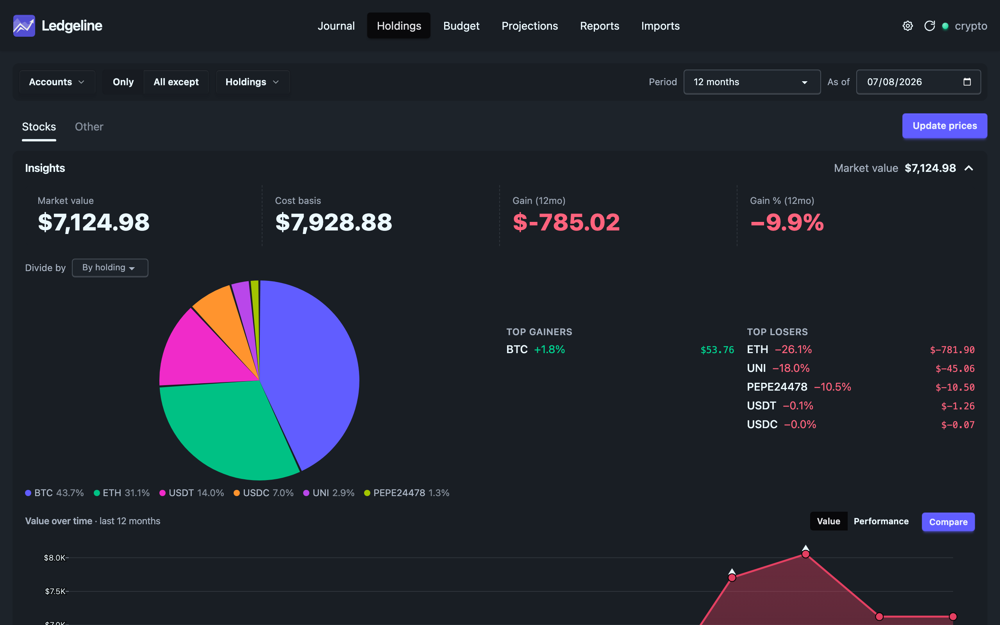

# Crypto

Ledgeline tracks coins the same way it tracks stocks. A coin is a commodity in
your journal, an account that holds one shows up on **Holdings → Stocks**, and
its price comes from Yahoo Finance. Charts, gains, the allocation pie and
Performance all work, provided you set up each coin as described below.



## Setting up a coin

Declare each coin once, with `type: crypto`:

```journal
commodity 1.00000000 BTC   ; type: crypto
commodity 1.000000 ETH     ; type: crypto
commodity 1.000000 SOL     ; type: crypto
commodity 1.00 USDC        ; type: crypto
```

- **`type: crypto`** tells Ledgeline the commodity is a coin. It is looked up
  on Yahoo Finance as the coin's pair in your journal's base currency: `BTC`
  becomes `BTC-USD` in a dollar ledger and `BTC-EUR` in a euro one, so the
  price is Yahoo's own euro price, not a dollar price converted. It also puts
  the coin in the **Crypto** slice of the pie in every view: asset class,
  sector, industry, security type, category and risk (see
  [Allocation by category](allocation.md)). `assetclass: crypto` does the same.
- **The number format** (`1.00000000`) is how many decimals you write. The
  Shares column shows each quantity as written, up to eight decimals (a
  satoshi), with trailing zeros dropped. Ledgeline, like hledger, reads at
  most ten decimals, so an ether quantity written to eighteen places (wei) is
  kept to ten.

A `$` ledger is taken to be in US dollars. A base currency without a single
ISO code (`¥`) gets no pair; Update prices then looks the coin up under its own
symbol and says so. Give such a coin a `yahoo:` tag naming its pair.

> [!NOTE]
> **Untagged coins are priced as whatever Yahoo calls that symbol.** On Yahoo
> Finance `BTC`, `ETH` and `XRP` are ETFs and `USDC` is a stock. An untagged
> `commodity BTC` is priced as the Grayscale Bitcoin Mini Trust ETF, about $27
> a share, because you might hold that ETF. When a well-known coin symbol is
> priced as something that is not a coin, Update prices and the Holdings page
> say what it was priced as and how to fix it.

### Tokens Yahoo lists under another ticker

Some tokens share a symbol with another token. Yahoo then adds a number to the
ticker, for example `UNI7083-USD` for Uniswap or `PEPE24478-USD` for Pepe, and
`UNI-USD` finds nothing. Search for the token on finance.yahoo.com and copy the
ticker exactly as shown into a `yahoo:` tag. hledger needs a symbol with digits
in it quoted, so it is simpler to keep a plain symbol and put the full ticker in
the tag:

```journal
commodity 1.00 UNI   ; type: crypto, yahoo: UNI7083-USD
```

A `yahoo:` tag always wins. Each price Update prices writes names what Yahoo
priced ("Uniswap USD"), so a ticker that points at a different token shows up.
If a coin-tagged commodity's ticker turns out to be a stock or an ETF, its
price is not recorded at all, and the summary says what Yahoo answered.

## The accounts

An account that holds a coin lands on **Stocks** without any tag, because a coin is a
non-currency commodity. Name your wallets and exchanges however you like:

```journal
account assets:crypto:coinbase   ; type: A
account assets:crypto:cold       ; type: A
```

Buying, selling and moving coins are ordinary transactions:

```journal
2026-03-02 Buy bitcoin
    assets:crypto:coinbase      0.05000000 BTC @ $61,200.00
    expenses:fees:crypto             $15.00
    assets:bank:checking        $-3,075.00

2026-03-09 Move to cold storage
    assets:crypto:cold          0.04990000 BTC
    expenses:fees:crypto        0.00010000 BTC
    assets:crypto:coinbase     -0.05000000 BTC
```

A move between two of your own wallets changes nothing on Holdings: Ledgeline
pools each coin across every account in scope. A network fee paid in the coin
reduces what you hold.

On the Performance chart that fee counts as a loss, not as money you took out,
and its share of the cost basis goes with it. A staking reward booked against
an income account with `staking` in its name counts as return, not as money
you put in. The words are a setting, Settings → Prices → Income that counts as
investment return (see [Holdings](index.md#the-value-over-time-chart)):

```journal
2026-04-01 Staking reward
    assets:crypto:coinbase      0.01 ETH @ $3,000.00
    income:staking
```

The reward's `@` value still joins the cost basis, so the holding's all-time
gain (value minus cost) leaves the reward out. A gain over a period counts it.

## Stablecoins

USDT, USDC and similar coins are priced like any other coin, so a depeg shows up.
They count as **Crypto** in the pie. To count one as cash instead, add
`assetclass: cash`:

```journal
commodity 1.00 USDC   ; type: crypto, assetclass: cash
```

The account stays on the Stocks tab either way. It holds a commodity, not your
base currency.

## Prices, weekends and today's quote

- **Update prices** and automatic updates fetch daily closes for coins like any
  other holding. Yahoo dates a coin's daily close at midnight UTC.
- **Every day is a trading day.** Automatic updates give a coin yesterday's
  close (midnight UTC) every day of the week, weekends included, and the
  weekly history takes each week's Sunday close rather than Friday's. A coin
  counts as one when it is tagged `type: crypto` or `assetclass: crypto`, or
  when Yahoo said so the last time Ledgeline fetched it. The
  [delayed quote](index.md#the-value-over-time-chart) for today applies on any
  day too.
- **A missing day takes the day before.** Yahoo occasionally has no close for
  a coin's day. Nothing is written for it, and valuation uses the previous
  close.
- **Small prices keep their digits.** A fetched price is written with six
  significant digits, and never fewer decimals than your base currency uses:
  USDT is `$0.99874`, a token worth a fraction of a cent is `$0.00000358`, and
  bitcoin is `$61656.01`. hledger reads at most ten decimals, so nothing
  smaller than that is written. How dollar amounts display elsewhere does not
  change.

## Not supported

- **Syncing wallets or exchanges.** Ledgeline reads your journal. It does not
  connect to a wallet, an exchange or a blockchain.
- **Tax lots.** Gains use average cost, as for stocks. There are no per-lot gains,
  wash-sale rules or tax reports.
- **DeFi positions, NFTs and staking pools** beyond what you book as
  ordinary transactions.
