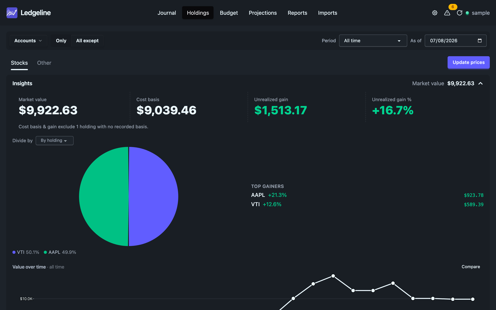
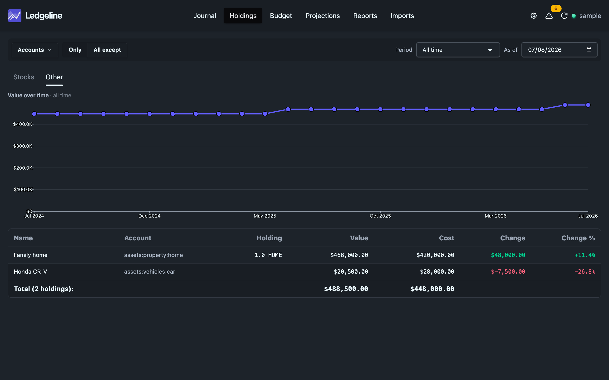
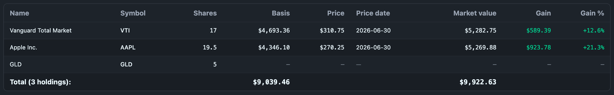

# Holdings

The Holdings tab has two sub-tabs:

- **Stocks** shows securities, one row per commodity, with average-cost basis and
  unrealized gain.
- **Other** shows everything else you own that is neither a security nor cash: a
  house, a car, a partnership interest, a receivable. It has one row per holding,
  with its value, its cost, and how much it has changed. A holding may be one
  account or a small subtree of them.



This section has six pages:

- this one: which tab an account lands on, what the columns mean, the period control and the value-over-time chart;
- [The holdings and valuation tags](tags.md): moving an account between tabs, rolling several accounts into one holding, and separating cost from value;
- [Prices](prices.md): where valuations come from and the Update prices button;
- [Allocation by category](allocation.md): the Divide by menu on the Stocks pie;
- [Comparing against a benchmark](benchmarks.md): the index-fund lines on the Performance chart;
- [Crypto](crypto.md): bitcoin, ether, stablecoins and other coins.

Design notes and the reasoning behind each decision live in
[`plans/10-stock-holdings.md`](https://github.com/zmre/ledgeline/blob/main/plans/10-stock-holdings.md) and
[`plans/14-other-holdings.md`](https://github.com/zmre/ledgeline/blob/main/plans/14-other-holdings.md), and for the chart
[`plans/47-holdings-charts.md`](https://github.com/zmre/ledgeline/blob/main/plans/47-holdings-charts.md).

## Why two tabs and not one list

They are keyed differently, and no single table can be keyed both ways. A
security is a *commodity*: you hold 19.5 AAPL across three accounts, and the
interesting row is AAPL. A house is an *account*: `assets:property:home` is the
thing, and what it holds is an implementation detail. Averaging cost across lots
makes sense for the first and is meaningless for the second.



## Which tab an account lands on

Without any tag, the rule is mechanical:

| The account…                                              | Tab            |
|-----------------------------------------------------------|----------------|
| holds a non-currency commodity (`AAPL`, `VTI`, `BTC`)      | **Stocks**     |
| is `type:A`, not cash, and holds only currency             | **Other**      |
| is `type:C` (cash)                                         | neither        |
| is a liability, equity, revenue or expense account         | neither        |

"Not cash" is exact: hledger folds `type:C` into Asset for most purposes, but the
Other tab tests for `type:A` *specifically*, or every bank account would appear
on it.

"Currency" means a symbol like `$`, `€` or `£`, or a three-letter ISO code
that your journal uses as money: one that is posted to a cash, liability,
income or expense account, or that a cost is written in (`@ 5 CHF`). Some codes
are also tickers. `BND` is both the Brunei dollar and Vanguard's bond fund.
Bought and held in a brokerage account, never spent or banked, `BND` is the
fund, so it lands on Stocks.

To override this rule, use the [`holdings:` tag](tags.md#the-holdings-tag).

## What the columns mean

| Column     | Meaning                                                              |
|------------|----------------------------------------------------------------------|
| Value      | The account's balance at the as-of date, priced in the base currency. |
| Cost       | The same balance at cost (hledger's `-B`).                            |
| Change     | Value − reference (see below).                                        |
| Change %   | Change ÷ reference.                                                   |

The **reference** is chosen by the same window control the Stocks tab uses, and
means the same thing on both:

- **All time** → the reference is *cost*, so change is the gain over what you
  paid.
- **Any bounded window** (1 week, 1 month, 3 months, year to date, 12 months,
  5 years) → the reference is the account's *value at the
  start of the window*. An asset you bought inside the window references zero, so
  the whole purchase reads as that window's change.

Totals sum only the rows that carry the input they need. An asset whose commodity
has no price route to the base currency contributes to no total and raises a
warning naming it, rather than being silently counted as zero.



## Scope, dates and the account chooser

Both tabs share one scope bar: the account filter, the as-of date, and the
period all apply to whichever tab is open.

### The period

The **Period** control sets two things at once, on both tabs: the window the
gain (Stocks) or change (Other) figures are measured over, and the span of the
*Value over time* chart. A chart of the last twelve months beside a one-week
gain would be two answers to the same question, so there is one control.
Holdings opens on **12 months**; a link without `?gain=` means that too.

Every window ends at the as-of date. Gain and change columns carry a suffix
naming it — `Gain (1wk)`, `Change (5yr)` — so a windowed number is never read as
an all-time one.

| Period        | Gain measured from                     | Chart                                   |
|---------------|----------------------------------------|-----------------------------------------|
| 1 week        | seven days before as-of                | daily, 8 points                          |
| 1 month       | one calendar month before (31st → 28th/29th) | daily                              |
| 3 months      | three calendar months before           | weekly                                   |
| Year to date  | December 31 of the previous year       | daily → weekly → monthly as the year goes on |
| 12 months     | one year before                        | monthly: 13 points                       |
| 5 years       | five years before                      | monthly: 61 points                       |
| All time      | cost (the gain over what you paid)     | from the scope's first holding activity  |

For every bounded window the chart's **first point is the gain's reference**:
it is taken on the date the gain is measured from, not at the end of that
date's month or week, and shows exactly the value the gain subtracts. The
points after it fall at the end of each day, week or month, and the last one
is the as-of date. So the twelve-month chart for an as-of of 28 September 2026
starts on 28 September 2025, then runs through the twelve month-ends to 28
September 2026. The benchmark comparison is seeded at that same first point.

A windowed gain is measured against the value at the *end* of its start date,
and counts only money moved in or out after it. That is why year to date starts
from December 31: its closing value is what the year opened with, and anything
you bought or sold on January 1 belongs to this year.

For **year to date** and **all time** the engine picks the interval so the line
has enough points to read without crowding: months once there are at least six
of them, weeks (or days) before that, and quarters or years past ten years of
history. "All time" starts at the first transaction that moved a holding in the
current scope *on that tab* — so the Other tab's chart starts at the house, not
at the first share you bought.

Daily and weekly points are labelled by date on the chart ("Sep 28"); a weekly
point is the value at the end of its week. The period is part of the page URL
(`?gain=1wk`, `?gain=5yr`, …), so a shared link opens on the same window.

### The value-over-time chart

**Value or Performance.** On the Stocks tab a switch in the chart's heading
picks what is drawn. Press <kbd>v</kbd> to flip it.

- **Value** (the default) is the market value of what you hold at each point.
  Buying and selling move it: selling $60k of a fund drops the line by $60k
  whether the fund went up or down.
- **Performance** is your return since the chart's first point, in percent. It
  starts at 0 % and buying and selling do not move it. Each step is measured
  as gain over the money that was invested during that step, with money moved
  in or out counted as arriving halfway through (the Modified Dietz method),
  and the steps are multiplied together (a time-weighted return). Use it to
  ask "how did my investments do", and Value to ask "how much do I have".

The choice is part of the URL (`?view=perf`). The Other tab has only Value.

**Why Gain % and the end of the Performance line can differ.** They answer
two different questions, and agree only when no money moved in or out during
the period.

- **Gain %** (the box above the chart) is *money-weighted*: the period's gain
  divided by the value at the start plus everything you put in, less what you
  took out, during the period. Money that arrived last week counts as if it had
  been invested all period. It answers "what did my money earn me".
- **Performance** is *time-weighted*: each step's return is measured against
  the money invested in that step, and the steps are multiplied together. When
  you added or withdrew money doesn't change it. It answers "how did my
  investments do", and is the measure fund returns and the benchmark lines
  use.

So a large purchase just before a rise lifts Gain % more than Performance, and
a sale just before a fall does the opposite. Gain % also covers only what you
still hold on the as-of date, while Performance includes a holding you sold
during the period for the time you held it.

**The y-axis does not start at zero.** A seven-figure portfolio drawn from $0
is a flat line along the top. Fitting the axis to the shown window alone has
the opposite problem: a 0.4 % week fills the chart and looks like a crash. So the axis is fitted
to a longer horizon than the one you are looking at:

| Period                                     | Axis fitted to   |
|--------------------------------------------|------------------|
| 1 week, 1 month, 3 months, YTD, 12 months  | the last year    |
| 5 years                                    | the last 5 years |
| All time                                   | all of history   |

The lowest and highest values over that horizon get 20 % of their range added
below and 10 % above, never below zero. Leading zeroes are ignored. A history that begins with an opening
balance jumps from $0 to the full amount on day one, and that $0 would otherwise
drag the axis down to the floor.

Performance uses the same horizons and the same padding, measured from the
chart's first point, but it can go below zero, so it has no floor. A thin line
marks 0 %.

**Colour says whether the period made money.** On Value the line and the
shading under it follow the **Gain** figure above the chart: green when the
gain over the period is positive, red when it is negative, the plain text
colour when it is zero. A sale that leaves less value at the end does not turn
a gaining period red. When the gain is unknown (a holding with no cost basis,
for example), the colour falls back to comparing the last point with the
first. The Other tab always compares last with first, because its Change
column is value-based. On Performance the colour is the sign of the last
point. Benchmark lines stay dashed and unshaded.

**Markers for buying and selling.** On Value, a point where you put in or took
out a noticeable amount gets a small ▲ (net bought) or ▼ (net sold), and its
tooltip says how much: "Net bought $12,000.00". Noticeable means at least 5 %
of the y-axis span, so reinvested dividends and a regular contribution to a
large portfolio are not marked. The Other tab shows the same markers when money
moves into or out of those accounts. Performance has no markers, because
buying and selling do not move it.

**Income your holdings earn is return.** A purchase paid for by a dividend or
a staking reward is not money you put in, so it raises Performance and gets no
marker. This applies to income accounts (`type: R`) whose name contains one of
the words set in **Settings → Prices → Income that counts as investment
return**: `dividend` and `staking` unless you change them. Income on any other
account, such as an RSU vest booked to `income:rsu` or salary paid in shares,
is money arriving from outside, so it counts as money in, like a deposit. The
settings page lists your income accounts under the two headings, and the list
can be kept for one ledger only. When income pays for only part of a purchase,
the rest counts as money in.

A fee paid in shares or coins to an expense account (`type: X`) is not money
you took out, so it lowers Performance.

In `ledgeline.toml` the setting is a list:

```toml
[ui]
returnIncomeAccounts = ["dividend", "distribution", "staking"]
```

**Cash dividends are not in Performance yet.** A dividend paid out as cash
leaves your holdings without being counted, so Performance reads slightly low
for a holding that pays one, while the benchmark lines include theirs. Over a
year the gap is roughly the holding's dividend yield. Reinvest the dividend in
the same transaction, as above, to have it count.

**Narrowing the chart to some holdings.** The **Holdings** menu beside the
account chooser picks which holdings the chart and the summary figures above it
cover. Press <kbd>F</kbd> to open it and type to search. You can also click:

- a row in the table (or press <kbd>f</kbd> on the highlighted row);
- a slice of the pie, or a name under Gainers and Losers;
- a category slice when the pie is divided by sector, industry or category,
  which picks every holding with any share in that category. A broad fund comes
  in at its full value, so the menu lists exactly what was picked.

Clicking the same thing again clears it. The table, pie and gainers and losers keep
every row, with the picked ones highlighted, so you can keep clicking. Compare
still works: Performance is then the picked holdings' own return. On the Other
tab the menu lists that tab's rows. The pick is part of the URL
(`?hold=VTI,AAPL`).

**Today's prices on short periods.** On **1 week** and **1 month**, with the
as-of date set to today, the page fetches one delayed quote per holding and uses it everywhere: table,
totals, gains and the chart's last point. The chart heading says when the quote
was taken ("live 2:35 PM (delayed)"). These quotes are held in memory and never written to your
prices file. A holding priced in the last 15 minutes, by this or by
[Update prices](prices.md), is not asked for again, and if Yahoo Finance says
"too many requests" Ledgeline stops asking for 15 minutes and shows saved
prices. Ledgeline is not a market monitor. The quote is there to show what a big day in the market
did to your money.

The account chooser's options are **not** filtered by the current scope or date,
deliberately. An option that vanished the moment you deselected it could not be
reselected, and one that vanished when you travelled back a month would make a
scope impossible to compose. So it offers every account that could ever be a row,
whether or not it holds anything today.
