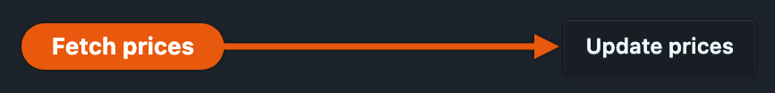

# Prices and valuation

## Valuation sources, and why the three reports differ

| Report            | Prices used                                                |
|-------------------|------------------------------------------------------------|
| Balance sheet     | Explicit `P` directives only (matches `hledger bs -V`)      |
| Other holdings    | Explicit `P` **plus** prices inferred from `@`/`@@` costs   |
| Stocks holdings   | `P` first, then a cost annotation as a per-symbol fallback  |

The Other tab infers from cost annotations for a specific reason: the common case
is a single `1 HOME @ $420,000.00` and no `P` directive at all. Reading only
explicit directives would report that house as unpriced — technically defensible,
practically useless. The balance sheet stays strict because it is claiming parity
with `hledger bs -V`.

## Updating prices from Yahoo Finance



The **Update prices** button sits beside the tab strip while the Stocks tab is
open. One press fetches the latest close for every symbol the tab currently
shows and appends a `P` directive per symbol to your journal.

It appears only when there is something for it to do: a journal Ledgeline can
write to, at least one stock currently held, and somewhere to put a price.

### Where the prices are written

| Your journal                                        | Where the update goes                   |
|-----------------------------------------------------|-----------------------------------------|
| Some file already holds `P` directives               | That file — the one holding the most     |
| No file anywhere holds a `P` directive               | A new `prices.journal`, `include`d for you |
| No `P` anywhere, but a `prices.journal` already sits beside your journal | Nothing is created or overwritten; the update goes to a file with no transactions in it, else your main journal |

**"Already holds prices" is decided by the directives, not by the filename.** If
your prices live in `history.journal`, `kurse.journal` or `2026/prices.j`,
Ledgeline finds them there and keeps writing there. It only creates a file when
no file in the whole include tree prices anything — and it will never write over
a `prices.journal` it did not create.

The new file is created beside your main journal, holding a comment and nothing
else, and `include prices.journal` is appended to the **end** of your main
journal. Both writes are proved to reparse before either one happens.

### The yahoo tag

Prices are looked up under the commodity's own symbol. When Yahoo Finance knows
a holding by a different ticker than your journal does — which is common, because
hledger commodity symbols cannot contain every character a ticker can — say so on
the `commodity` directive:

```journal
commodity 1.0000 BRKB   ; yahoo: BRK-B
commodity 1.0000 VTSAX  ; yahoo: VTSAX
```

| Tag present | Looked up as         |
|-------------|----------------------|
| `yahoo: X`  | `X`                  |
| absent      | the commodity symbol |

The tag goes on the `commodity` directive line itself — not on an indented line
under it — and lives happily beside any other tag you keep there. Anything Yahoo
Finance quotes works: stocks, ETFs, mutual funds by their NAV, and index symbols
like `^GSPC`.

### What a press actually does

- **Runs twice, writes once.** A symbol that already has a `P` line for the
  fetched date is reported as *already current* and nothing is appended, so
  pressing the button repeatedly does not grow the file.
- **Reports per symbol, fails as a whole for nothing.** A ticker Yahoo has no
  quote for, or a request that fails outright, is listed by name in the summary;
  every other symbol is still written.
- **Writes in your journal's own style.** The fetched quote is rounded to the
  precision your journal already uses for the base commodity, so an update reads
  as `P 2026-08-31 AAPL $315.23` rather than the ten-digit float Yahoo answers
  with.
- **Appends at the end of the file**, the one position that cannot disturb
  anything already in it. Your comments, ordering and spacing are untouched.
- **During market hours the "latest close" is the day's live price**, because
  that is the candle Yahoo is still forming. This matches what `pricehist` and
  the shell scripts this replaced do. Press it after the close for a settled
  number.
