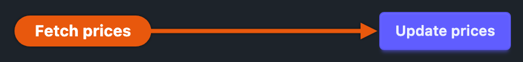

# Prices and valuation

## Valuation sources, and why the three reports differ

| Report            | Prices used                                                |
|-------------------|------------------------------------------------------------|
| Balance sheet     | Explicit `P` directives only (matches `hledger bs -V`)      |
| Other holdings    | Explicit `P` **plus** prices inferred from `@`/`@@` costs   |
| Stocks holdings   | `P` first, then a cost annotation as a per-symbol fallback  |

The Other tab infers from cost annotations for a specific reason: the common case
is a single `1 HOME @ $420,000.00` and no `P` directive at all. Reading only
explicit directives would report that house as unpriced — technically defensible,
practically useless. The balance sheet stays strict because it is claiming parity
with `hledger bs -V`.

## Updating prices from Yahoo Finance



The **Update prices** button sits beside the tab strip while the Stocks tab is
open. One press fetches the latest close for every symbol the tab currently
shows and adds a `P` directive per symbol to your journal.

It appears only when there is something for it to do: a journal Ledgeline can
write to, at least one stock currently held, and somewhere to put a price.

### Where the prices are written

| Your journal                                        | Where the update goes                   |
|-----------------------------------------------------|-----------------------------------------|
| Some file already holds `P` directives               | That file — the one holding the most     |
| No file anywhere holds a `P` directive               | A new `prices.journal`, `include`d for you |
| No `P` anywhere, but a `prices.journal` already sits beside your journal | Nothing is created or overwritten; the update goes to a file with no transactions in it, else your main journal |

**"Already holds prices" is decided by the directives, not by the filename.** If
your prices live in `history.journal`, `kurse.journal` or `2026/prices.j`,
Ledgeline finds them there and keeps writing there. It only creates a file when
no file in the whole include tree prices anything — and it will never write over
a `prices.journal` it did not create.

The new file is created beside your main journal, holding a comment and nothing
else, and `include prices.journal` is appended to the **end** of your main
journal. Both writes are proved to reparse before either one happens.

### The yahoo tag

Prices are looked up under the commodity's own symbol. When Yahoo Finance knows
a holding by a different ticker than your journal does — which is common, because
hledger commodity symbols cannot contain every character a ticker can — say so on
the `commodity` directive:

```journal
commodity 1.0000 BRKB   ; yahoo: BRK-B
commodity 1.0000 VTSAX  ; yahoo: VTSAX
```

| Tag present | Looked up as         |
|-------------|----------------------|
| `yahoo: X`  | `X`                  |
| absent      | the commodity symbol |

The tag goes on the `commodity` directive line itself — not on an indented line
under it — and lives happily beside any other tag you keep there. Anything Yahoo
Finance quotes works: stocks, ETFs, mutual funds by their NAV, and index symbols
like `^GSPC`.

### What a press actually does

- **Runs twice, writes once.** A symbol that already has a `P` line for the
  fetched date is reported as *already current* and nothing is appended, so
  pressing the button repeatedly does not grow the file.
- **Reports per symbol, fails as a whole for nothing.** A ticker Yahoo has no
  quote for, or a request that fails outright, is listed by name in the summary;
  every other symbol is still written.
- **Writes in your journal's own style.** The fetched quote is rounded to the
  precision your journal already uses for the base commodity, so an update reads
  as `P 2026-08-31 AAPL $315.23` rather than the ten-digit float Yahoo answers
  with.
- **Keeps the file in date order.** Each new line goes straight after the
  last `P` line dated on or before it, so same-day prices stay together; a
  price older than every other goes before the first, and a file with no `P`
  lines yet is appended to. Nothing already in the file moves: your comments,
  blank lines and other directives stay where they are, and a file that is
  already out of order stays exactly as out of order as it was (the new line
  goes after the last line, counting from the end, dated on or before it).
- **Only records closes.** During market hours Yahoo's daily series ends with
  today's still-forming candle, whose "close" is just the last trade so far.
  Ledgeline drops a candle until the exchange's own regular session for that
  day has ended, so a press at lunchtime records yesterday's close, and a press
  after the bell records today's.

## Automatic price updates

Turn on **Settings → Prices → Keep stock prices up to date in the background**
and Ledgeline keeps the prices current for you while it is open:

- **Shortly after it starts**, and then **about once an hour**, it checks your
  journal for stocks missing the **latest closing price** — today's once US
  markets have closed (after 21:30 UTC on a weekday), otherwise the previous
  weekday's.
- **It fills in weekly history.** For each of the last *N* Monday-to-Sunday
  weeks (6 by default, 0 to 52), a stock with no `P` line anywhere in that week
  gets the week's Friday close — or the week's last trading day, when the
  Friday was a holiday. A price on any day of the week counts, so prices you
  add yourself mid-week are respected. Set the weeks to 0 to fetch only the
  latest close.
- **It prices what you held.** A stock needs a price for a date if you held it
  at some point between that date and today. A stock bought last month still
  gets the weeks before you bought it — that is the history a chart of it
  shows — but a stock you sold all of in September gets nothing after the week
  you sold it, and one sold yesterday does not need today's close.

New lines go where **Update prices** would put them, in date order, in your own
style. A line already there for that date is never duplicated.

### It needs a prices file first

Nothing happens until some file in your journal holds a `P` directive. The
automatic update never decides where a journal's first price goes, and never
creates `prices.journal` itself. Click **Update prices** once: it creates the
file (or finds the one you already use), and from then on the automatic
updates add to it. Holdings shows *Click Update prices once to start automatic
updates* until you do.

A read-only journal is never written to.

### Going easy on Yahoo Finance

- The hourly check is done **on your own journal**, with no network at all. A
  request goes out only for a stock that is actually missing a price.
- **One request per stock**, however many weeks are being filled in.
- At most **two requests at a time**, started at least a quarter of a second
  apart.
- If Yahoo Finance answers *too many requests*, the run stops at once and
  automatic updates pause for an hour, then two, four, and so on up to a day.
  Holdings says when they resume. The **Update prices** button still works
  during a pause.
- A stock Yahoo has nothing new for — a market holiday, a delisted ticker — is
  asked about once per trading day, not every hour.

Next to the **Update prices** button, Holdings shows what the last automatic
run did, such as *Prices auto-updated 2 h ago*.

### Settings for one ledger

The setting is shared by every ledger unless you tick **Use for this ledger
only** on the Prices settings tab, which keeps both the on/off switch and the
number of weeks in that ledger's `ledgeline.toml` (see
[Settings files](../settings/settings-files.md)). That way your real books can
update themselves while a sample ledger you demo with does not. The keys are
`autoPrices` and `autoPricesWeeks`.
