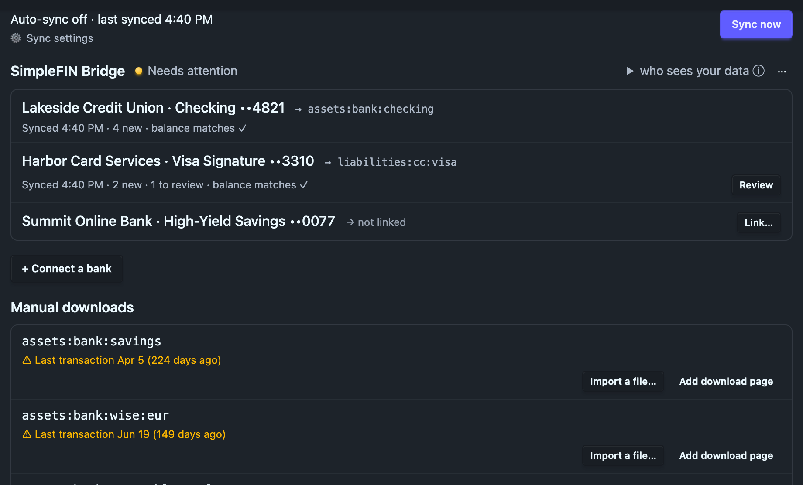
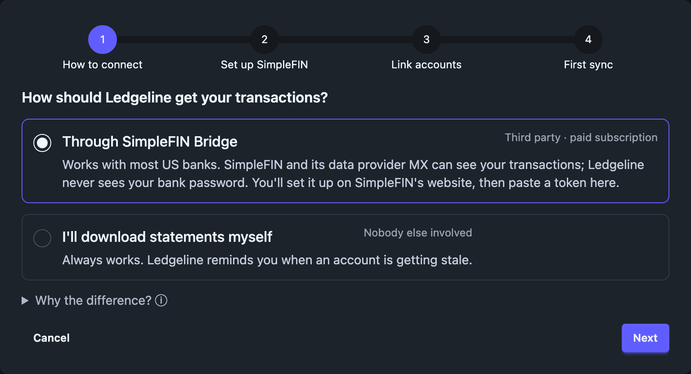
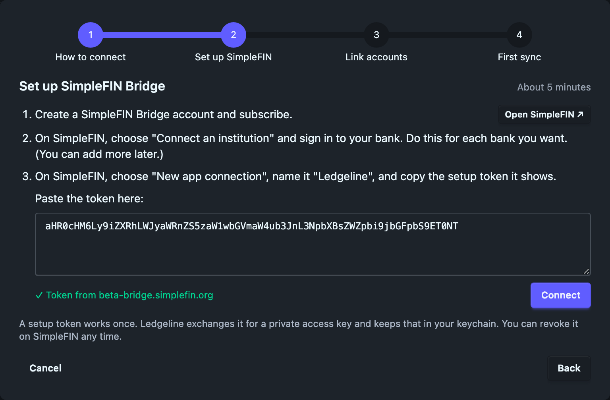
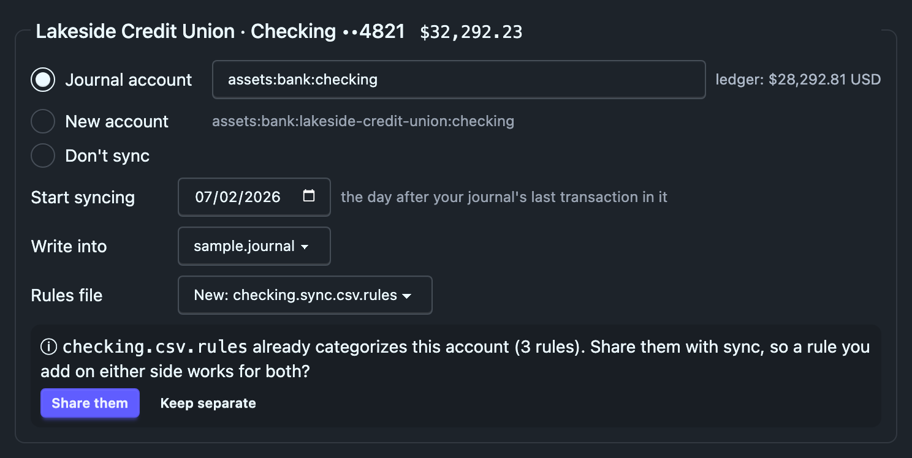
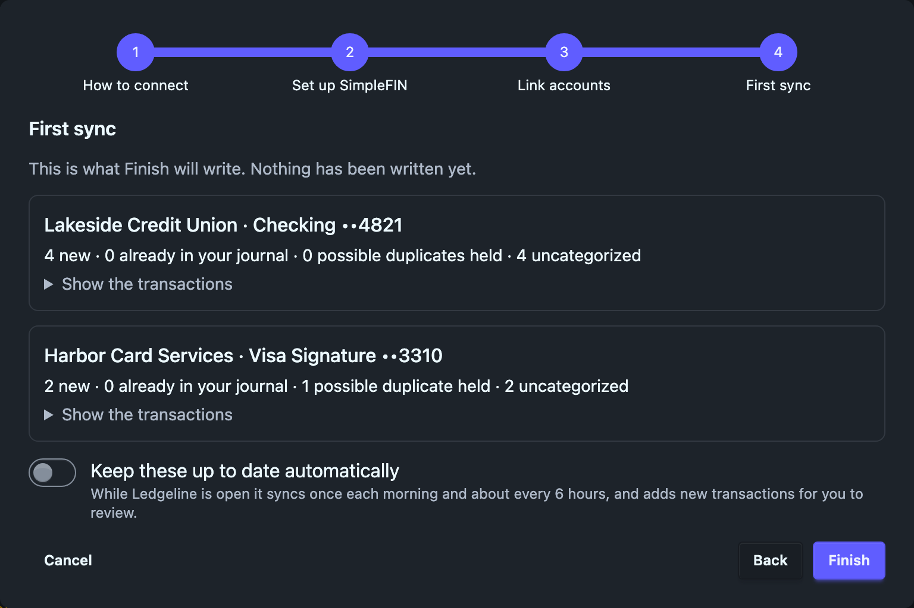
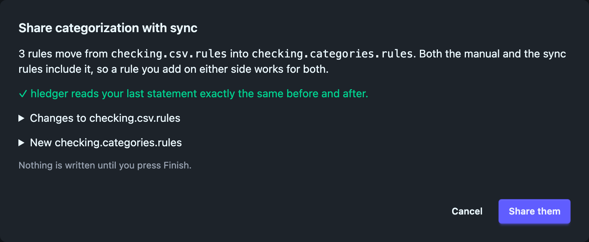
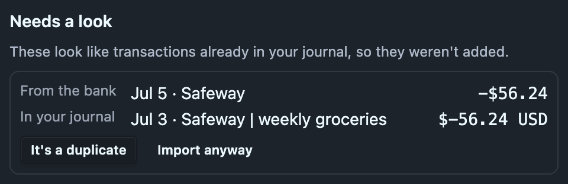
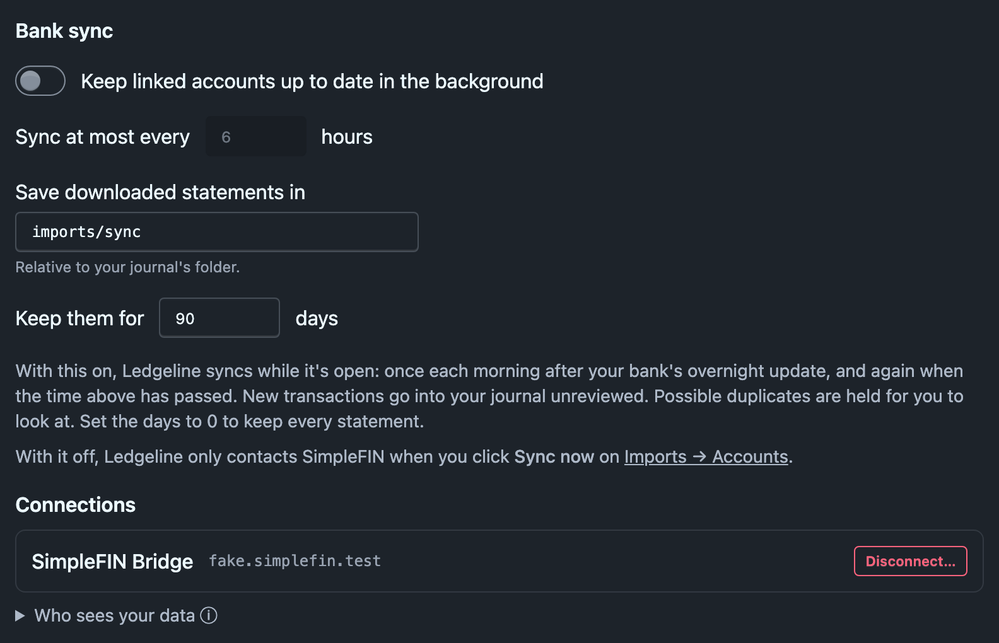
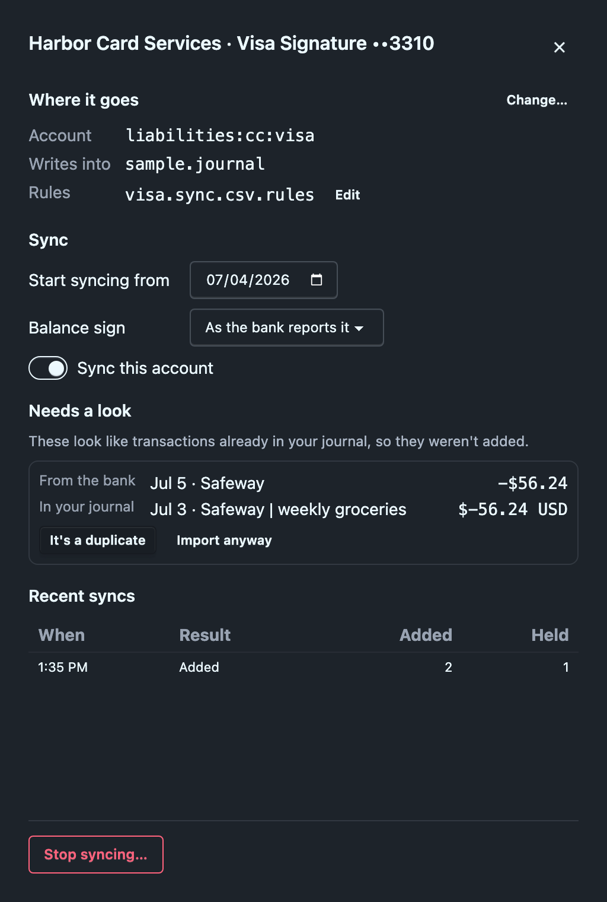
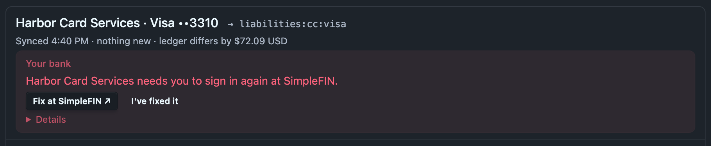

# Bank sync

Bank sync fetches new transactions from your bank and writes them into your journal, categorized by your rules and marked as not yet reviewed. It works through [SimpleFIN Bridge](https://beta-bridge.simplefin.org/), a paid third-party service. You link each account once. After that, one click on **Sync now** brings everything up to date, or Ledgeline can do it for you in the background.

Banks you don't link keep working the way they always have, through [New transactions](new-transactions.md). The Accounts tab lists both kinds side by side.

Bank sync is in the desktop app only. The iOS app hides the Accounts tab and the Sync settings tab.



## Who sees your data

Read this before you sign up. Bank sync means a company other than you and your bank sees your transactions.

| Connection | Who sees your transactions | Where your bank password lives |
| --- | --- | --- |
| SimpleFIN Bridge | SimpleFIN Bridge and MX (its data provider) | With MX, not with Ledgeline |
| Manual download | Nobody but you | Nowhere (you log in yourself) |

- **SimpleFIN Bridge** runs on MX, a bank-data aggregator. You sign in to your bank on SimpleFIN's website, not in Ledgeline. MX keeps that login and fetches your accounts. SimpleFIN passes the results on to apps you allow.
- **Ledgeline talks only to SimpleFIN Bridge.** It never sees your bank password. It holds one access key, which lets it read what SimpleFIN has. You can revoke that key on SimpleFIN at any time.
- **It costs money.** SimpleFIN Bridge is a subscription, $15 a year at the time of writing. Ledgeline charges nothing for bank sync.

### Why there is no direct option

You may have read that SimpleFIN lets a bank serve your data itself. The standard allows it, but no bank runs its own SimpleFIN server. Every SimpleFIN server in use today is an aggregator like the Bridge.

The other no-middleman route is OFX Direct Connect, the bank connection Quicken and GnuCash use. It is fading. Fidelity, Schwab and Chase no longer answer, many banks only accept clients that pretend to be Quicken, and logins that need a one-time code can't be automated. Ledgeline doesn't offer it.

If you don't want a third party involved, don't link your banks. Download statements from your bank's website and import them on [New transactions](new-transactions.md). That always works, and the Accounts tab reminds you when an account hasn't had new transactions for a while.

## What you need

- A SimpleFIN Bridge account with an active subscription, and your banks connected there.
- hledger 1.40 or newer, the same as for any import. See [What you need first](index.md#what-you-need-first).
- A journal Ledgeline can write to. A journal opened read-only shows its links but can't sync.
- A secure place for the access key. On a Mac that is your login keychain. On Linux, Ledgeline needs a Secret Service such as GNOME Keyring or KWallet, and won't connect without one.

## Connect a bank

Open **Imports → Accounts** and press **+ Connect a bank**. The wizard has four steps, shown along its top: **How to connect**, **Set up SimpleFIN**, **Link accounts** and **First sync**. **Back** returns to the previous step and **Cancel** closes the wizard. Nothing is written to your journal until you press **Finish**.

### 1. Choose how to connect

Pick **Through SimpleFIN Bridge** and press **Next**.

If you pick **I'll download statements myself** instead, the button reads **Show my accounts**. It closes the wizard and highlights the **Manual downloads** list. **Why the difference?** opens the table from [Who sees your data](#who-sees-your-data).



### 2. Set up SimpleFIN Bridge

This part happens on SimpleFIN's website. It takes about five minutes.

1. Press **Open SimpleFIN ↗**. Create a SimpleFIN Bridge account and subscribe.
2. On SimpleFIN, choose "Connect an institution" and sign in to your bank. Repeat for each bank you want. You can add more later.
3. On SimpleFIN, choose "New app connection", name it "Ledgeline", and copy the setup token it shows.
4. Back in Ledgeline, paste the token into the box and press **Connect**.

When you switch back to Ledgeline with a token on the clipboard, a **Paste token from clipboard** button appears. Ledgeline reads the clipboard only when the window or the box gets focus, and puts nothing in the box until you press the button.

As you paste, Ledgeline decodes the token and shows where it points:

| What it says | What it means |
| --- | --- |
| ✓ Token from beta-bridge.simplefin.org | A SimpleFIN Bridge token. Go ahead. |
| ⚠ Not SimpleFIN Bridge. Only continue if you trust *host*. | Another SimpleFIN server. Ledgeline will connect to it, but only you can judge whether to trust it. |
| That isn't a setup token. Copy the whole token SimpleFIN shows you. | Part of the token is missing, or it's something else. |
| That's an access URL, not a setup token. | You pasted an access URL from another app. Paste the setup token instead. |
| This token points to *host* over plain http, which isn't safe. | Ledgeline only connects over https. |

A setup token works once. Ledgeline exchanges it for a private access key and keeps that key in your keychain. If the exchange fails, see [This token was already used](#token-used) or [SimpleFIN's firewall refused the connection](#edge-blocked).



If SimpleFIN has no banks connected yet, the next step says so. Connect one on SimpleFIN, then press **Re-check**.

### 3. Link accounts

Ledgeline lists every account SimpleFIN found, with its current balance. For each one, choose where it goes.



**Journal account, New account, or Don't sync.** Pick one:

- **Journal account** maps it onto an account already in your journal. Ledgeline suggests one from the last four digits of the account number, words the two names share, and a matching balance. Beside it, the ledger's balance is shown with "✓ matches" or "✓ close" when it agrees with the bank's.
- **New account** creates one. Give it a name, a type (**Cash (bank account)**, **Asset** or **Liability (card or loan)**), an opening balance and a date. Ledgeline writes an `account` declaration and an opening-balance transaction against `equity:opening balances` into the file you choose under **Write into**.
- **Don't sync** leaves it out. An account Ledgeline couldn't match starts here, so nothing is linked by accident.

**The balance sign.** Some banks report a card balance as positive when your ledger has it negative. When the bank's balance is exactly the ledger's with the sign flipped, Ledgeline asks, for example: "Chase reports this as +1,032.18. Your ledger has −1,032.18. Treat Chase's sign as reversed?" Tick it if so. This only affects the [balance check](#balance-check), not the transactions. You can change it later in the account's drawer.

**Start syncing.** The first date to import. For an existing account it defaults to the day after its last transaction in your journal, so nothing you already have is fetched again. Rows dated before it are dropped. Two notes can appear under the date:

- "*Bank* only provides history back to *date*": the bank sent nothing older, so an earlier start date gains nothing.
- "That much history takes *N* requests to SimpleFIN, which allows about 24 a day": SimpleFIN serves at most 90 days per request, so a long history is fetched in 90-day pieces. See [The daily limit](#the-daily-limit).

**Write into.** The journal file new transactions are appended to. Ledgeline suggests the file that holds the account's newest transaction.

**Rules file.** The rules file that categorizes this account's transactions. You pick it here, on purpose, and you can change it later.

- **New: *name*.sync.csv.rules** (the default) creates a sync rules file in your journal's folder, named after the journal account. For `liabilities:cc:chase` that is `chase.sync.csv.rules`.
- Any existing sync rules file is listed too. Only files that read the sync format appear. A rules file you use for manual downloads reads a different set of columns, so it isn't offered. The next section explains how to share its categories instead.

Press **Preview** when every account you want is set up. If anything is missing, the wizard lists what to fix, such as "Choose a journal account."

### 4. First sync

Ledgeline fetches each linked account and runs the import as a dry run. Nothing has been written yet. Each account shows a line like "38 new · 0 already in your journal · 2 possible duplicates held · 6 uncategorized". **Show the transactions** shows the exact journal text Finish will write.

Below the list, **Keep these up to date automatically** turns on [automatic sync](#sync-now-and-automatic-sync). It is off unless you have turned it on before.

Press **Finish**. Ledgeline writes the links, the rules files, any new accounts and the first import. The last screen says what was added. **Review now** opens the [Review](../journal/review.md) cards over the new transactions. **Done** closes the wizard.



## Sharing categories with your manual rules

An account can be synced and still be imported by hand now and then, for example to backfill history older than what SimpleFIN offers. The sync file and your bank's CSV or OFX file have different columns, so they need two rules files. Your `if` rules shouldn't have to live in both.

When the wizard finds a manual rules file whose `account1` is the account you chose, it asks:

> `chase.csv.rules` already categorizes this account (41 rules). Share them with sync, so a rule you add on either side works for both?

- **Share them** moves the `if` rules out of `chase.csv.rules` into a new `chase.categories.rules` beside it. The manual file and the new sync rules file both end with `include chase.categories.rules`. The categories file is named after the manual rules file, and the sync rules file is created in the same folder.
- **Keep separate** leaves the manual file alone. The sync rules file starts with no `if` rules of its own.

Before you decide, **Share them** opens a preview. It says how many rules move, lists any that stay, and shows both files' changes. Then Ledgeline runs the manual rules file over the last statement you imported with it, before and after the change. When hledger's output is byte for byte the same, it says "✓ hledger reads your last statement exactly the same before and after." When it isn't, sharing is turned off and the difference is shown. Nothing is written until you press **Finish**.



### Rules that stay in the manual file

Some rules can't work on synced rows, or would change meaning if moved. They stay where they are, and the preview gives the reason:

| Reason shown | What it means |
| --- | --- |
| Uses the *name* column, which bank sync doesn't have. | The rule tests or copies a column only your bank's file has, such as `%trntype` or `%checknum`. |
| Its pattern depends on how this bank's file writes a row or a date, and sync's CSV writes them differently. | The pattern depends on how your bank's file lays out a row. The sync file's rows look different, so it would match the wrong things. This also covers a rule on the date column when your bank's dates aren't written as `2026-11-14`, because sync dates always are. |
| A table or an advanced rule Ledgeline can't move safely. | An `if` table, or a block Ledgeline doesn't fully understand. |
| A later rule that stays also sets *field*, and moving this one would make it win. | In hledger the last matching rule wins. The include goes at the end of the file, so moving this rule would let it override a later one that has to stay. |
| Sets the transaction comment, which sync uses for its id. | Sync stores each transaction's id in its comment. A rule that replaces the comment would erase the id, and the transaction would be imported again on every sync. |

Once shared, the categories file appears on **Edit Rules** like any other rules file. **Remember as a rule** from the Review cards adds new rules to it, so a rule learned from a manual import covers sync too, and the other way round.

## What a sync does

Each sync, whether you clicked or it ran on its own, follows the same steps for every linked account:

1. Fetch recent transactions from SimpleFIN. Each fetch re-reads the last five days before the previous successful sync, because SimpleFIN is vague about which date it filters on.
2. Drop pending transactions, and anything dated before the account's start date.
3. Drop transactions your journal already has, and hold possible duplicates for you.
4. Save the rest as a CSV and import it through the account's rules file, exactly as New transactions would.
5. Compare the bank's balance with your ledger's.

New transactions are written without a `reviewed:` tag, so they show up in **Review Recents**, and the uncategorized ones in **Review Unknowns**. After **Sync now**, a message such as "Synced 3 accounts · 9 new transactions" appears with a **Review** button.

### Dates and pending transactions

Only posted transactions are imported. A purchase that is still pending is skipped, and arrives once it posts, usually one to three days later. There is no setting to import pending transactions. Pending and posted versions of a charge often have different ids and amounts, so importing both would double-count.

The transaction date is the date the bank posted it. When the bank also reports a different date for when you made the purchase, that becomes hledger's secondary date:

```journal
2026-11-14=2026-11-12 BLUE BOTTLE COFFEE  ; id:4a91c2-TRN-8812
    liabilities:cc:chase        $-6.50
    expenses:food:coffee
```

### Where the downloaded files go

Every sync saves what it imported as a plain CSV inside your journal's folder:

```
imports/sync/<connection>/<account>-<id>/2026-11-14T0712.csv
```

- The folder is the **Save downloaded statements in** setting, `imports/sync` by default. It must be inside your journal's folder.
- Files older than **Keep them for** (90 days by default) are deleted. Set it to 0 to keep every file.
- `hledger import` with the account's rules file reads these files the same way Ledgeline does, so you can check or repeat an import from a terminal.
- Each sync writes a new file, and Ledgeline deletes the `.latest` file hledger leaves beside it. Duplicates are caught by id instead, so a transaction that arrives late still gets in.
- Ledgeline writes no `.gitignore`. If your journal is in git, decide yourself whether to commit these files.
- SimpleFIN's raw answers are never saved anywhere.

## Duplicates

Ledgeline checks every fetched transaction against your journal in three ways.

**By id.** Every synced transaction gets an `id:` tag, made from a short code for the account and the bank's own transaction id. A transaction whose id is already in the journal is skipped quietly. If you edited that transaction since, your edit wins and nothing is reported.

**By start date.** Rows dated before the account's start date are never imported. That protects history you imported before linking, which has no sync ids.

**By looking alike.** A transaction with a new id is held when your journal already has one on the same account that looks like the same money moving: the same amount, dated within three days, sharing a word of the payee, and not already matched to something in this fetch. That is what a bank re-issuing its ids looks like, and what an OFX file you imported by hand for a synced account looks like.

### Possible duplicates

Held transactions are never written on their own. The account's row says how many are waiting, and its drawer lists them under **Needs a look**, each beside the transaction it resembles.



- **It's a duplicate** adds the new id to the existing transaction as a second `id:` tag, and writes nothing else. The next sync sees the id and skips it.
- **Import anyway** writes the transaction through the account's rules file, like any other synced row.

## Sync now and automatic sync

**Sync now**, on the Accounts tab, fetches and writes in one step, like **Update prices** on Holdings. The click is your go-ahead, so there is no separate confirm. The ⋯ menu on a connection also has **Sync this connection now**.

Automatic sync is off until you turn it on, either from the wizard's last step or with **Settings → Sync → Keep linked accounts up to date in the background**. With it off, Ledgeline never contacts SimpleFIN unless you ask.

With it on, Ledgeline syncs while it is open:

- **Shortly after it starts**, 45 seconds plus a random delay of up to ten minutes, it checks whether a sync is due. The delay keeps many computers from asking SimpleFIN at the same moment.
- **A sync is due** when the last successful one was before 7:00 this morning, local time, or longer ago than **Sync at most every** (6 hours by default, 3 to 24). SimpleFIN's data provider updates overnight, so a sync after 7:00 picks up yesterday's complete day, and fetching more often gains nothing.
- **It checks again every five minutes.** That check is done on your own computer. A request goes out only when a sync is due.
- **Quiet on success.** No message pops up. The status line and the header icon change.
- **Quiet on failure, too.** A laptop that is offline for a weekend doesn't nag. After a network error it waits 15 minutes before trying again, then twice as long each time, up to 6 hours.

Like automatic prices, automatic sync can be kept for one ledger. Tick **Use for this ledger only** on the Sync settings tab to keep these settings in that ledger's `ledgeline.toml`. See [Settings files](../settings/settings-files.md).



### The daily limit

SimpleFIN allows about 24 requests a day for each access key. Going over first adds warnings, and then SimpleFIN disables the key. Ledgeline counts every request per connection, per UTC day, and keeps the count across restarts:

| Requests today | What happens |
| --- | --- |
| 6 | Automatic sync stops for the day. |
| 12 | **Sync now** still works, with a note under it: "12 syncs today. SimpleFIN allows about 24 before it disables access." |
| 16 | **Sync now** is turned off until midnight UTC. |

A first sync with a long history counts one request per 90 days. Connecting, **Re-check accounts** and the wizard's preview count too, so setting up a connection uses a few requests. If SimpleFIN itself warns about the limit, automatic sync pauses until the next UTC day.

### Where status shows

- **The header.** A sync icon appears once an account is linked. It spins while syncing, turns amber when something needs your attention and red when a connection is broken. Click it to open Imports → Accounts.
- **The Accounts tab.** A status line such as "Auto-sync on · last synced 7:12 AM · next around 1:15 PM", and under each account a line such as "Synced 7:12 AM · 4 new · 2 to review · balance matches ✓".
- **The Problems drawer.** Warnings and errors appear in their own **Bank sync** group, each with its fix button. Notes that need no action, such as a quiet account, appear only in the account's drawer.

Click an account's name to open its drawer. It shows where the account goes (**Change…** to edit it), its start date, the balance sign, a **Sync this account** switch to pause it, the last ten syncs under **Recent syncs**, and **Needs a look**.



<a id="balance-check"></a>

### The balance check

After each sync, Ledgeline compares the balance SimpleFIN reports with your ledger's balance for the account on the same date. A difference is the best sign that a transaction is missing. It never stops a sync. See [Ledger differs from bank](#balance).

## Manual downloads

Under the linked accounts, **Manual downloads** lists the asset and liability accounts in your journal that no sync link covers, with the date of each one's last transaction.

- **Add download page** saves the address of the bank's statement page. **Open download page ↗** then takes you there.
- **Import a file…** opens New transactions.
- An account with no new transaction for 35 days turns amber, as a reminder. For an account that is quiet on purpose, press **Edit** (or **Add download page**), untick **Remind me after 35 days**, and press **Save**.

The download page and the reminder setting are saved in the ledger's `ledgeline.toml`.

## Changing or removing a link

**Change a mapping.** In the account's drawer, **Change…** edits the journal account, the file it writes into, and the rules file. The rules file is typed as a path relative to your journal's folder, and must be one that reads the sync format. **Edit** beside the rules file opens Edit Rules.

**Pause an account.** Turn off **Sync this account** in its drawer. The link stays.

**Stop syncing an account.** **Stop syncing…** at the bottom of the drawer removes the link. Its transactions and rules file stay.

**Link an account added later.** Connect it on SimpleFIN, then choose **Re-check accounts** from the connection's ⋯ menu. New accounts appear as "→ not linked" with a **Link…** button.

**Replace the token.** **Replace token…** in the ⋯ menu asks for a new setup token and keeps the connection and all its links. Use it when SimpleFIN access was revoked, or when you want a fresh key.

## Disconnecting

**Disconnect…**, in the connection's ⋯ menu or under Settings → Sync, deletes the access key from your keychain and removes the connection from the ledger's `ledgeline.toml`. Your transactions stay. The linked accounts are listed under **Not connected on this computer** until you stop syncing them.

Disconnecting doesn't tell SimpleFIN anything. To stop SimpleFIN sharing your data, also disable the "Ledgeline" app connection on SimpleFIN's website. The confirmation has an **Open SimpleFIN ↗** button for that.

If you only need a new token, use **Replace token…** instead. It keeps your links. Linking the same accounts again through a new connection gives their transactions new ids, so the start date and the duplicate check are all that stand between you and a second copy.

## Where things are kept

| What | Where |
| --- | --- |
| The SimpleFIN access key | Your keychain only, one item per connection, named `ledgeline.sync` in Keychain Access. On Linux, the Secret Service. Never in a file, a log, or a diagnostic report. |
| Connections and account links | The `[sync]` part of `ledgeline.toml` beside your journal. Linking creates the file if needed. |
| Sync settings | `autoSync`, `autoSyncEveryHours`, `syncSourceDir` and `syncKeepSourceDays`, in `ui-prefs.toml` or a ledger's `ledgeline.toml`, like other [settings](../settings/settings-files.md#the-keys). |
| Request counts, recent results, held transactions | `sync-state.json` in Ledgeline's cache folder. Deleting it costs one extra fetch and the history list. |

`ledgeline.toml` travels with your journal, so Ledgeline treats it as untrusted. It holds no secret and no server address: the address comes from the keychain. Rules files, target files and the source folder named there must be inside the journal's folder, or that link is skipped with a [setup problem](#setup).

The keychain item stays on the computer that created it. Open the same ledger on a second Mac and its connection reads **Not connected on this computer**. Choose **Connect on this computer…** from the connection's ⋯ menu and paste a new setup token there.

## From a terminal

`ledgeline sync` runs the same engine without a window. It prints the same JSON the Accounts tab reads.

```sh
ledgeline sync -j books.journal connect <setup-token> [--name NAME]
ledgeline sync -j books.journal accounts <connection>
ledgeline sync -j books.journal link <connection> <remote-id> \
    --account liabilities:cc:chase --rules chase.sync.csv.rules \
    --target 2026.journal --start 2026-11-01 [--label LABEL] [--balance-sign -1]
ledgeline sync -j books.journal status
ledgeline sync -j books.journal now [--connection <connection>]
ledgeline sync -j books.journal reconnect <connection> <setup-token>
ledgeline sync -j books.journal diagnostics <connection>
```

- `connect` claims a setup token, saves the key, and lists the accounts it can see. `status` lists connection ids.
- `link` uses an existing rules file when one by that name exists, and creates a new sync rules file otherwise. It runs the first sync straight away, with no preview.
- `diagnostics` prints the report **Copy diagnostic report** copies, with credentials removed. Attach it to a bug report.

## Problems and how to fix them

Each problem says who has to act (**Your bank**, **SimpleFIN**, **Ledgeline**, **Network** or **Your setup**), what happened, and since when. Most have one button that fixes them. **Details** shows the raw message, and links to the matching section below.



<a id="con-auth"></a>

### Sign in again at SimpleFIN

"*Bank* needs you to sign in again at SimpleFIN."

**Why.** The bank stopped accepting the login SimpleFIN uses. A changed password, a new security question or a periodic re-consent all cause it. It affects every account at that bank.

**What to do.** Press **Fix at SimpleFIN ↗**, find the institution, and sign in again. Then press **I've fixed it** to sync those accounts. Nothing is lost in between: the next sync reaches back to where the data stopped.

<a id="act-failed"></a>

### SimpleFIN couldn't fetch this account

"SimpleFIN couldn't fetch this account today. Usually temporary."

**Why.** SimpleFIN reached the bank, but this one account failed. It usually clears up on its own within a day.

**What to do.** Nothing at first. If it keeps failing for three days, it turns red and gets a **Fix at SimpleFIN ↗** button. Check the account on SimpleFIN's site, sign in again if asked, then press **I've fixed it**.

<a id="revoked"></a>

### Access was turned off or revoked

"Ledgeline's access to SimpleFIN was turned off or revoked."

**Why.** SimpleFIN refused Ledgeline's access key. You disabled the app connection on SimpleFIN, or SimpleFIN disabled it, for example after too many requests in a day. Automatic sync stops for this connection.

**What to do.** On SimpleFIN, create a new setup token. Then press **Reconnect…** and paste it. The connection keeps its links and history.

<a id="payment"></a>

### Subscription needs renewing

"Your SimpleFIN subscription needs renewing."

**Why.** SimpleFIN Bridge reports that your subscription has lapsed. Automatic sync stops for this connection.

**What to do.** Press **Open SimpleFIN ↗** and renew. No new token is needed. Press **Sync now** afterwards.

<a id="quota"></a>

### Close to the daily limit

"Close to SimpleFIN's daily limit. Auto-sync paused until tomorrow."

or

"16 syncs today. SimpleFIN allows about 24 before it disables access, so Ledgeline stops here until midnight UTC."

**Why.** The first comes from SimpleFIN itself. The second is Ledgeline stopping **Sync now** before SimpleFIN disables your key. See [The daily limit](#the-daily-limit).

**What to do.** Wait until the next UTC day. Both clear on their own. If this happens often, raise **Sync at most every** in Settings → Sync, and avoid pressing Sync now repeatedly: SimpleFIN only updates once a day.

<a id="network"></a>

### Can't reach SimpleFIN

"Couldn't reach *host*. Check your connection." Later: "Can't reach SimpleFIN since *date*."

**Why.** No internet, a timeout, or SimpleFIN's servers having trouble. For the first 24 hours this is a quiet note. Automatic sync retries after 15 minutes, then waits longer each time, up to 6 hours. After a day of failures it turns amber.

**What to do.** Check your connection and press **Try again**. If it lasts, check whether SimpleFIN Bridge is down.

<a id="edge-blocked"></a>

### SimpleFIN's firewall refused the connection

"SimpleFIN's firewall refused the connection. Try again in a few minutes."

**Why.** SimpleFIN's network provider blocked the request before it reached SimpleFIN. This happens only while exchanging a setup token. The token has not been used.

**What to do.** Wait a few minutes and press **Try again** with the same token.

<a id="token-used"></a>

### This token was already used

"This token was already used. If you didn't use it in another app, someone else may have, so disable it on SimpleFIN. Then create a new one and paste it here."

**Why.** A setup token can be exchanged once. Either you already used it, in Ledgeline or another app, or someone else got hold of it first.

**What to do.** If you're not sure where it went, treat it as stolen. Press **Open SimpleFIN ↗**, disable any app connection you don't recognize, create a new token, and paste that.

<a id="stale"></a>

### No new transactions for a while

"No new transactions from SimpleFIN since *date*. Normal for quiet accounts."

**Why.** Syncs succeed, but the newest transaction is more than 14 days old. For a savings account that rarely moves, that's normal. For a card you use every day, the bank connection has probably broken without SimpleFIN noticing.

**What to do.** If the account should have activity, press **Fix at SimpleFIN ↗** and check the institution there. This note appears only in the account's drawer, not in the Problems drawer.

<a id="hledger"></a>

### hledger is missing or too old

The same message the New transactions tab shows when it can't run hledger.

**Why.** Sync imports through hledger, like every import. Ledgeline couldn't find hledger 1.40 or newer.

**What to do.** Press **Set hledger path**. It opens New transactions, where you can type the path to hledger. See [What you need first](index.md#what-you-need-first).

<a id="rules"></a>

### The rules stopped working

"The rules for this account stopped working."

**Why.** hledger rejected the account's rules file, or a file it includes. **Details** shows hledger's own error. A typo from a hand edit is the usual cause.

**What to do.** Press **Edit rules**, open the file named in the error, and fix it. Then sync again. Nothing was written while the rules were broken.

<a id="held"></a>

### Transactions need a look

"2 transactions need a look before they're added."

**Why.** These look like transactions already in your journal. See [Duplicates](#duplicates).

**What to do.** Press **Review** to open the account's **Needs a look** list. For each one, choose **It's a duplicate** or **Import anyway**.

<a id="balance"></a>

### Ledger differs from bank

"Ledger differs from bank by $12.40 as of Nov 13."

**Why.** The bank's balance and your ledger's balance for this account disagree on the bank's balance date. Common causes:

- a transaction is missing, often one from before the start date;
- a transaction was entered twice, by hand and by sync;
- the bank reports the balance with the opposite sign;
- the opening balance is wrong.

**What to do.** Press **Show me** to open the journal on this account's [running balance](../journal/running-balances.md) and look for where it drifts. If the difference is exactly twice the balance, set **Balance sign** to **Reversed** in the account's drawer. This is a note, not an error. It never stops a sync.

<a id="target"></a>

### Can't write to the file

"Can't write to 2025.journal."

**Why.** The file the account writes into is missing, read-only, or no longer part of your journal: perhaps you renamed it or removed its `include` line.

**What to do.** Press **Choose another file**, pick a file under **Write into**, and save.

<a id="not-connected"></a>

### Not connected on this computer

"Not connected on this computer."

**Why.** The ledger's `ledgeline.toml` has links, but this computer's keychain has no access key for them. That's expected on a second computer, or after you deleted the keychain item, or after **Disconnect…**.

**What to do.**

- If the connection is still listed on the Accounts tab, choose **Connect on this computer…** from its ⋯ menu and paste a new setup token. The links are kept.
- If you disconnected, the accounts are listed under **Not connected on this computer**. Connect a bank again and link them, then open each old entry and press **Stop syncing…**.

<a id="setup"></a>

### Something in your setup

**Why.** Something in your own files or computer stops the sync, and there's no single button for it. The message says which. The common ones:

| Message | What to do |
| --- | --- |
| The rules file … isn't inside the journal's folder, or doesn't exist. | The link names a rules file that moved or that `ledgeline.toml` points outside your journal's folder. Use **Change…** in the account's drawer to pick the right one. |
| The sync source folder … isn't inside the journal's folder. | **Save downloaded statements in** leads outside your journal's folder, perhaps through a symbolic link. Change it in Settings → Sync. |
| The sync source folder couldn't be created. | Check the folder's permissions. |
| No journal file is open, so there is nowhere to sync into. | Open a journal. |
| No secure storage available on this computer… | On Linux, start a Secret Service such as GNOME Keyring or KWallet. |
| The saved SimpleFIN access key on this computer is damaged. | Choose **Replace token…** from the connection's ⋯ menu and paste a new setup token. |
| ledgeline.toml: … | Ledgeline couldn't use part of the `[sync]` section. Fix or remove the entry it names. |

<a id="other"></a>

### Anything else

Anything that fits none of the above, with the message as written. Some you may see:

- "SimpleFIN didn't return this account. It may have been removed at the bank." The account was closed, or removed on SimpleFIN. Stop syncing it, or link it again if it moved.
- "This account uses a custom currency (points or miles)…" The amounts are written with the commodity `?`. Change the `currency` line in the account's sync rules file.
- "SimpleFIN's answer couldn't be used" or "The import didn't go through". Try again later. If it repeats, choose **Copy diagnostic report** from the connection's ⋯ menu and include it in a [bug report](https://github.com/zmre/ledgeline/issues). The report never contains your access key.

## Related pages

- [New transactions](new-transactions.md): importing a statement you downloaded yourself.
- [Editing rules files](rules-editor.md): changing the rules a synced account uses.
- [Reviewing transactions](../journal/review.md): working through what a sync added.
- [Settings files](../settings/settings-files.md): where the sync settings and links are stored.
