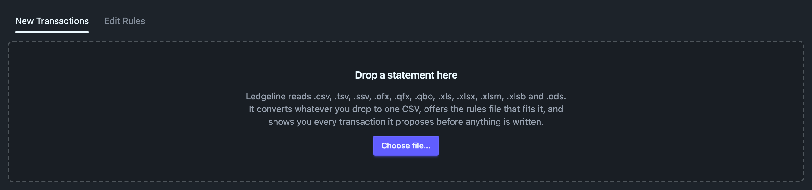
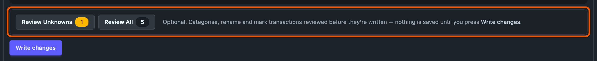
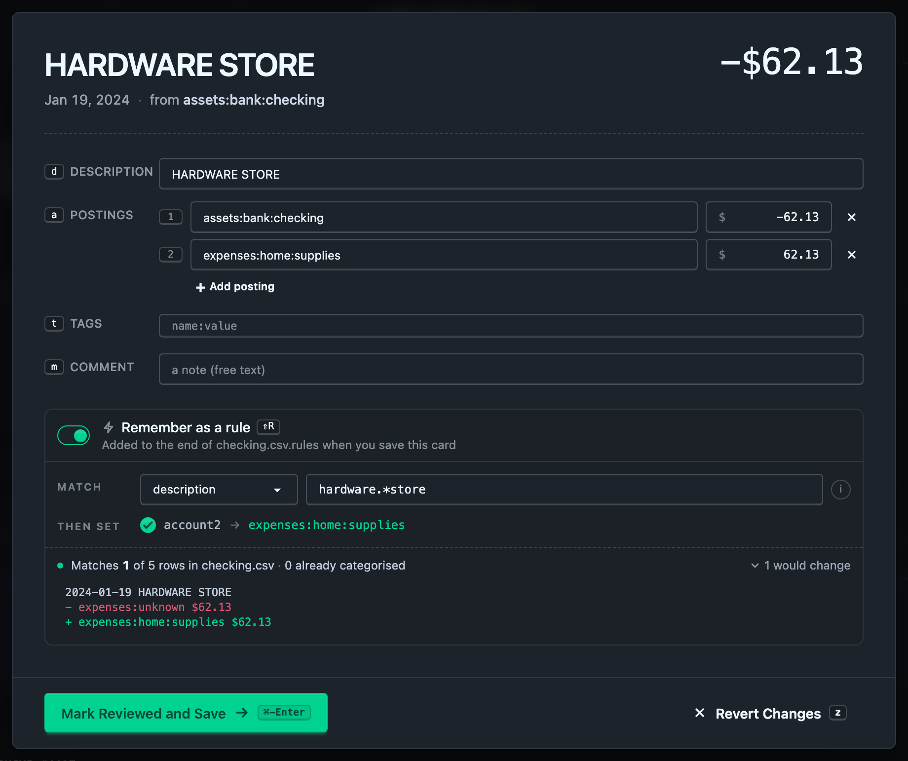

# New transactions

The New Transactions tab takes one statement file and walks it through to your journal. Nothing is written until you have seen exactly what hledger proposes and pressed **Write changes**.

## Drop a statement

Drag a file onto the dashed panel, or press **Choose file…** to pick one. Ledgeline takes one file at a time, because one import is one statement going into one journal. A file in a format it can't read, such as a PDF, is refused with a sentence saying why.



Ledgeline converts the file to a CSV and shows a short preview of the rows it read. It also reports anything it had to guess, such as the delimiter, the text encoding, or which sheet of a workbook it read. If the statement's own totals don't match its rows, it says so, which usually means a column was misread.

If the file is a QuickBooks Online Journal export, a different panel takes over. See [Importing from QuickBooks](quickbooks.md).

## Choose a rules file

Under **Read it with**, Ledgeline lists the `*.rules` files beside your journal that fit this data, best match first. Each card shows a score, the signals behind it (for example, whether the columns and dates line up), and a sample of the transactions that file would produce. Pick the one whose sample looks right.

The last option, **Don't import, just save the CSV**, writes the converted file and leaves your journal alone.

If no rules file fits, the list says so and offers **Create rules file…**. That drafts a new one from your data. See [Creating a rules file](create-rules.md).

## Where it goes

The **Where it goes** box has two fields.

- **CSV file** is where the converted CSV is saved, relative to the folder your journal is in. hledger keeps its import state, a `.latest` file, beside this CSV, so use the same name each time you import from the same account.
- **Import into** is the journal file the transactions are appended to. Ledgeline lists the journal files it can see and can write to. In a journal split across `include`d files, pick the file for the year or account you are importing.

Balances are always checked against the whole journal you opened, not only the file you are writing to. [Two journals](../development/imports-internals.md#two-journals-for-writing-and-for-reckoning) explains why that matters for split journals.

## Check the statement balance

The **Statement balance** box is optional. Type the closing balance from your statement and the account it belongs to. OFX files often include the balance, and then Ledgeline fills it in for you.

Ledgeline checks the balance against your journal plus the new transactions. It reports "The balance reconciles" or says how far off it is. Tick **Write it into the journal as a balance assertion** if you want hledger to re-check that balance every time it reads the file.

## Preview before writing

Press **Test Import** to run a dry run. It writes nothing: hledger works out what it would add, and Ledgeline shows the result under "Nothing has been written yet". The panel shows:

- hledger's own status line, and the proposed transactions exactly as they will be appended;
- a warning if hledger would silently drop rows dated on or before the last import from this CSV;
- the balance check, if you gave a balance;
- any accounts your [account aliases](../settings/account-aliases.md) would rename, measured by running the import with and without them;
- a notice if a plain `hledger import` from a terminal would produce different account names, with a one-click fix that writes the matching `--alias` lines to `hledger.conf`;
- rows matched by id, described in [re-downloading a statement](#re-downloading-a-statement);
- a `ledgeline import …` command that repeats this import from a terminal.

If hledger rejects the import, the panel shows hledger's error output unedited. It usually names the row it failed on.

## Review before writing

Once the dry run is ready, two buttons sit between the proposed transactions and **Write changes**. They open the same card-by-card [review](../journal/review.md) the Journal uses, over the transactions this import would add.



- **Review Unknowns** brings up the transactions no rule categorized. Its count leaves out any you have already fixed.
- **Review All** brings up every transaction in the import.

Press <kbd>u</kbd> or <kbd>r</kbd> to open them from the keyboard.

Review here is optional, and nothing you do in it is written until you press **Write changes**. Categorizing, renaming, tagging, **Reviewed** and **Ignore** all become edits that **Write changes** applies along with the import. When you close the review after saving a card, the dry run runs again, and the proposed transactions show your edits exactly as they will be written. **Reviewed** writes the transaction with `reviewed:` and today's date. Transactions you don't review are written without the tag.

**Write changes** is always available. You can close the review halfway, or never open it, and the import writes whatever is left as hledger proposed it. Uncategorized rows stay in your fallback account, as they would without review.

A line under **Write changes** counts what the write will apply, for example "2 reviewed edits · 3 existing transactions edited". If the import changed under an edit, for example because the rules file was edited in another tab, the line adds "K need another look". Open it to see each such edit with what it does, and discard it or keep it.

The `ledgeline import …` command below doesn't carry review edits. When you have some, a note under it says how many, and that the command line imports without them.

### Similar transactions in two places

On an import card, Similar has two groups, each with its own count and its own check-all box.

- **Similar in this import** lists other transactions in the same statement. Checking them changes what the import writes.
- **Similar already in the journal** lists unreviewed transactions you imported before. Checking them edits those existing transactions.

Edits to transactions already in the journal are held until **Write changes**, and then applied in the same write as the import. If you leave without writing, the journal is untouched. If the write fails, Ledgeline puts every file it changed back the way it was.

The ⋯ menu on an import card has no **Open in full editor**, because the transaction isn't in a file yet, and no **Settings**, because the review always covers the whole import.

## Remember as a rule

A card whose description or account you changed can save that change as a rule in the import's rules file, so the next statement arrives already categorized. The toggle reads **Remember as a rule**. Press <kbd>Shift</kbd>+<kbd>R</kbd> or click it. It starts off on every card, so rules are only written when you ask.



**Match** says which column the rule tests and the pattern it looks for.

- The column defaults to `description` when the rules file names one in its `fields` line. You can pick any other field name, or **whole record** to test the whole CSV row.
- The pattern is a regular expression, matched case-insensitively anywhere in that column. Ledgeline fills it in from the statement's raw text for this row, without the numbers, joined with `.*`. `SQ *BLUE BOTTLE 4412 OAKLAND` becomes `sq.*blue.*bottle.*oakland`, which also matches the next visit with a different store number. Edit it to make it broader or narrower.

**Then set** lists what the rule assigns, one line per change on the card.

- Each account you changed is set through the field hledger uses for that posting. The second posting is `account2`. Account lines start ticked.
- A new description is set as `description`. It starts ticked only when the rename is the card's only change, because a rule that renames every match is a bigger step than one tidy-up.

The values follow the card. To change one, change the card.

Under that, a live check runs the import again with the rule added to a temporary copy of the rules file: "Matches 1 of 5 rows in checking.csv · 0 already categorised". The count covers the rows this import would add. "Already categorised" counts the matching rows another rule already handles. Expand "N would change" to see each affected row's lines before and after. A pattern that matches nothing gets a warning.

The rule is saved when you save the card. Ledgeline adds it at the end of the rules file, because in hledger the last matching rule wins:

```
if %description hardware.*store
    account2 expenses:home:supplies
```

A **whole record** match has no field name: `if hardware.*store`. A ticked description adds a `description Hardware Store` line.

After saving, the dry run runs again with the new rule. Review edits the rule now covers are dropped, because the import produces them by itself. If the import can't be regenerated with the new rule, the review shows hledger's message above the cards. The rule is saved either way, and you can fix it under [Edit Rules](rules-editor.md). If the rule can't be saved, the card keeps your edits and the reason shows under the rule.

hledger reads `%` followed by a letter, digit, `_` or `-` in a rule's value as a CSV field reference. `%description` puts the row's description there, and an unknown name such as `%off` puts nothing there. hledger has no way to write a literal `%` before a letter, so a description such as "50%off" can't be set by a rule. The builder warns when a ticked line contains one. A `%` before a space, such as "50% off", is written as it is.

## Write the changes

Press **Write changes**. Ledgeline appends the text you just saw, unaltered, to the journal you chose. Any review edits to transactions already in the journal are applied in the same write. It then tells hledger to record the import so the same rows aren't proposed again. If that last step fails, Ledgeline restores the journal to how it was and reports the whole import as failed.

The result panel lists every file it wrote.

### Re-sorting by date

hledger appends at the end of the file. If that leaves the journal out of date order, the result panel lists the transactions that would move and offers to re-sort the file. Re-sorting moves only transactions. Directives, `include` lines and comments stay where they are.

## Re-downloading a statement

hledger de-duplicates imports by date. It remembers the newest date it imported from a CSV and skips every row on or before it. That works for statements that only ever grow, but not when you download the same period twice. A card charge that first appeared as a pending hold and later settled would never be updated.

Ledgeline can match rows by the bank's own transaction id instead. Add this line to the rules file:

```
comment id:%fitid
```

OFX, QFX and QBO files carry a `FITID` for every transaction, and Ledgeline exposes it as the `fitid` column. With that line in place, every imported transaction carries an `id:` tag, and the dry run sorts each incoming row into one of four outcomes.

| Outcome | What happens |
| --- | --- |
| New | No transaction in the journal has this id. It is imported as usual. |
| Unchanged | The journal already has it, identically. It is skipped. |
| Status changed | Only the cleared status differs, such as a pending hold that has since cleared. Ledgeline updates the `*` or `!` mark on the existing transaction. |
| Conflicting | Something else differs, such as the amount. The row is reported with the differences and never imported or edited. |

The dry run lists the status changes and conflicts before you write anything. A conflict usually means you edited the transaction yourself, so Ledgeline leaves your version alone. Notes you add to a transaction's comment don't count as a difference.

Status changes only apply when the rules file sets a `status` field, and only to transactions in the file you are importing into. Rules files without an `id:` line keep hledger's date-based behaviour exactly. [Matching a re-download by row id](../development/imports-internals.md#matching-a-re-download-by-row-id) has the details.

## Doing it from a terminal

The dry-run panel shows a `ledgeline import` command for the import on screen. Run it from the folder that holds your journal to repeat the same import later with a new statement. `ledgeline import --help` lists the options.
