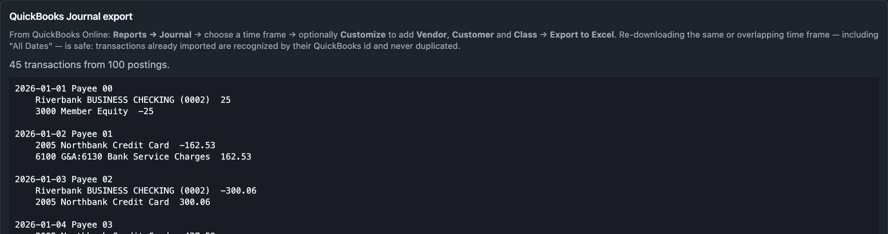
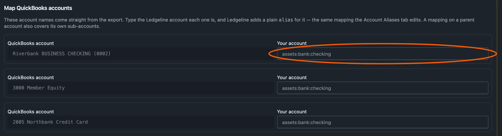
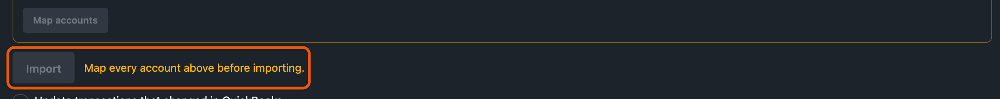

# Importing from QuickBooks

Ledgeline imports the **Journal** report from QuickBooks Online. That report is already double-entry: every transaction appears as a numbered group of debit and credit rows followed by a total row. hledger's CSV rules can't read that shape, so Ledgeline reads it itself and writes the transactions straight into your journal. No rules file or CSV is involved.

> [!NOTE]
> **Exporting the Journal from QuickBooks Online**
>
> 1. Go to **Reports** and search for **Journal**.
> 2. Set the report period. **All dates** is a good choice. Re-importing skips transactions that are already in your journal, matched by QuickBooks' transaction number (Trans #), which Ledgeline stores as an `id:` tag.
> 3. Optionally, use **Customize** to add the **Vendor**, **Customer** and **Class** columns. Ledgeline keeps them as tags when they are present.
> 4. Run the report.
> 5. Choose **Export**, then **Export to Excel**, to download an `.xlsx` file. Use the Excel export rather than CSV.

## Import the file

Open **Imports → New Transactions** and drop the `.xlsx` file, or press **Choose file…**. Ledgeline recognises a QuickBooks Journal report from the file's contents, whatever it is named, and the QuickBooks panel replaces the usual rules-file flow.

The panel shows how many transactions and postings it read, plus a sample of the transactions it will write. If every date in the export could be read as either day/month or month/day, it warns you and names the order it chose. Check a few sample dates. If they are wrong, export a wider date range so that some date has a day above 12.



## Create the accounts you want first

QuickBooks account names such as `1520 Computer & Office Equipment` won't match the accounts in your journal. Decide what each one should be called in hledger before you map them.

Declare those accounts in [Settings → Accounts](../settings/accounts.md) first. Use hledger's account types (asset, liability, equity, revenue, expense, cash) and hledger-style names such as `assets:equipment:computers`. Their declared types are what the reports use to classify them.

You can map to a name you haven't declared. The import still works, but that account is then only implicit in your journal, with no declared type.

## Map the QuickBooks accounts

Any QuickBooks account your journal doesn't map yet appears in the **Map QuickBooks accounts** table. Each row shows the QuickBooks name and a field for your account, which suggests accounts already in your journal as you type. Fill in as many rows as you like and press **Map accounts**.



Each mapping is saved as a plain hledger alias in your main journal, the file you opened. If that file can't be written, it goes in the first included file that already declares aliases and can be.

```journal
alias 1520 Computer & Office Equipment = assets:equipment:computers
```

That is the same directive the [Account Aliases](../settings/account-aliases.md) settings tab shows and edits, so you can review or change a mapping there later. Mapped accounts drop off the table as soon as they are saved.

A mapping on a parent account covers its QuickBooks sub-accounts too, following hledger's own alias rule. With the alias above, `1520 Computer & Office Equipment:1521 Computer & Equipment - Accum Depr` becomes `assets:equipment:computers:1521 Computer & Equipment - Accum Depr`. Map the sub-account separately if you want a different name for it.

Only plain aliases count. A `/regex/` alias in your journal is never applied to QuickBooks names, so an account it would have matched still shows as unmapped.

The **Import** button stays disabled until every account in the export is mapped.



## What gets written

Press **Import**. Ledgeline writes each new transaction into the journal file where its date belongs. In a journal split into yearly `include`d files, a multi-year export lands in the right year files.

Each transaction carries:

- an `id:` tag holding QuickBooks' Trans #;
- each line's own memo (QuickBooks' Description column) as that posting's comment;
- `class:`, `customer:` and `vendor:` tags on each posting, when those columns were in the export;
- the payee name as its description, or the QuickBooks transaction type plus the first memo when there is no payee;
- amounts in your journal's default commodity (its `D` directive), or else the commodity your journal uses most.

```journal
2017-01-03 Office Depot  ; id: 615
    assets:equipment:computers        $49.99  ; Monitor arms, vendor: Office Depot
    assets:bank:checking             $-49.99  ; Monitor arms
```

Every line of a QuickBooks transaction becomes its own posting, even when several lines use the same account. Lines are combined only when they have the same account, memo and tags. Such lines would read identically anyway, and combining them avoids writing a row of `$0.00` postings.

The result panel says how many transactions were imported. If any journal file ended up out of date order, it offers to re-sort that file.

If your journal is in a git repository, the import refuses to start while any journal file has uncommitted changes. Afterwards it commits only the files it wrote, as described in [the git safety net](new-transactions.md#the-git-safety-net).

## Importing again

Before writing, Ledgeline compares every transaction in the export with the transactions already in your journal, by their `id:` tag. The comparison covers every file in the journal.

- A transaction whose id isn't in the journal is written.
- A transaction already in the journal, unchanged, is skipped.
- A transaction already in the journal with different details is reported with the number of differing rows and left alone, unless you ask for it to be updated (below). From a terminal, each one is listed by id along with what differs, such as `postings: journal has 2, export has 18`.

So you can export **All dates** every time, or overlapping periods, without creating duplicates.

To take QuickBooks' version of the transactions that differ, tick **Update transactions that changed in QuickBooks** before pressing **Import** (`--update-changed` from a terminal). Each one is replaced in place with the export's dates, description, postings and memos. Its cleared or pending status, code, secondary date and the comment beside its `id:` tag are kept, because QuickBooks doesn't export them. The option is off by default and has to be ticked for each import. Leave it off if you recategorize imported transactions by hand, because the update would put the export's accounts back.

A difference usually means you edited the transaction after importing it, so your version wins. That includes marking it cleared with `*`, and changing an account mapping after the first import. Both make the old transactions differ from what the export now produces. It also happens when the transaction changed in QuickBooks after you imported it, for example when someone added a line to a journal entry. Your journal keeps the old version until you update it.

One limit follows from the matching. QuickBooks numbers transactions per company, so the same Trans # can exist in two different companies. Import each company into its own journal.

## From a terminal

The same import runs without the window:

```sh
ledgeline import -i Journal.xlsx -j main.journal
```

Ledgeline detects the QuickBooks format from the file. The `-o`, `-r` and balance options are refused for this format, because there is no CSV, rules file or single statement balance. Every account still has to be mapped first. `ledgeline import --help` lists the remaining options, including `--dry-run`, `--no-git` and `--update-changed`.

The design notes for this importer are in [plan 17](https://github.com/zmre/ledgeline/blob/main/plans/17-quickbooks-journal-import.md).
