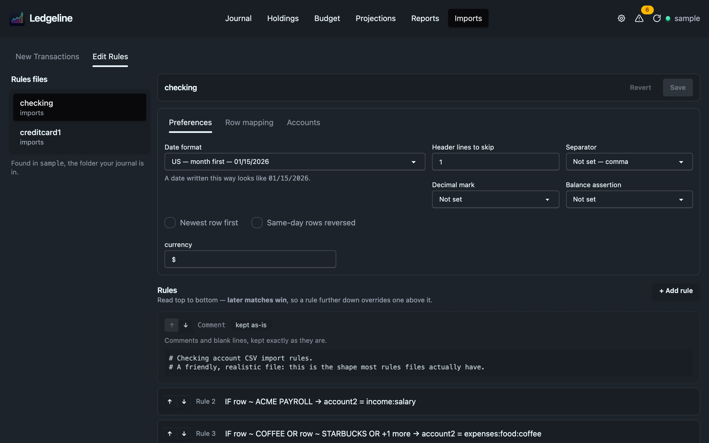

# Editing rules files

The Edit Rules tab lists every hledger CSV rules file (`*.rules`) in the folder your journal is in and below it. Pick one on the left and a structured editor opens on the right.

It is not a text editor. If you want to edit the raw text, use your own editor in a terminal. The tab covers the parts that are easy to get wrong by hand: what a date format does to a real date, which CSV column is which, and the order of your rules.

If no rules files exist yet, the tab says so. Create one by dropping a CSV on [New Transactions](new-transactions.md) and using [Create Rules](create-rules.md), or put `statement.csv.rules` next to `statement.csv` and it shows up here.

## The three settings tabs

**Preferences** holds the file-wide settings:

- the date format, picked from a list with an example of each, or typed in;
- how many header lines to skip;
- the separator (comma, semicolon, tab, space, pipe, or something else);
- the decimal mark;
- the balance assertion type (`=`, `==`, `=*` or `==*`);
- "Newest row first" and "Same-day rows reversed".

Other settings the file already has show up as plain text boxes below these. A `source` line is shown but can't be edited here.

**Row mapping** is the `fields` line. It shows each CSV column next to an example value from the file, and you name the column. You can use a name hledger knows (`date`, `amount`, `description` and so on) or any other name. A custom name, such as `cat`, labels the column so a rule can match on it or interpolate it as `%cat`.

**Accounts** holds two accounts. "This file's account" is `account1`, the account the statement belongs to, so every imported row has one leg there. "Fallback category" is `account2`, where a row goes when no rule matches it. Keep the fallback something obvious, like `expenses:unknown`, so unrecognized rows are easy to find afterwards.

## Rules

Below the tabs is the list of `if` rules. Each one collapses to a single summary line, such as `IF description ~ AMAZON → account2 = expenses:shopping:online`. Open a rule to edit it.

A rule has three parts:

- **When any of these match.** Each group is an alternative (OR). Within a group, every condition must match (AND). A condition names a column, or "the whole row", and the text or regex to look for.
- **Then set.** One or more fields to assign, such as `account2`, `description`, `comment`, `amount`, `currency`, `date`, `status` or `code`.
- **And with the row.** Import it as usual, skip this row, or stop reading here.

Order matters. hledger applies every matching rule, and the last one to set a field wins. The list says "later matches win" for that reason, and "+ Add rule" puts the new rule at the end, where nothing below can override it.

Use the arrow buttons to move a rule. Moving a rule changes what gets imported whenever two rules match the same row.

## Lines the editor won't change

Some parts of a rules file can't be edited safely from a form. Those show as dimmed cards with the original text and a reason. They are written back exactly as they were, byte for byte, and you can still move them up and down.

A card marked "advanced, edit in terminal" holds a construct the editor deliberately leaves alone:

| What's in the file | Why it's read-only |
| --- | --- |
| An `if` table | hledger reads each row against the header by position, so editing one part could change every row. |
| A `!` negation, or a leading `&` with nothing above it | Ledgeline doesn't edit these combinations. |
| A capture group in a pattern | Later values can refer back to it. |
| A matcher line starting with `#` or `;` | hledger reads it as a pattern, not a comment. |
| `skip N`, `end N`, or more than one `skip`/`end` in a block | These change how many records are read, not just this row. |
| Something Ledgeline doesn't recognize | It stays as written rather than risk a wrong guess. |

The rest of the file, such as comments and blank lines, is "kept as-is".

## Saving

The editor marks the file "unsaved" once you change something. Save writes only the parts you edited. Everything else, including comments, spacing, tabs, Windows line endings and a missing final newline, stays exactly as it was. Revert throws your edits away.

If the file changed on disk after you opened it, perhaps because you edited it in vim, the save writes nothing. Ledgeline tells you the file changed and offers "Reload and discard my changes", so you can re-apply your edit to the new version.

## Rules-file details that catch people out

These come from hledger itself, checked against hledger 1.52:

- A matcher line must start in the first column. Body lines (the assignments) must be indented.
- A `#` or `;` line between matchers is a regex to hledger, not a comment.
- An assignment's value runs to the end of the line. `account2 x ; note` assigns the literal text `x ; note`.
- The `&` that starts an AND line can be written `&B`, `& B` or `&  B`. Inside a pattern, as in `%description &COFFEE`, `&` is an ordinary character.
- A same-line `&&` is always an AND, with no way to escape it. `A&B && C` means "A&B" and "C".
- A bare `skip` in a rule drops the matching row. `skip 2` drops the matching row and the one after it, which is a different thing.

For how the editor preserves files and why it refuses what it refuses, see [Rules editor internals](../development/imports-internals.md#the-one-invariant-everything-rests-on) and [Editable vs opaque](../development/imports-internals.md#editable-vs-opaque).
