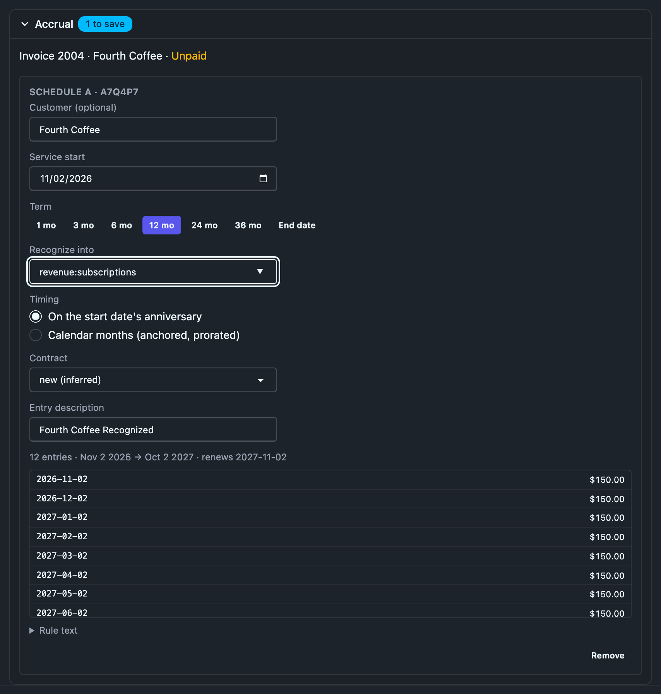
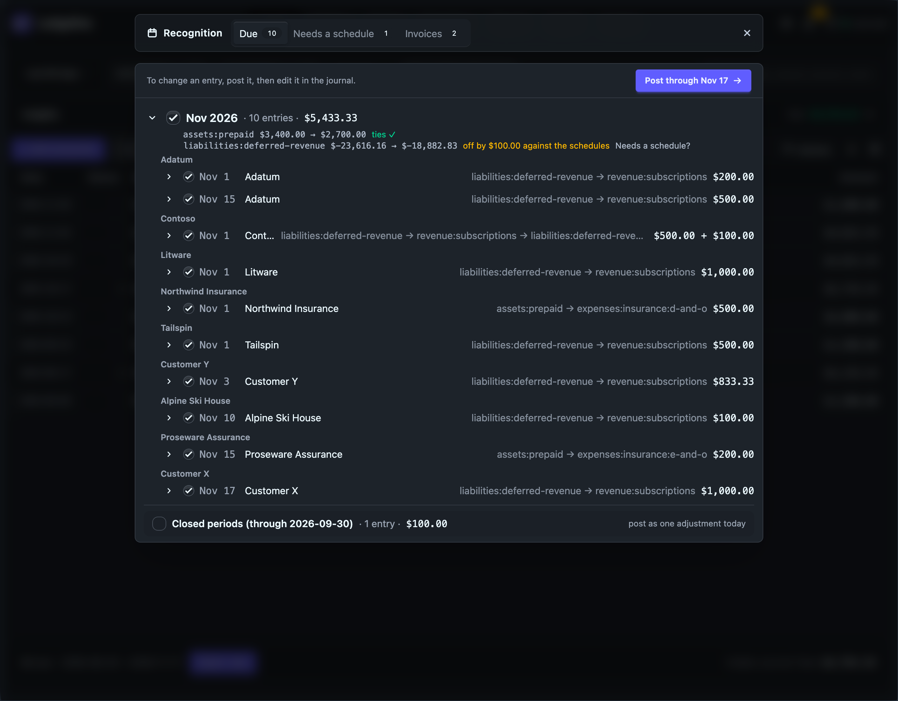
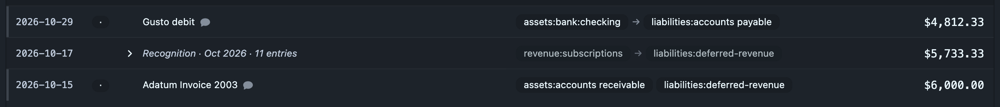

# Revenue and expense recognition

On accrual books, money received for a year of service isn't a year of revenue on the day it arrives. It sits in deferred revenue and moves to revenue one month at a time. Prepaid expenses such as an annual insurance policy work the same way in reverse. In most bookkeeping tools somebody enters those monthly journal entries by hand.

Ledgeline keeps a **schedule** for each prepaid amount, writes the schedule as ordinary hledger rules, and posts each month's entry when it falls due. You see what is due, check that it ties to the account balance, and post it with one button.

## When the helpers appear

The helpers are for accrual books only. A household or cash-basis ledger sees none of this: no button, no editor section, no filter chip.

They turn on when an account has one of these roles:

| Role | How Ledgeline knows |
| --- | --- |
| Deferred revenue | `kpi: deferred-revenue` on the account, or a liability whose name contains `unearned`, or `deferred` together with `revenue` or `income` |
| Prepaid expense | `kpi: prepaid` on the account, or an asset whose name contains `prepaid` |
| Accounts receivable | `kpi: receivable`, or an asset whose name contains `receivable` |
| Accounts payable | `kpi: payable`, or a liability whose name contains `payable` |

A declared `kpi:` always wins over the name. Declare the accounts in [Settings → Accounts](../settings/accounts.md) or in the journal:

```journal
account assets:prepaid                  ; type: A, kpi: prepaid
account liabilities:deferred-revenue    ; type: L, kpi: deferred-revenue
```

To switch the helpers off on a ledger that has, say, a `taxes payable` account, set `basis = "cash"` under `[books]` in the ledger's `ledgeline.toml`. `basis = "accrual"` turns them on before any account is declared. See [Settings files](../settings/settings-files.md#books). The ▾ next to the Recognition button says why the helpers are on.

## The shapes this handles

Revenue arrives in four shapes. The expense side mirrors each one, with accounts payable for bills, a prepaid asset instead of deferred revenue, and `vendor:` instead of `customer:`.

1. **Paid and delivered at once.** A sale to revenue against the bank. Nothing is deferred. The only help is the `customer:` tag.
2. **Prepaid, recognized over a term.** An annual prepayment lands in deferred revenue, then moves to revenue monthly.
3. **Invoiced, paid later, recognized over a term.** The invoice debits accounts receivable and credits deferred revenue. The payment clears receivable to the bank. Recognition starts on the service start date, whether or not the invoice is paid yet. Matching the payment to its invoice is covered in [Invoice matching](invoice-matching.md).
4. **Billed after delivery.** The invoice credits revenue directly and the payment clears receivable. Nothing is deferred. Only the invoice matching applies.

## Setting up a schedule

Open a transaction in the editor. When it has a credit to deferred revenue (or a debit to a prepaid account) with no schedule, the **Accrual** section offers **Recognize over time** on that line.



The form asks for:

- **Customer** (or **Vendor**): optional, completed from the names your journal already uses. When the transaction has no tag, the form may suggest one from earlier payments by the same payee. It never fills it in for you.
- **Service start**: defaults to the transaction date.
- **Term**: 1, 3, 6, 12, 24 or 36 months, or an end date.
- **Recognize into**: the revenue (or expense) account each month's entry moves the money to.
- **Timing**: on the start date's anniversary, or calendar months. See [Anchored and unanchored billing](#anchored-and-unanchored-billing).
- **Contract**: new, renewal, expansion or reactivation.

Under the fields, a preview lists every period with its date and amount, and shows the rules exactly as they will be written.

Several deferred lines with the same terms, such as a subscription and a support line both starting on the same day for a year, form one schedule. Each month gets one entry with a pair of postings per line. A line with different terms gets a schedule of its own. Fees, one-time items and the bank leg are never scheduled.

When the customer already has a schedule, the form fills in from their latest one, so a renewal takes a click. A banner says where it came from, for example "Prefilled from Customer X · Dec 2025 · 12 months · cx1217". Every field stays editable, and the contract is marked as a renewal.

**Save** writes the transaction, with the schedule's tags on its deferred line, and then the rules. On the first save, Ledgeline asks before it creates the recognition file.

For a line that went straight to revenue but should have been spread, choose **over a term** under "Earned at once / over a term". The line moves to the deferred-revenue account and the form opens.

## The recognition file

Schedules live in `recognition.journal`, beside your main journal. It holds hledger periodic rules, one group per schedule:

```journal
; ── Customer Y · cy0203 · 2026-02-03 Customer Y Payment
~ monthly from 2026-02-03 to 2027-01-03  Customer Y Recognized  ; recognition: cy0203, renewal-date: 2027-02-03
    liabilities:deferred-revenue     $833.33  ; customer: Customer Y
    revenue:subscriptions           $-833.33  ; customer: Customer Y
~ 2027-01-03  Customer Y Recognized  ; recognition: cy0203
    liabilities:deferred-revenue     $833.37  ; customer: Customer Y
    revenue:subscriptions           $-833.37  ; customer: Customer Y
```

Your journal does **not** `include` this file, and it shouldn't. Included, hledger and the Budget tab would read every schedule as a budget goal. Ledgeline warns if you include it (see [Problems](problems.md#recognition-file-included)). To read the schedules with hledger, name both files with `-f`, as in [Check it with hledger](#check-it-with-hledger).

Rules are never used as [projection](../projections/index.md) scenarios or [budget](../budget.md) goals. To include upcoming recognition in a forecast, copy the file to a `projection-*.journal` and remove the rules' `to` dates.

To keep the file elsewhere, set `recognition-file = "books/recognition.journal"` under `[books]` in `ledgeline.toml`. The path has to be inside the journal's folder.

You can write rules by hand. Ledgeline reads them like its own and posts them. It will only rewrite a rule group it can map back to a schedule.

## Tags

Everything Ledgeline needs is in the journal, as tags:

| Tag | Where | Value |
| --- | --- | --- |
| `recognition` | The deferred (or prepaid) posting of the source transaction, every rule, and every posted entry | The schedule id, six letters and digits. `none` on a source posting means "don't schedule this, and don't ask again". |
| `service-start` | The source posting | The first day of service, when it isn't the transaction date |
| `term-months` | The source posting | The length of service in months |
| `service-end` | The source posting, instead of `term-months` | The last day of service, for a term that isn't whole months or a contract that ended early |
| `proration` | The source posting | `calendar` for calendar-month periods. Absent means anniversary periods. |
| `contract` | The source posting | `new`, `renewal`, `expansion` or `reactivation` |
| `customer`, `vendor` | Source postings, rules and posted entries | The name |
| `invoice` | Invoice and payment transactions | The document number |
| `renewal-date` | The main rule and each posted entry | Service start plus the term |
| `recognized` | Each posted entry | The period it fills, as its scheduled date |
| `restated` | A catch-up adjustment | The date of the restatement |

`recognized` holds the scheduled date even if you move the entry's own date, so a period is never counted twice. Because hledger tag values are regular expressions, `tag:recognized=2026-12` finds every December entry.

## Anchored and unanchored billing

**Unanchored** contracts run from the signup date: a 12-month contract starting November 17 has twelve periods starting on the 17th. Each entry is dated the day its period begins, November 17 through October 17. This is the **anniversary** timing.

**Anchored** contracts bill on the 1st of each month. Choose **Calendar months (anchored, prorated)**:

- Each full month's entry is dated the 1st.
- A partial first month is prorated by days and dated the service start.
- The last period takes whatever rounding is left.

For example, `lw0517` in the fixture is $12,000 from May 17: a $483.87 stub dated 2026-05-17, $1,000 on the 1st of each month, and $516.13 on 2027-05-01.

Amounts are split evenly and rounded to the commodity's precision. Any rounding remainder lands in the final period: $10,000 over 12 months is eleven entries of $833.33 and a final $833.37.

## Posting due entries

The **Recognition** button sits beside Find Matches on the Journal toolbar. Its badge counts entries that are due, deferrals that need a schedule, and invoices ready to link. Hover it for the breakdown. Press <kbd>a</kbd> or click it to open the overlay. It opens on the first tab with something in it.


An entry is **due** when its date is today or earlier and it hasn't been posted. Nothing dated after today is ever posted.

The **Due** tab groups due entries by month, then by customer or vendor. Every row starts checked. Expand a row to see the postings it will write.



Under each month, a line per deferred-revenue and prepaid account shows its balance at the month's end before and after posting, compared with what the schedules say should remain. "ties ✓" means they agree. Otherwise it shows the difference, with a link to **Needs a schedule**, because an unscheduled deferral is the usual cause.

**Post through ‹date›** writes every checked row in one write. The date is the end of the latest checked month, or today if that's earlier. Each entry goes into the file that holds its neighbours by date, so a journal split into one file per year gets each entry in the right year. Posting twice writes nothing the second time. A toast says what was written and links to the month in the journal.

To change an entry's amount or date, post it, then edit it in the journal like any other transaction.

**Needs a schedule** lists credits to deferred revenue and debits to prepaid accounts that carry no `recognition` tag, from the last 90 days. Change the lookback with the ▾ next to the button. **Open in editor** takes you to the Accrual section for that transaction. To answer "never" for a line, tag its posting `recognition: none`.

**Invoices** lists [invoice matches](invoice-matching.md).

### Posting automatically

To have entries posted without opening the overlay, turn on **Post due recognition entries automatically** in [Settings → Books](../settings/settings-files.md#books). It's off by default. With it on, Ledgeline posts what's due when it opens, once a day after midnight, after you save a schedule, and when the journal changes on disk (after a `git pull`, say). Entries in closed periods are never posted automatically.

## Closed periods

Once a month is closed, entries dated in it shouldn't change. **Close books through…** in [Settings → Books](../settings/settings-files.md#books) records the date as `closed-through` under `[books]` in `ledgeline.toml`. It asks first and creates the file if there isn't one.

An entry that falls due on or before that date is listed apart, as "Closed periods", unchecked. Checking it posts the missed entries as **one adjustment per schedule, dated today**, never into the closed month.

## Changing a schedule: restatement

Edit a scheduled transaction in Ledgeline, change the deferred amount, the term, the start or the target account, and save. The Accrual section shows a restatement preview before anything is written:

- the old rule and the new one;
- each entry already posted, before and after, and what happens to it: **kept**, **rewrite** or **delete**;
- entries on or before `closed-through` are kept as they are, and their combined difference becomes **one** adjustment dated in the current month, no later than today, tagged `restated:`;
- the schedule's total after the change, against the deferred line.

**Apply all** writes it: the transaction first, then the rewritten entries and the adjustment, then the rules.

Schedules created by an invoicing app, or edited outside Ledgeline, are not restated automatically. If a schedule no longer adds up to its source line, [Problems](problems.md#schedule-total-mismatch) says so.

**End contract**, in the Accrual section of a scheduled transaction, ends a contract early on the date you give. It restates the schedule to stop there. When a credit note debits a customer's deferred revenue outside a recognition entry, the section asks whether it credits one of their contracts and offers the same action.

## The entries in the journal

A schedule posts one entry per month, so a busy ledger gets many of them. In the journal, each month's posted entries collapse into one row, such as "Recognition · Oct 2026 · 12 entries", with the month's totals.



Click the row's ▸, or press <kbd>l</kbd> or <kbd>Enter</kbd> on it, to show the entries under it. Searching expands every month that has a hit.

The **Recognition** chip in the filter bar switches between:

- **Grouped**: one row per month (the default);
- **Hidden**: no rows at all;
- **Shown**: every entry as its own row.

Ledgeline remembers the choice. Hidden or grouped, the entries still count everywhere: in the totals footer, the charts, the reports and running balances. The footer says how many are hidden. With an account's running balance pinned, entries are never grouped, because every row needs its own balance.

In Insights, a month's recognition entries count as one line among Top Transactions, such as "Recognition, Nov · 37 entries". Click it to open that month in the journal, expanded.

## Problems

Six [Problems](problems.md) checks watch the schedules: the recognition file included by mistake, a period posted twice, a schedule that no longer adds up, a schedule with no rule or no source, an entry due in a closed period, and a rule that posts to an undeclared account.

## Check it with hledger

Everything here is plain hledger, so you can check it without Ledgeline. The output below is hledger 1.52 on the synthetic books in `fixtures/accrual/`, as of 2026-11-17.

Plain reports read only what was posted. The rules in the recognition file are ignored unless you name the file:

```
$ hledger -f books.journal bal liabilities:deferred-revenue assets:prepaid
           $3,400.00  assets:prepaid
         $-23,616.16  liabilities:deferred-revenue
--------------------
         $-20,216.16  
```

One contract end to end, `cy0203`: the $10,000 payment and every entry posted so far:

```
$ hledger -f books.journal reg tag:recognition=cy0203
2026-02-03 Customer Y Payment   li:deferred-revenue    $-10,000.00   $-10,000.00
2026-02-03 Customer Y Recogn..  li:deferred-revenue        $833.33    $-9,166.67
                                re:subscriptions          $-833.33   $-10,000.00
2026-03-03 Customer Y Recogn..  li:deferred-revenue        $833.33    $-9,166.67
                                re:subscriptions          $-833.33   $-10,000.00
⋮
2026-10-03 Customer Y Recogn..  li:deferred-revenue        $833.33    $-9,166.67
                                re:subscriptions          $-833.33   $-10,000.00
```

The same contract with the schedule ahead. Name the recognition file with `-f`, never with `include`, and start the forecast tomorrow:

```
$ hledger -f books.journal -f recognition.journal reg tag:recognition=cy0203 \
    --forecast=tomorrow.. --today 2026-11-17
2026-02-03 Customer Y Payment   li:deferred-revenue    $-10,000.00   $-10,000.00
⋮
2026-10-03 Customer Y Recogn..  li:deferred-revenue        $833.33    $-9,166.67
                                re:subscriptions          $-833.33   $-10,000.00
2026-12-03 Customer Y Recogn..  li:deferred-revenue        $833.33    $-9,166.67
                                re:subscriptions          $-833.33   $-10,000.00
2027-01-03 Customer Y Recogn..  li:deferred-revenue        $833.37    $-9,166.63
                                re:subscriptions          $-833.37   $-10,000.00
```

The November 3 entry is in neither list: it's due but not posted yet, and a forecast that starts tomorrow doesn't generate it. That is the entry the Due tab offers. (`--today` pins the fixture's date. Leave it off on your own books.)

A forecast that starts in the past regenerates entries that are already posted, and counts them twice. Here September and October double:

```
$ hledger -f books.journal -f recognition.journal bal ^revenue:subscriptions -M \
    -b 2026-08 -e 2026-11 --forecast=2026-09-01..2026-11-01 --today 2026-11-17
Balance changes in 2026-08-01..2026-10-31:

                       ||        Aug         Sep         Oct 
=======================++====================================
 revenue:subscriptions || $-4,133.33  $-8,166.66  $-9,266.66 
-----------------------++------------------------------------
                       || $-4,133.33  $-8,166.66  $-9,266.66 
```

For any `--forecast` run whose period starts in the past, screen out the generated recognition entries:

```
$ hledger -f books.journal -f recognition.journal bal ^revenue:subscriptions -M \
    -b 2026-08 -e 2026-11 --forecast=2026-09-01..2026-11-01 --today 2026-11-17 \
    expr:"not (tag:recognition and tag:_generated-transaction)"
Balance changes in 2026-08-01..2026-10-31:

                       ||        Aug         Sep         Oct 
=======================++====================================
 revenue:subscriptions || $-4,133.33  $-4,033.33  $-4,633.33 
-----------------------++------------------------------------
                       || $-4,133.33  $-4,033.33  $-4,633.33 
```

Revenue recognized per month, from the posted entries:

```
$ hledger -f books.journal bal ^revenue tag:recognized -M -b 2026-08 -e 2026-11
Balance changes in 2026-08-01..2026-10-31:

                       ||        Aug         Sep         Oct 
=======================++====================================
 revenue:subscriptions || $-4,133.33  $-4,033.33  $-4,633.33 
 revenue:support       ||   $-100.00    $-100.00    $-100.00 
 revenue:onboarding    ||   $-300.00    $-300.00    $-300.00 
-----------------------++------------------------------------
                       || $-4,533.33  $-4,433.33  $-5,033.33 
```

Why `-f` and not `include`: an included `~` rule is also a budget goal, so `hledger bal --budget` and Ledgeline's Budget tab would treat every schedule as one. And don't use `--budget` to check recognition. A budget report compares rules against postings, which is not what a schedule is.

## Related pages

- [Invoice matching](invoice-matching.md)
- [Transfer matching](transfer-matching.md)
- [Problems](problems.md)
- [Settings files](../settings/settings-files.md#books)
- [Accounts](../settings/accounts.md)
- [Startup metrics](../reports/startup-metrics.md)
