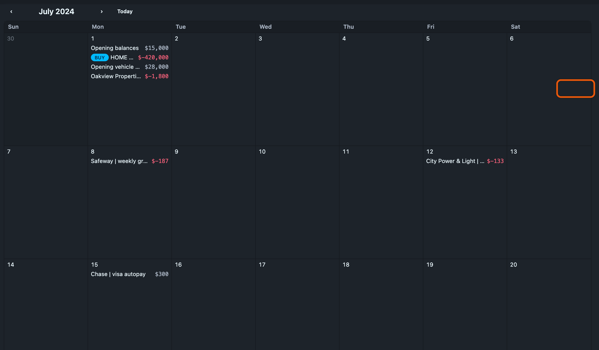

# Calendar view

The calendar view shows the journal one month at a time, with each transaction listed on its date. Use it to see when money moves: rent on the 1st, paychecks every other Friday, a run of card charges on a trip.

## Opening it

The two buttons at the right of the table toolbar, next to the column gear, switch between the list and the calendar. <kbd>v</kbd> does the same from the keyboard.

The calendar always shows exactly one month. When you open it, the date range in the [filter bar](filtering.md) changes to a single month: the month your range ended in, or the current month if the range ran into the future. Moving to another month changes the date range too, so the insights panel and the totals footer always describe the month on screen.

If you pick a different range in the filter bar while the calendar is open, the calendar jumps to the month that range ended in. Switching back to the list keeps the month you were looking at.

The search box and the account filter work as usual. Search for `coffee`, or filter to one credit card, and the calendar shows only those transactions.

A [pinned running balance](running-balances.md) has nowhere to go in a calendar, so opening the calendar unpins it. Pinning an account while the calendar is open switches back to the list.

## Moving between months

The ‹ and › buttons above the grid move one month back or forward. **Today** jumps to the current month.

| Keys                         | Action         |
| ---------------------------- | -------------- |
| <kbd>h</kbd> or <kbd>←</kbd> | Previous month |
| <kbd>l</kbd> or <kbd>→</kbd> | Next month     |
| <kbd>t</kbd>                 | This month     |

The URL includes the calendar and its month, so a bookmark or a shared link opens the same view.

## What a day shows

Each transaction takes one line: the description on the left, the amount on the right. A long description is cut short with an ellipsis so it never runs into the amount.

Amounts are rounded to whole units, so `$56.50` shows as `$57`. Their sign and colour tell you which way the money went:

- **Income** is positive, in green. A paycheck with tax withheld shows what you were paid after the deductions recorded in the same transaction.
- **Expenses** are negative, in red.
- **Transfers** between your own accounts, such as a card payment, show the amount moved with no sign, in grey.

Ledgeline decides between income, expense and transfer from each account's declared [type](../settings/accounts.md), not from its name.

A stock trade shows a **BUY** or **SELL** pill, then the symbol and the number of shares, then the cash that changed hands: `SELL AAPL -120 $18,030`. A purchase is negative because money left your account, and a sale is positive. Any posting that exchanges one commodity for another at a price (`10 AAPL @ $150`) counts as a trade.

A transaction flagged by the [problems checks](problems.md) has the same coloured dot it has in the table. Hover any line to see the full description, the amount, and what the checks found.

## Busy days

When a day has more transactions than fit in its cell, the last line says how many are hidden, such as **2 more**. Click it to see the whole day in a panel over the calendar. Press <kbd>Esc</kbd> or click outside the panel to close it.

Each week is a fixed height, about ten lines of transactions, whatever the size of the window. Only the width of the days changes as the window does. A larger [text size](../settings/themes.md#text-size) makes everything bigger, the cells included.

## Editing from the calendar

Click a transaction to open it in the [transaction editor](index.md#the-transaction-editor). Changes you save appear on the calendar straight away. **Add transaction** and <kbd>n</kbd> work in the calendar as they do in the list, as do the Review and Find Matches buttons.

The row keys (<kbd>j</kbd>, <kbd>k</kbd>, <kbd>e</kbd>, <kbd>x</kbd> and the rest) apply only to the list.
