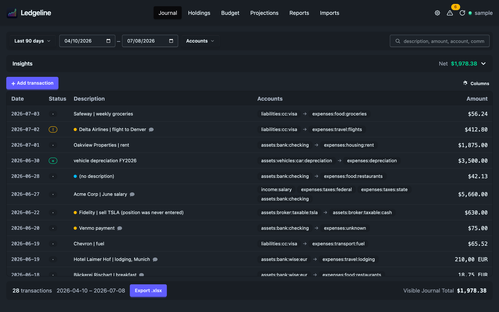
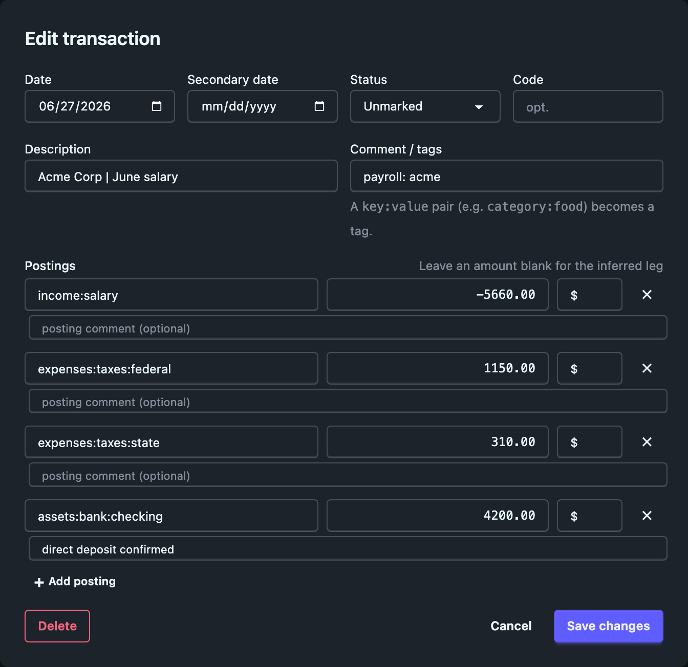

# The journal

The Journal tab is where Ledgeline opens. It lists every transaction in your hledger journal, newest first, under a filter bar and an insights panel.

The page has four parts, top to bottom:

- The [filter bar](filtering.md) picks a date range, accounts and a search term.
- The insights panel summarizes what the filters selected.
- The transaction table lists the matching transactions.
- The totals footer counts them, nets them, and exports them.

The view refreshes itself every 30 seconds while the window is visible. If you edit the journal in a text editor, the change shows up without a restart.

## The transaction table

Each row is one transaction. The columns are:

| Column | What it shows |
| --- | --- |
| Date | The transaction's primary date. |
| Status | `*` for cleared, `!` for pending, a dot for unmarked. |
| Description | The description, a comment marker when the transaction or a posting carries a comment, and a coloured dot when the [problems checks](problems.md) flagged it. |
| Accounts | The accounts involved. A simple two-account transaction reads `source → destination`. A split shows every account as a chip. |
| Amount | The size of the transaction: the sum of its positive postings, per commodity. |

Hover the comment marker to read the comments. Hover a problem dot to read what the check found.

The gear menu at the right of the table toolbar turns columns on and off. Ledgeline remembers the choice. In a narrow window the table switches to one card per transaction.

The table only draws the rows on screen, so it stays fast on journals with tens of thousands of transactions.

## Editing transactions

Ledgeline writes your changes straight into the journal file. Editing is available when Ledgeline's own engine serves the app. Against a plain `hledger-web` server the table is read-only and the edit controls don't appear.

Each edit changes only the lines of the transaction you touched. Ledgeline re-reads the journal after every write and checks that the result parses and still says what you intended. If the file changed on disk since Ledgeline last read it, the edit is refused, the view refreshes, and a notice asks you to re-apply your change.

### Quick edits in the table

Three edits happen in place, without opening a dialog:

- Click the description to rename it. Press <kbd>Enter</kbd> to save or <kbd>Esc</kbd> to cancel. Clicking away also saves.
- Click an account chip to recategorize it. The field suggests existing account names as you type. Every posting in that transaction on the old account moves to the new one.
- Click the status badge to cycle it from unmarked to pending to cleared and back to unmarked.

The same edits have [keyboard shortcuts](keyboard.md): <kbd>e</kbd> for the description, <kbd>c</kbd> for the category, and <kbd>s</kbd> for status, all on the row under the cursor.

### The transaction dialog

The **Add transaction** button above the table opens an empty dialog. The pencil button that appears when you hover a description opens the same dialog filled in with that transaction. <kbd>n</kbd> and <kbd>Enter</kbd> do the same from the keyboard.

The dialog has these fields:

- Date and an optional secondary date.
- Status: unmarked, pending (`!`) or cleared (`*`).
- An optional code.
- Description. hledger reads `payee | note` as a payee and a note.
- Comment / tags. A `key:value` pair such as `category:food` becomes an hledger tag.
- One row per posting, with an account, an amount, a commodity and an optional posting comment.

Leave one posting's amount blank and hledger infers it, as it would in the file. **Add posting** adds a row and the ✕ removes one. <kbd>Enter</kbd> in any field saves, and so does <kbd>Cmd</kbd>/<kbd>Ctrl</kbd>+<kbd>Enter</kbd>. <kbd>Esc</kbd> closes the dialog without saving.

The dialog keeps parts of a posting it doesn't let you edit:

- A cost annotation (`@` or `@@`) is written back unchanged.
- A virtual posting stays virtual, in `(account)` or `[account]` form.
- A balance assertion stays on the posting. A **Remove** button drops it. An assertion needs an amount on its posting, and the dialog says so if you clear the amount.

Ledgeline refuses a transaction that doesn't balance and shows the reason in the dialog. A new transaction goes into the file that holds its neighbours by date. If your journal `include`s one file per year, a 2026 transaction lands in the 2026 file.

### Deleting a transaction

There are two ways to delete:

- In the table, put the cursor on the row and press <kbd>x</kbd>. A bar above the table names the transaction and offers **Delete** and **Keep**. Press <kbd>x</kbd> again to confirm, or <kbd>Esc</kbd> to back out.
- In the edit dialog, press **Delete**, then **Confirm delete**.

## The insights panel

The panel above the table has two tabs. Click the panel's header to collapse it. The header keeps showing the active tab's headline figure, and Ledgeline remembers whether you left it open.

**Activity** summarizes the filtered transactions:

- Income, Expenses and Net for the period, in the journal's main commodity.
- A pie chart of where the money went, or a line chart over time by day, week or month.
- A commodity picker when the period uses more than one, and a category picker (expenses by default).
- An **Account depth** slider that rolls the chart up to fewer, broader accounts.

**Balances** answers "how much cash do I have right now". It ignores the filter bar and reads the whole journal as of today. It lists cash on hand, short-term liabilities and net cash, then each bank and card account with its balance and the date it last changed. A balance confirmed by a balance assertion in the journal is marked *checked*.

Which accounts count as cash or short-term debt comes from the `type:` and `bsterm:` account tags, the same ones the [balance sheet](../reports/balance-sheet.md) uses. See [Accounts](../settings/accounts.md) for declaring them. A negative cash balance shows in red here and also appears in [Problems](problems.md).

## The totals footer

The footer under the table shows:

- How many transactions match the filters.
- The date range they cover.
- An **Export .xlsx** button, described in [Exporting the journal](export.md).
- The **Visible Journal Total**.

The Visible Journal Total is income minus expenses across the filtered transactions, in the journal's main commodity. Expenses pull it negative and income pulls it positive, so a refund cancels the charge it reverses. When you filter by accounts, only postings to those accounts count. Filter to one store and the total is your net spending there.

A dash means the filtered postings net to exactly zero, or there are none.

## Related pages

- [Filtering the journal](filtering.md)
- [Problems](problems.md)
- [Keyboard shortcuts](keyboard.md)
- [Exporting the journal](export.md)
- [Importing statements](../imports/index.md)
