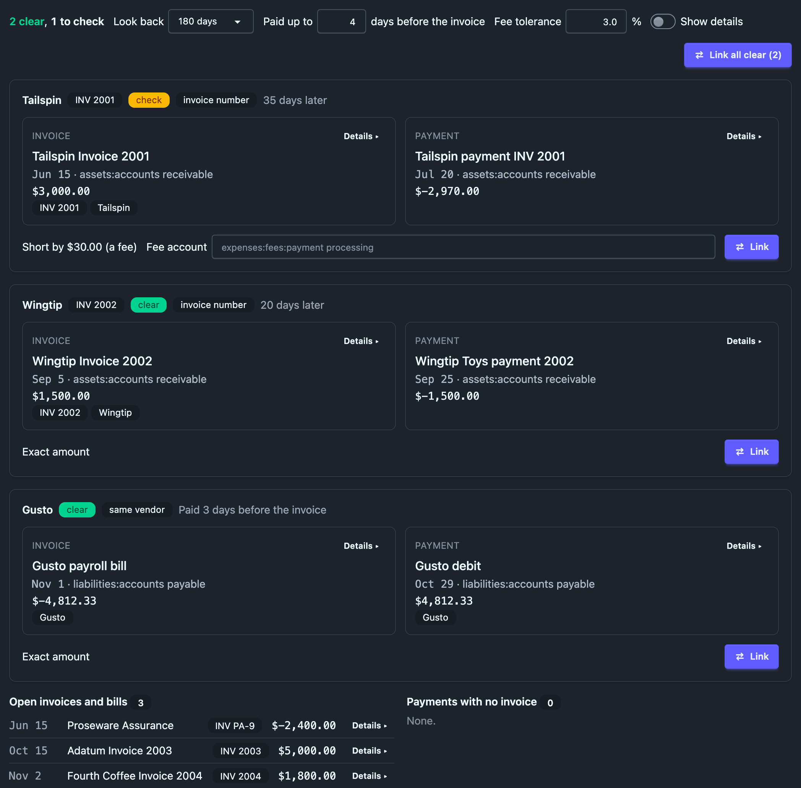
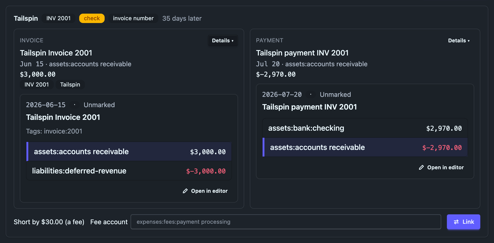

# Invoice matching

On accrual books an invoice and its payment are two transactions. The invoice debits accounts receivable, and the payment credits it when the money arrives. Bills work the same way through accounts payable. Until the two are paired, you can't tell from the books which invoices are still open.

Ledgeline proposes the pairs and links them with the same `match:` tag [transfer matching](transfer-matching.md) uses, with accounts receivable and accounts payable acting as the clearing accounts. Both transactions stay as they are; a link adds one tag to each side's receivable (or payable) posting.

Invoice matching appears with the [recognition helpers](accrual-recognition.md#when-the-helpers-appear): when an account is a receivable or payable, by `kpi: receivable` or `kpi: payable` or by its name.

## Where to find it

- The **Invoices** page in the main navigation.
- The **Invoices** tab of the Recognition overlay on the Journal (<kbd>a</kbd>).

Both show the same list.



## How pairs are proposed

An invoice is a debit to accounts receivable (or a credit to accounts payable) with no `match:` tag. A payment is the opposite posting on the same account, in a transaction with a cash leg, also with no `match:` tag. Each must be a real posting with one amount and no cost.

Ledgeline pairs an invoice with a payment on the same account and in the same commodity, one to one, and ranks the candidates by:

1. **Invoice number.** The same `invoice:` tag on both, or the payment's description containing the invoice number as a whole word.
2. **Customer or vendor.** The same `customer:` (or `vendor:`) on both. When a payment has no tag, the customer that earlier matched payments from the same payee belonged to.
3. **Amount.** An exact amount first, then a payment short of the invoice by no more than the fee tolerance (3% by default). A payment larger than its invoice is shown, but it can't be linked.
4. **Days apart.** The fewest days between the two.

A pair is **clear** when it's the only good candidate for both sides, the amount is exact, and the invoice number or the customer matches. Anything else is marked **check**: look at it before you link it.

### Payments made before the invoice

Usually a payment comes after its invoice, but not always. A payroll provider, for example, debits your bank account and sends the bill a few days later. Ledgeline accepts a payment up to 4 days before its invoice, and the card says "Paid 3 days before the invoice".

Change the limit with **Paid up to N days before the invoice** in the page header, or in [Settings → Books](../settings/settings-files.md#the-keys) (`settlementLeadDays`, 0 to 60). An exact payment just before a bill outranks a different-sized payment two weeks after it.

### Looking back

The list covers the last 180 days. Change it with **Look back** in the page header (`settlementLookbackDays`). "All time" looks at the whole journal. The limit applies to both sides of a pair.

## Linking a pair

**Link** writes `match:ID` on the invoice's and the payment's receivable (or payable) postings. Both transactions get the same id.

While the link is written, the card shows **Linking…** and the other cards wait with "One moment". When the list comes back, the linked card is gone.

### Short payments and fees

A payment that is short of its invoice by no more than the fee tolerance is offered with the difference as a fee. The card names the fee account: the one used for fees on the last linked payment on that account, or empty when there's none, in which case you type one. **Link** then edits the payment in the same write:

- its receivable posting is set to the invoice amount, written out even if it was left blank;
- a posting for the difference goes to the fee account.

The two receivable postings then cancel exactly:

```journal
2026-07-20 Tailspin payment
    assets:bank:checking          $2,970.00
    expenses:payment fees            $30.00
    assets:accounts receivable   $-3,000.00  ; customer: Tailspin, match: xa53h2
```

Set the tolerance with **Fee tolerance** in the page header, or in Settings → Books (`settlementToleranceBps`, in hundredths of a percent: 300 is 3%).

### Link all

**Link all clear** links every clear pair in the list, after asking. It links exactly the pairs you see, in one write to the journal, so it takes about as long as a single link. If the journal changed since the list was read, it refuses and the list refreshes. Nothing is proposed again partway through: a pair that only becomes clear because its rival was just linked waits for the next look.

## Details

Each side of a card shows one posting: the invoice line or the payment line. To see the rest of each transaction, every account, amount and comment, click **Details** on either side. Both sides open together, with the matched posting highlighted, so you can read the invoice and the payment side by side. Click **Details** again, or press <kbd>d</kbd> while the card has focus, to close them.



**Show details** in the page header opens every card at once. It lasts until you reload. **Open in editor** under each transaction opens it in the transaction editor.

The rows under the cards, **Open invoices and bills** and **Payments with no invoice**, have a Details toggle of their own.

## In the editor

The transaction editor's Accrual section shows the same information for one transaction:

- On an invoice or bill: its invoice number, the customer or vendor, and **Paid** or **Unpaid**.
- On a payment: its invoice candidates, with **Link**.

See [Revenue and expense recognition](accrual-recognition.md#setting-up-a-schedule) for the rest of that section.

## Unlinking

Open either transaction in the editor. Its match line lists the link with **Unlink**, which removes the `match:` tag from both sides and leaves both transactions otherwise as they are. A fee posting a link added stays; delete it by hand if you no longer want it.

Unlike a transfer, a linked invoice and payment stay two rows in the journal. See [Transfer matching](transfer-matching.md#what-each-answer-writes) for the tags themselves.

## Open invoices with hledger

The links are plain tags, so hledger can list what's still open: every receivable posting with no `match:` tag. On the synthetic books in `fixtures/accrual/`, with hledger 1.52:

```
$ hledger -f books.journal reg tag:kpi=receivable not:tag:match
2026-06-15 Tailspin Invoice ..  ..ccounts receivable     $3,000.00     $3,000.00
2026-07-20 Tailspin payment ..  ..ccounts receivable    $-2,970.00        $30.00
2026-09-05 Wingtip Invoice 2..  ..ccounts receivable     $1,500.00     $1,530.00
2026-09-25 Wingtip Toys paym..  ..ccounts receivable    $-1,500.00        $30.00
2026-10-15 Adatum Invoice 2003  ..ccounts receivable     $5,000.00     $5,030.00
2026-11-02 Fourth Coffee Inv..  ..ccounts receivable     $1,800.00     $6,830.00
```

```
$ hledger -f books.journal bal tag:kpi=receivable not:tag:match
           $6,830.00  assets:accounts receivable
--------------------
           $6,830.00
```

`tag:kpi=receivable` matches the account's own `kpi:` tag, so the query follows whichever accounts you declared. The list includes payments not yet linked to an invoice. Once Tailspin and Wingtip are linked, only the Adatum and Fourth Coffee invoices remain. Use `tag:kpi=payable` for bills.

## Related pages

- [Revenue and expense recognition](accrual-recognition.md)
- [Transfer matching](transfer-matching.md)
- [Settings files](../settings/settings-files.md#the-keys)
