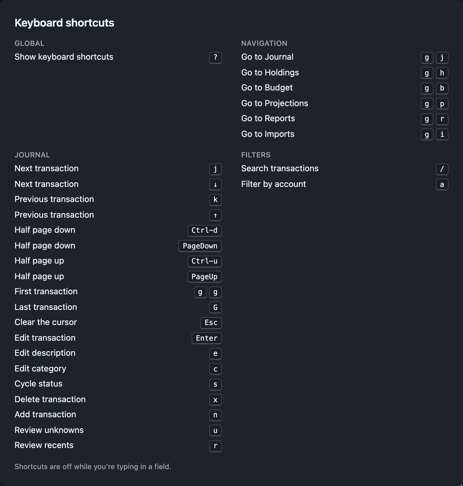

# Keyboard shortcuts

You can use all of Ledgeline from the keyboard. The keys follow vim where vim has an answer: <kbd>j</kbd> and <kbd>k</kbd> move, <kbd>/</kbd> searches, and some commands are two-key sequences that start with <kbd>g</kbd>.

## Press `?` for help

<kbd>?</kbd> opens a sheet listing the shortcuts that work on the current page, grouped by area. Press <kbd>Esc</kbd> or <kbd>?</kbd> again to close it. The sheet only lists keys that do something right now, so the edit keys don't appear when the journal is read-only.

Shortcuts are ignored while you type in a text field, date field or dropdown, so <kbd>j</kbd> in the search box types a "j". Click outside the field to get the shortcuts back. In the search box, <kbd>Esc</kbd> does the same.

## Sequences

A sequence such as <kbd>g</kbd> <kbd>j</kbd> means press <kbd>g</kbd>, release it, then press <kbd>j</kbd>. A small indicator shows that <kbd>g</kbd> is waiting for its second key. The wait times out after about a second if you change your mind.

## Everywhere

| Keys                      | Action                                           |
| ------------------------- | ------------------------------------------------ |
| <kbd>?</kbd>              | Show or hide keyboard shortcuts                  |
| <kbd>g</kbd> <kbd>j</kbd> | Go to Journal                                    |
| <kbd>g</kbd> <kbd>h</kbd> | Go to Holdings                                   |
| <kbd>g</kbd> <kbd>b</kbd> | Go to Budget                                     |
| <kbd>g</kbd> <kbd>p</kbd> | Go to Projections                                |
| <kbd>g</kbd> <kbd>r</kbd> | Go to Reports                                    |
| <kbd>g</kbd> <kbd>i</kbd> | Go to Imports (when the engine supports imports) |

## Journal

These need a cursor row. <kbd>j</kbd> or <kbd>k</kbd> puts one on the table, and clicking a row moves it there.

| Keys                                                 | Action                                       |
| ---------------------------------------------------- | -------------------------------------------- |
| <kbd>j</kbd> or <kbd>↓</kbd>                         | Next transaction                             |
| <kbd>k</kbd> or <kbd>↑</kbd>                         | Previous transaction                         |
| <kbd>Ctrl</kbd>+<kbd>d</kbd> or <kbd>Page Down</kbd> | Half a page down                             |
| <kbd>Ctrl</kbd>+<kbd>u</kbd> or <kbd>Page Up</kbd>   | Half a page up                               |
| <kbd>g</kbd> <kbd>g</kbd>                            | First transaction                            |
| <kbd>G</kbd>                                         | Last transaction                             |
| <kbd>Esc</kbd>                                       | Cancel a pending delete, or clear the cursor |
| <kbd>Enter</kbd>                                     | Edit the whole transaction                   |
| <kbd>e</kbd>                                         | Edit the description                         |
| <kbd>c</kbd>                                         | Edit the category (account)                  |
| <kbd>s</kbd>                                         | Cycle status: unmarked, pending, cleared     |
| <kbd>x</kbd>                                         | Delete. Press <kbd>x</kbd> again to confirm. |
| <kbd>n</kbd>                                         | Add a transaction                            |
| <kbd>u</kbd>                                         | Review Unknowns                              |
| <kbd>r</kbd>                                         | Review Recents                               |
| <kbd>m</kbd>                                         | Find Matches                                 |
| <kbd>Shift</kbd>+<kbd>M</kbd>                        | Find match for the cursor's transaction      |
| <kbd>l</kbd>                                         | Expand or collapse a transfer row            |
| <kbd>v</kbd>                                         | Switch between the list and the calendar     |

The editing keys (<kbd>Enter</kbd>, <kbd>e</kbd>, <kbd>c</kbd>, <kbd>s</kbd>, <kbd>x</kbd>, <kbd>n</kbd>, <kbd>u</kbd>, <kbd>r</kbd>, <kbd>m</kbd>) only work when the journal can be edited. See [The journal](index.md#editing-transactions). <kbd>u</kbd>, <kbd>r</kbd> and <kbd>m</kbd> don't need a cursor row, and each is off when its button is disabled.

<kbd>Shift</kbd>+<kbd>M</kbd> works on a row with a transfer half that isn't linked or ignored yet. See [Find match for one transaction](transfer-matching.md#find-match-for-one-transaction).

<kbd>l</kbd> works on a linked transfer row, which shows both halves of a transfer as one row, and on either half once it is expanded. See [Transfer matching](transfer-matching.md#linked-transfers-in-the-journal).

In the [calendar](calendar.md), only <kbd>n</kbd>, <kbd>u</kbd>, <kbd>r</kbd>, <kbd>m</kbd> and <kbd>v</kbd> from this table apply. The calendar adds its own:

| Keys                         | Action         |
| ---------------------------- | -------------- |
| <kbd>h</kbd> or <kbd>←</kbd> | Previous month |
| <kbd>l</kbd> or <kbd>→</kbd> | Next month     |
| <kbd>t</kbd>                 | This month     |

<kbd>Enter</kbd> and <kbd>n</kbd> open the [transaction editor](#transaction-editor). In an inline description or account edit, <kbd>Enter</kbd> saves and <kbd>Esc</kbd> cancels.

## Review

These work in the [review](review.md) of the journal or of an import. Most are single keys, which work when no field has focus. Press <kbd>Esc</kbd> to leave a field first. The keys with <kbd>Cmd</kbd> also work while you type. <kbd>Cmd</kbd> is <kbd>Ctrl</kbd> on Linux and Windows.

| Keys | Action |
| --- | --- |
| <kbd>Cmd</kbd>+<kbd>Enter</kbd>, <kbd>y</kbd> or <kbd>Enter</kbd> | Reviewed, or save the changes (the left footer button) |
| <kbd>Cmd</kbd>+<kbd>Shift</kbd>+<kbd>Enter</kbd> or <kbd>Y</kbd> | Accept the selected suggestion, mark reviewed, save, next |
| <kbd>→</kbd>, <kbd>n</kbd> or <kbd>l</kbd> | Skip |
| <kbd>←</kbd>, <kbd>p</kbd> or <kbd>h</kbd> | Previous card |
| <kbd>z</kbd> | Revert the card's changes |
| <kbd>d</kbd> | Edit the description |
| <kbd>a</kbd> | Edit the unknown account, or the first posting's |
| <kbd>1</kbd> to <kbd>9</kbd> | Edit that posting's account |
| <kbd>$</kbd> | Edit the first posting's amount |
| <kbd>t</kbd> | Add a tag |
| <kbd>m</kbd> | Edit the comment. <kbd>Enter</kbd> in it starts a new line. |
| <kbd>Shift</kbd>+<kbd>D</kbd> | Edit the date, status, code and secondary date |
| <kbd>!</kbd> | Cycle the status: unmarked, pending, cleared |
| <kbd>#</kbd> | Edit the code |
| <kbd>Tab</kbd> | In a field, accept the completion. In an unknown account, fill in the selected suggestion, then cycle to the next. |
| <kbd>s</kbd> | Open or close Similar |
| <kbd>Space</kbd> | Check or uncheck the focused similar row, while Similar is open |
| <kbd>Shift</kbd>+<kbd>A</kbd> | Check or uncheck every similar row |
| <kbd>Shift</kbd>+<kbd>R</kbd> | Remember as a rule, when a rules file fits the card. Not for QuickBooks imports. |
| <kbd>i</kbd> | Ignore: tag `reviewed:ignore` and move on |
| <kbd>Esc</kbd> | Leave the field. With no field focused, close the review. |
| <kbd>?</kbd> | Show the keyboard shortcuts |

<kbd>Enter</kbd> presses the focused button or checkbox when one has focus. <kbd>Esc</kbd> on a card with unsaved edits asks before closing. A second <kbd>Esc</kbd> keeps editing.

## Find Matches

These work in [Find Matches](transfer-matching.md#find-matches), which pairs the two halves of each transfer. As in review, the single keys work when no field has focus.

| Keys | Action |
| --- | --- |
| <kbd>Cmd</kbd>+<kbd>Enter</kbd>, <kbd>y</kbd> or <kbd>Enter</kbd> | Link the pair, saving any edited descriptions. On the first screen, <kbd>Enter</kbd> starts the cards. |
| <kbd>a</kbd> | On the first screen, link all clear matches. It asks first. |
| <kbd>x</kbd> | Not a match: remember that these two are not a pair |
| <kbd>→</kbd>, <kbd>n</kbd> or <kbd>l</kbd> | Skip, until Find Matches is next opened |
| <kbd>c</kbd> | Choose the next alternative, when more than one half fits |
| <kbd>1</kbd>, <kbd>2</kbd> | Edit the left or right description |
| <kbd>z</kbd> | Revert the descriptions |
| <kbd>Esc</kbd> | Leave the field. With no field focused, close Find Matches. |
| <kbd>?</kbd> | Show the keyboard shortcuts |

Find match for one transaction has its own keys:

| Keys | Action |
| --- | --- |
| <kbd>Cmd</kbd>+<kbd>Enter</kbd>, <kbd>y</kbd> or <kbd>Enter</kbd> | Link the selection, when it adds up. <kbd>Enter</kbd> presses the focused button or ticks the focused box first. |
| <kbd>c</kbd> | Choose the next exact partner or combination |
| <kbd>x</kbd> | Not a match, when one exact partner is selected |
| <kbd>i</kbd> | Ignore this side. It asks first. |
| <kbd>Esc</kbd> | Leave the field, cancel a confirm, or close |
| <kbd>?</kbd> | Show the keyboard shortcuts |

## Transaction editor

The [transaction editor](index.md#the-transaction-editor) is the review card on its own, so it takes the same keys for its fields. It has no queue, so it has no Skip, previous card or Ignore. These are its keys:

| Keys | Action |
| --- | --- |
| <kbd>Cmd</kbd>+<kbd>Enter</kbd> or <kbd>Enter</kbd> | Save (Add, for a new transaction) |
| <kbd>Cmd</kbd>+<kbd>Shift</kbd>+<kbd>Enter</kbd> | Accept the selected suggestion and save. The Mark reviewed box stays as it is. |
| <kbd>v</kbd> | Check or uncheck Mark reviewed |
| <kbd>Shift</kbd>+<kbd>X</kbd> | Delete the transaction. Press it again to confirm. |
| <kbd>z</kbd> | Revert the changes |
| <kbd>d</kbd> | Edit the description |
| <kbd>a</kbd> | Edit the unknown account, or the first posting's |
| <kbd>1</kbd> to <kbd>9</kbd> | Edit that posting's account |
| <kbd>$</kbd> | Edit the first posting's amount |
| <kbd>t</kbd> | Add a tag |
| <kbd>m</kbd> | Edit the comment |
| <kbd>Shift</kbd>+<kbd>D</kbd> | Edit the date |
| <kbd>!</kbd> | Cycle the status: unmarked, pending, cleared |
| <kbd>#</kbd> | Edit the code |
| <kbd>s</kbd>, <kbd>Space</kbd>, <kbd>Shift</kbd>+<kbd>A</kbd> | Open Similar, check a row, check every row |
| <kbd>Shift</kbd>+<kbd>R</kbd> | Remember as a rule, when a rules file fits the transaction |
| <kbd>Esc</kbd> | Leave the field. With no field focused, close the editor. |
| <kbd>?</kbd> | Show the keyboard shortcuts |

A new transaction opens with the description focused, so you can start typing at once. <kbd>Shift</kbd>+<kbd>X</kbd>, Similar and Remember as a rule only apply to a transaction that's already in the journal.

## Filters

| Keys         | Action                            |
| ------------ | --------------------------------- |
| <kbd>/</kbd> | Focus the journal search box      |
| <kbd>a</kbd> | Open the journal's account picker |
| <kbd>b</kbd> | Pin the one filtered account's running balance, or unpin it |

<kbd>b</kbd> works when exactly one account is in the filter, or when a [running balance](running-balances.md) is already pinned. On the Holdings page, which has no search box, <kbd>/</kbd> opens the account picker instead.

## Holdings

| Keys                         | Action                                          |
| ---------------------------- | ----------------------------------------------- |
| <kbd>1</kbd>, <kbd>2</kbd>   | Switch to the Stocks or Other tab               |
| <kbd>j</kbd> or <kbd>↓</kbd> | Next holding                                    |
| <kbd>k</kbd> or <kbd>↑</kbd> | Previous holding                                |
| <kbd>g</kbd> <kbd>g</kbd>    | First holding                                   |
| <kbd>G</kbd>                 | Last holding                                    |
| <kbd>Esc</kbd>               | Clear the cursor                                |
| <kbd>Enter</kbd>             | Show this holding's transactions in the journal |

## Projections

| Keys                         | Action                                                                    |
| ---------------------------- | ------------------------------------------------------------------------- |
| <kbd>1</kbd> to <kbd>6</kbd> | Runway, Balance sheet, Income statement, Cash flow, Accounts, Journal     |
| <kbd>j</kbd> or <kbd>↓</kbd> | Next entry in the scenario list                                           |
| <kbd>k</kbd> or <kbd>↑</kbd> | Previous entry                                                            |
| <kbd>g</kbd> <kbd>g</kbd>    | First entry                                                               |
| <kbd>G</kbd>                 | Last entry                                                                |
| <kbd>Enter</kbd> or <kbd>e</kbd> | Edit the entry                                                        |
| <kbd>J</kbd> / <kbd>K</kbd>  | Move the entry down or up                                                 |
| <kbd>c</kbd>                 | Duplicate                                                                 |
| <kbd>C</kbd>                 | Duplicate as alternative                                                  |
| <kbd>t</kbd>                 | Turn the entry off or on                                                  |
| <kbd>x</kbd> <kbd>x</kbd>    | Delete the entry (press twice)                                            |
| <kbd>n</kbd>                 | Open the **+ Add** menu                                                   |
| <kbd>Esc</kbd>               | Cancel a delete, or clear the cursor                                      |

In the entry editor, <kbd>⌘</kbd> <kbd>Enter</kbd> is Done and <kbd>Esc</kbd> is Cancel. Like every shortcut, the list's keys are ignored while you're typing in a field. Click outside the field first.

## Reports

| Keys                         | Action                                                            |
| ---------------------------- | ----------------------------------------------------------------- |
| <kbd>1</kbd> to <kbd>6</kbd> | Insights, Balance Sheet, P&L, Cash Flow, Net Worth, Subscriptions |
| <kbd>j</kbd> or <kbd>↓</kbd> | Next row                                                          |
| <kbd>k</kbd> or <kbd>↑</kbd> | Previous row                                                      |
| <kbd>g</kbd> <kbd>g</kbd>    | First row                                                         |
| <kbd>G</kbd>                 | Last row                                                          |
| <kbd>Esc</kbd>               | Clear the cursor                                                  |
| <kbd>Enter</kbd>             | Expand a group, or show the account in the journal                |

On the Balance Sheet and P&L, <kbd>Enter</kbd> on a group row expands it and on an account row opens the journal. On the other tables, it opens the journal filtered to that account.

## Imports

| Keys                         | Action                                   |
| ---------------------------- | ---------------------------------------- |
| <kbd>1</kbd>, <kbd>2</kbd>   | New Transactions, Edit Rules             |
| <kbd>j</kbd> or <kbd>↓</kbd> | Next rule                                |
| <kbd>k</kbd> or <kbd>↑</kbd> | Previous rule                            |
| <kbd>g</kbd> <kbd>g</kbd>    | First rule                               |
| <kbd>G</kbd>                 | Last rule                                |
| <kbd>J</kbd>                 | Move the rule down                       |
| <kbd>K</kbd>                 | Move the rule up                         |
| <kbd>Enter</kbd>             | Open or close the rule                   |
| <kbd>Esc</kbd>               | Close the open rule, or clear the cursor |
| <kbd>u</kbd>                 | Review this import's unknowns            |
| <kbd>r</kbd>                 | Review all of this import                |

The rule keys work in the rules list on the Edit Rules tab. <kbd>u</kbd> and <kbd>r</kbd> work once a dry run is ready on New Transactions. See [Review before writing](../imports/new-transactions.md#review-before-writing).

## Settings

| Keys                       | Action                    |
| -------------------------- | ------------------------- |
| <kbd>1</kbd>, <kbd>2</kbd> | Accounts, Account Aliases |

## Desktop app menus

The desktop window adds menu shortcuts. <kbd>Cmd</kbd> on macOS is <kbd>Ctrl</kbd> on Linux.

| Keys                                                      | Action                                          |
| --------------------------------------------------------- | ----------------------------------------------- |
| <kbd>Cmd</kbd>+<kbd>N</kbd>                               | Start a [new ledger](../new-ledger.md)          |
| <kbd>Cmd</kbd>+<kbd>O</kbd>                               | Open a journal                                  |
| <kbd>Cmd</kbd>+<kbd>R</kbd>                               | Reload                                          |
| <kbd>Cmd</kbd>+<kbd>[</kbd> / <kbd>Cmd</kbd>+<kbd>]</kbd> | Back / forward (macOS)                          |
| <kbd>Alt</kbd>+<kbd>←</kbd> / <kbd>Alt</kbd>+<kbd>→</kbd> | Back / forward (Linux)                          |
| <kbd>Ctrl</kbd>+<kbd>Q</kbd>                              | Quit (Linux)                                    |
| <kbd>F10</kbd>                                            | Show or hide the title bar and menu bar (Linux) |

## Related pages

- [The journal](index.md)
- [Reviewing transactions](review.md)
- [Filtering the journal](filtering.md)
