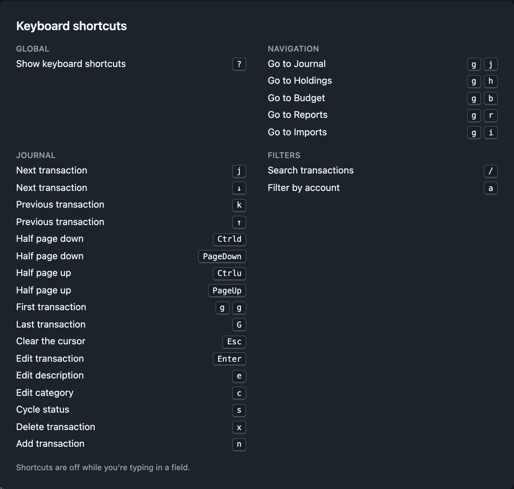

# Keyboard shortcuts

You can use all of Ledgeline from the keyboard. The keys follow vim where vim has an answer: <kbd>j</kbd> and <kbd>k</kbd> move, <kbd>/</kbd> searches, and some commands are two-key sequences that start with <kbd>g</kbd>.

## Press `?` for help

<kbd>?</kbd> opens a sheet listing the shortcuts that work on the current page, grouped by area. Press <kbd>Esc</kbd> or <kbd>?</kbd> again to close it. The sheet only lists keys that do something right now, so the edit keys don't appear when the journal is read-only.

Shortcuts are ignored while you type in a text field, date field or dropdown, so <kbd>j</kbd> in the search box types a "j". Click outside the field to get the shortcuts back. In the search box, <kbd>Esc</kbd> does the same.

## Sequences

A sequence such as <kbd>g</kbd> <kbd>j</kbd> means press <kbd>g</kbd>, release it, then press <kbd>j</kbd>. A small indicator shows that <kbd>g</kbd> is waiting for its second key. The wait times out after about a second if you change your mind.

## Everywhere

| Keys                      | Action                                           |
| ------------------------- | ------------------------------------------------ |
| <kbd>?</kbd>              | Show or hide keyboard shortcuts                  |
| <kbd>g</kbd> <kbd>j</kbd> | Go to Journal                                    |
| <kbd>g</kbd> <kbd>h</kbd> | Go to Holdings                                   |
| <kbd>g</kbd> <kbd>b</kbd> | Go to Budget                                     |
| <kbd>g</kbd> <kbd>p</kbd> | Go to Projections                                |
| <kbd>g</kbd> <kbd>r</kbd> | Go to Reports                                    |
| <kbd>g</kbd> <kbd>i</kbd> | Go to Imports (when the engine supports imports) |

## Journal

These need a cursor row. <kbd>j</kbd> or <kbd>k</kbd> puts one on the table, and clicking a row moves it there.

| Keys                                                 | Action                                       |
| ---------------------------------------------------- | -------------------------------------------- |
| <kbd>j</kbd> or <kbd>↓</kbd>                         | Next transaction                             |
| <kbd>k</kbd> or <kbd>↑</kbd>                         | Previous transaction                         |
| <kbd>Ctrl</kbd>+<kbd>d</kbd> or <kbd>Page Down</kbd> | Half a page down                             |
| <kbd>Ctrl</kbd>+<kbd>u</kbd> or <kbd>Page Up</kbd>   | Half a page up                               |
| <kbd>g</kbd> <kbd>g</kbd>                            | First transaction                            |
| <kbd>G</kbd>                                         | Last transaction                             |
| <kbd>Esc</kbd>                                       | Cancel a pending delete, or clear the cursor |
| <kbd>Enter</kbd>                                     | Edit the whole transaction                   |
| <kbd>e</kbd>                                         | Edit the description                         |
| <kbd>c</kbd>                                         | Edit the category (account)                  |
| <kbd>s</kbd>                                         | Cycle status: unmarked, pending, cleared     |
| <kbd>x</kbd>                                         | Delete. Press <kbd>x</kbd> again to confirm. |
| <kbd>n</kbd>                                         | Add a transaction                            |

The editing keys (<kbd>Enter</kbd>, <kbd>e</kbd>, <kbd>c</kbd>, <kbd>s</kbd>, <kbd>x</kbd>, <kbd>n</kbd>) only work when the journal can be edited. See [The journal](index.md#editing-transactions).

In the transaction dialog, <kbd>Enter</kbd> or <kbd>Cmd</kbd>/<kbd>Ctrl</kbd>+<kbd>Enter</kbd> saves and <kbd>Esc</kbd> closes without saving. In an inline description or account edit, <kbd>Enter</kbd> saves and <kbd>Esc</kbd> cancels.

## Filters

| Keys         | Action                            |
| ------------ | --------------------------------- |
| <kbd>/</kbd> | Focus the journal search box      |
| <kbd>a</kbd> | Open the journal's account picker |

On the Holdings page, which has no search box, <kbd>/</kbd> opens the account picker instead.

## Holdings

| Keys                         | Action                                          |
| ---------------------------- | ----------------------------------------------- |
| <kbd>1</kbd>, <kbd>2</kbd>   | Switch to the Stocks or Other tab               |
| <kbd>j</kbd> or <kbd>↓</kbd> | Next holding                                    |
| <kbd>k</kbd> or <kbd>↑</kbd> | Previous holding                                |
| <kbd>g</kbd> <kbd>g</kbd>    | First holding                                   |
| <kbd>G</kbd>                 | Last holding                                    |
| <kbd>Esc</kbd>               | Clear the cursor                                |
| <kbd>Enter</kbd>             | Show this holding's transactions in the journal |

## Projections

| Keys                         | Action                                                                    |
| ---------------------------- | ------------------------------------------------------------------------- |
| <kbd>1</kbd> to <kbd>6</kbd> | Runway, Balance sheet, Income statement, Cash flow, Accounts, Journal     |
| <kbd>j</kbd> or <kbd>↓</kbd> | Next entry in the scenario list                                           |
| <kbd>k</kbd> or <kbd>↑</kbd> | Previous entry                                                            |
| <kbd>g</kbd> <kbd>g</kbd>    | First entry                                                               |
| <kbd>G</kbd>                 | Last entry                                                                |
| <kbd>Enter</kbd> or <kbd>e</kbd> | Edit the entry                                                        |
| <kbd>J</kbd> / <kbd>K</kbd>  | Move the entry down or up                                                 |
| <kbd>c</kbd>                 | Duplicate                                                                 |
| <kbd>C</kbd>                 | Duplicate as alternative                                                  |
| <kbd>t</kbd>                 | Turn the entry off or on                                                  |
| <kbd>x</kbd> <kbd>x</kbd>    | Delete the entry (press twice)                                            |
| <kbd>n</kbd>                 | Open the **+ Add** menu                                                   |
| <kbd>Esc</kbd>               | Cancel a delete, or clear the cursor                                      |

In the entry editor, <kbd>⌘</kbd> <kbd>Enter</kbd> is Done and <kbd>Esc</kbd> is Cancel. Like every shortcut, the list's keys are ignored while you're typing in a field. Click outside the field first.

## Reports

| Keys                         | Action                                                            |
| ---------------------------- | ----------------------------------------------------------------- |
| <kbd>1</kbd> to <kbd>6</kbd> | Insights, Balance Sheet, P&L, Cash Flow, Net Worth, Subscriptions |
| <kbd>j</kbd> or <kbd>↓</kbd> | Next row                                                          |
| <kbd>k</kbd> or <kbd>↑</kbd> | Previous row                                                      |
| <kbd>g</kbd> <kbd>g</kbd>    | First row                                                         |
| <kbd>G</kbd>                 | Last row                                                          |
| <kbd>Esc</kbd>               | Clear the cursor                                                  |
| <kbd>Enter</kbd>             | Expand a group, or show the account in the journal                |

On the Balance Sheet and P&L, <kbd>Enter</kbd> on a group row expands it and on an account row opens the journal. On the other tables, it opens the journal filtered to that account.

## Imports

| Keys                         | Action                                   |
| ---------------------------- | ---------------------------------------- |
| <kbd>1</kbd>, <kbd>2</kbd>   | New Transactions, Edit Rules             |
| <kbd>j</kbd> or <kbd>↓</kbd> | Next rule                                |
| <kbd>k</kbd> or <kbd>↑</kbd> | Previous rule                            |
| <kbd>g</kbd> <kbd>g</kbd>    | First rule                               |
| <kbd>G</kbd>                 | Last rule                                |
| <kbd>J</kbd>                 | Move the rule down                       |
| <kbd>K</kbd>                 | Move the rule up                         |
| <kbd>Enter</kbd>             | Open or close the rule                   |
| <kbd>Esc</kbd>               | Close the open rule, or clear the cursor |

The rule keys work in the rules list on the Edit Rules tab.

## Settings

| Keys                       | Action                    |
| -------------------------- | ------------------------- |
| <kbd>1</kbd>, <kbd>2</kbd> | Accounts, Account Aliases |

## Desktop app menus

The desktop window adds menu shortcuts. <kbd>Cmd</kbd> on macOS is <kbd>Ctrl</kbd> on Linux.

| Keys                                                      | Action                                          |
| --------------------------------------------------------- | ----------------------------------------------- |
| <kbd>Cmd</kbd>+<kbd>O</kbd>                               | Open a journal                                  |
| <kbd>Cmd</kbd>+<kbd>R</kbd>                               | Reload                                          |
| <kbd>Cmd</kbd>+<kbd>[</kbd> / <kbd>Cmd</kbd>+<kbd>]</kbd> | Back / forward (macOS)                          |
| <kbd>Alt</kbd>+<kbd>←</kbd> / <kbd>Alt</kbd>+<kbd>→</kbd> | Back / forward (Linux)                          |
| <kbd>Ctrl</kbd>+<kbd>Q</kbd>                              | Quit (Linux)                                    |
| <kbd>F10</kbd>                                            | Show or hide the title bar and menu bar (Linux) |

## Related pages

- [The journal](index.md)
- [Filtering the journal](filtering.md)
