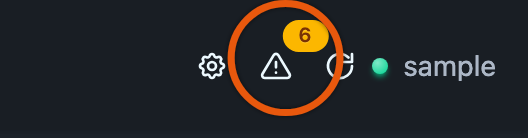
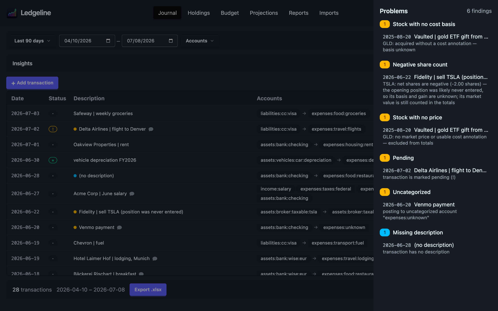

# Problems

Ledgeline checks your whole journal in the background every time it loads. The checks look for mistakes hledger would reject, and for things hledger accepts that are probably not what you meant.

## Where problems show up

When there is at least one finding, a warning triangle with a count appears in the top bar. Its colour follows the worst finding: red for an error, amber for a warning, blue for information. A clean journal shows no triangle at all.



Click the triangle to open the Problems drawer. Findings are grouped by check, with a count beside each group.



Most findings point at a transaction. Click one and Ledgeline closes the drawer, opens the Journal, scrolls to that transaction and pulses it. If the transaction falls outside the current date filter, the range widens just enough to include it. Account and search filters stay as they are, so clear them if the row doesn't appear.

A few findings are about an account instead of a transaction. Those show the account name and aren't clickable.

In the journal table, a flagged transaction has a coloured dot before its description. Hover the dot to read the findings.

The checks run on the whole journal, whatever the filter bar says.

## The checks

| Check | Severity | Anchored to |
| --- | --- | --- |
| [Unbalanced](#unbalanced) | error | transaction |
| [Balance assertion](#balance-assertion) | error | transaction |
| [Automatic posting rule](#automatic-posting-rule) | error | transaction |
| [Unknown account in a rule](#unknown-account-in-a-rule) | warning | account |
| [Unknown account tag value](#unknown-account-tag-value) | warning | account |
| [Stock checks](#stock-checks) | warning | transaction |
| [Pending](#pending) | warning | transaction |
| [Uncategorized](#uncategorized) | warning | transaction |
| [Negative cash balance](#negative-cash-balance) | warning | account |
| [Missing description](#missing-description) | info | transaction |
| [Future date](#future-date) | info | transaction |

The first six come from Ledgeline's engine. If you point the app at a plain `hledger-web` server instead, those engine checks are missing, and Ledgeline runs a simpler balance check of its own.

### Unbalanced

A transaction's postings don't sum to zero. The message says what is left over.

Ledgeline balances the way hledger does. A posting with a cost (`10 AAPL @ $150`) counts in the cost commodity. Real postings and `[bracketed]` virtual postings each balance on their own. `(parenthesized)` virtual postings don't have to balance. Each group may leave out one amount, and two missing amounts in one group is also an error.

To fix it, correct the amount that is wrong, or leave one posting's amount blank so hledger fills it in.

### Balance assertion

A posting asserts a balance (`assets:checking  $-20 = $880`) and the account's running balance at that point is different. The message shows the asserted balance, the calculated balance and the difference.

Usually a transaction is missing, duplicated or entered with the wrong amount before that date. Find the difference, then fix the transaction that causes it. Change the assertion only if the assertion itself was wrong.

### Automatic posting rule

With `--auto` on, an `=` rule would make hledger refuse the journal at this transaction. Either the rule's postings don't balance, or a rule with an amountless posting fired more than once here. The message names the rule and its file and line. See [Automatic postings](automatic-postings.md#problems-a-rule-can-cause) for how to fix each.

### Unknown account in a rule

An `=` rule posts to an account that no `account` directive declares and no transaction uses. It is usually a typo. Correct the rule, or declare the account if it is new on purpose. See [Automatic postings](automatic-postings.md).

### Unknown account tag value

An `account` directive uses one of Ledgeline's account tags with a value it doesn't recognize. Ledgeline ignores the tag and falls back to its default, and the message says what that costs:

| Tag | Accepted values | What happens when the value is wrong |
| --- | --- | --- |
| `type:` | `A`, `L`, `E`, `R`, `X`, `C`, `V`, `G`, or `Asset`, `Liability`, `Equity`, `Revenue`, `Expense`, `Cash`, `Conversion`, `Gain` | The type is guessed from the account name. |
| `issection:` | `revenue`, `cogs`, `opex`, `depreciation`, `interest`, `tax`, `other` | The account goes to its default P&L section. |
| `cfsection:` | `operating`, `investing`, `financing`, `cash` | The account goes to its default cash flow section. |
| `bsterm:` | `current`, `noncurrent` | The account gets the default balance sheet grouping. |
| `holdings:` | `stocks`, `other`, `none` | The account lands on a Holdings tab by whether it holds a non-currency commodity. |
| `valuation:` | `cost`, `unrealized`, `depreciation`, `adjustment` | The account counts as cost basis, so any unrealized gain on that holding reads as zero. |

The `valuation:` case matters most, because a zero gain looks like a holding that hasn't moved. Fix the spelling in the `account` directive. An empty value (`; bsterm:`) counts as no tag and is not reported.

The same warning appears for a correctly spelled tag on an account of the wrong statement, because the tag is ignored there:

| Tag | Ignored on | Why |
| --- | --- | --- |
| `issection:`, `isgroup:` | asset, liability and equity accounts | The income statement only shows revenue and expense accounts. |
| `bsgroup:`, `bsterm:` | revenue and expense accounts | The balance sheet only shows asset, liability and equity accounts. |
| `cfsection:`, `cfgroup:` | revenue and expense accounts | The [cash flow statement](../reports/cash-flow.md) counts those accounts only through net income. |

The type that decides this is the account's effective type, declared or guessed from its name. Remove the tag, or move it to the account it was meant for.

#### A type that looks like a typo

The same group also warns when an account's declared `type:` disagrees with its name and with one more piece of evidence. For example:

```journal
account expenses:ga        ; type:A, issection:opex, isgroup:G&A
account expenses:ga:rent   ; type:X
```

The message names the account, the type you wrote, the evidence and the file and line of the directive:

> account 'expenses:ga' is declared `type: A` (asset), but its name reads as an expense, its subaccounts are declared `type: X` (expense), and it carries `issection:` and `isgroup:`, which only income-statement accounts use. Did you mean `type: X`? … (declared at books.journal:11)

It warns only when the name's type differs from the declared type, and at least one of these is also true:

- the account has subaccounts with their own `type:`, and every one of them matches the name
- the account carries a tag that only the name's statement uses, such as `issection:` or `isgroup:` on an account declared as an asset, or `bsgroup:`, `bsterm:`, `cfsection:` or `cfgroup:` on one declared as an expense

A disagreement with the name alone is not reported, because it is often deliberate. `expenses:prepaid ; type: A` stays quiet, and so does a parent whose subaccounts have mixed types. Cash, Gain and Conversion count as Asset, Revenue and Equity, so `assets:bank ; type: C` is not a disagreement.

This warning is advice. Ledgeline still classifies the account by the type you declared, so until you fix it the account sits on the balance sheet, and anything posted to it directly, including a projection, is booked as an asset. When this warning fires, the separate "tag is ignored" warnings for the same account are left out, since fixing the type fixes those too.

The tags are explained on [Accounts](../settings/accounts.md), [Balance sheet](../reports/balance-sheet.md), [Income statement](../reports/income-statement.md) and [Holdings](../holdings/index.md).

### Stock checks

Three checks come from the same engine as the [Holdings](../holdings/index.md) tab, so the two always agree:

- **Stock with no cost basis**: shares were acquired with no cost annotation, so their cost basis is unknown. Add a cost to the purchase, such as `10 AAPL @ $150.00`.
- **Negative share count**: the share count went below zero. An opening position was probably never entered. Add the purchase or an opening balance that brought the shares in.
- **Stock with no price**: a position has no market price and no usable cost, so Holdings leaves it out of the totals. Add a `P` price directive, or fetch prices from the Holdings tab.

These checks cover the whole journal, including transactions dated in the future.

### Pending

The transaction is marked pending with `!`. Pending usually means "not yet confirmed by the bank". Once it clears, mark it cleared: click its status badge, or press <kbd>s</kbd> with the row under the cursor until it shows `*`.

### Uncategorized

A posting goes to an account that was never categorized. The check flags:

- any account whose last part is `unknown` or `uncategorized`, such as `expenses:unknown`
- a bare top-level income or expense account with no subaccount, such as `expenses` on its own

"Top-level income or expense" is decided by account type, so it works for charts of accounts rooted at other names, like `cogs`. Recategorize the posting by clicking its account chip in the journal, or press <kbd>c</kbd> on the row.

hledger's CSV import writes `expenses:unknown` and `income:unknown` when no rule matched, so this check also finds imported rows that still need a category. A rule in your rules file fixes future imports. See [Imports](../imports/index.md).

### Negative cash balance

A cash account's balance is below zero today. You can't hold less than nothing in a bank account, so it is either an overdraft or a booking mistake, such as a payment recorded against the wrong account or a missing deposit.

This check uses the same accounts as the Balances tab of the journal's insights panel. A red row there always has a finding here. Liabilities are not checked, because a negative balance is what owing money looks like. Accounts tagged `bsterm: noncurrent` are excluded.

### Missing description

The transaction has no description. Click the description cell or press <kbd>e</kbd> to add one.

### Future date

The transaction is dated after today. That is fine for scheduled payments. Otherwise it is usually a typo in the year or month.

## Related pages

- [The journal](index.md)
- [Accounts](../settings/accounts.md)
- [Keyboard shortcuts](keyboard.md)
