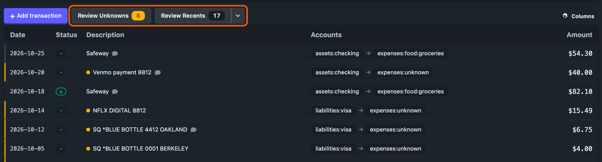
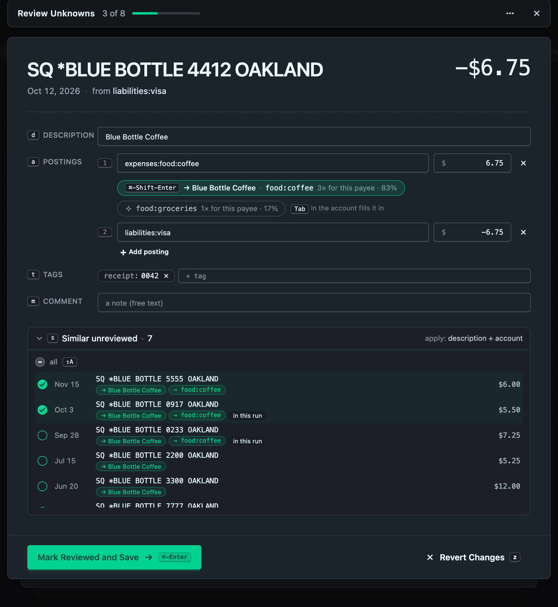
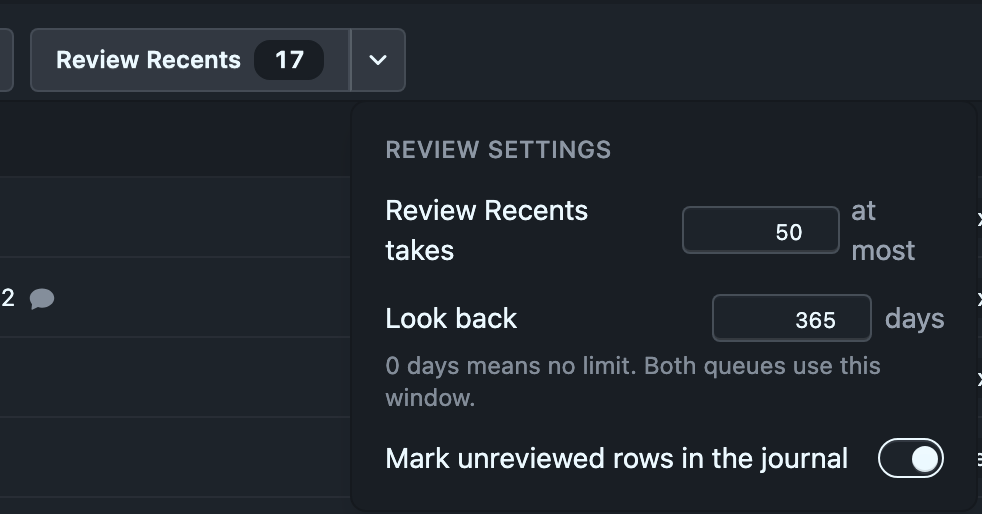
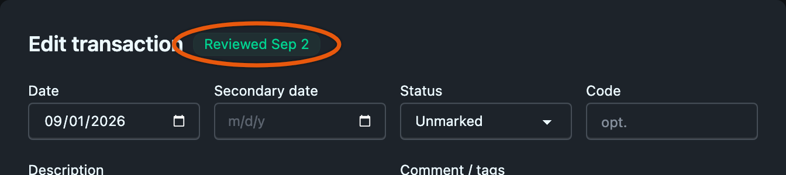

# Reviewing transactions

Imported statements leave work behind. Some rows land in `expenses:unknown` because no rule matched, and bank descriptions like `SQ *BLUE BOTTLE 4412 OAKLAND` need a better name. Review shows you those transactions one at a time, as a stack of cards, so you can categorize, rename and confirm each one from the keyboard.

Each card you confirm gets a `reviewed:` tag with the date. The tag is plain hledger, so you can query it from a terminal, and Ledgeline uses it to know what you have already looked at.

Review is available when the journal can be edited. See [Editing transactions](index.md#editing-transactions).

## Two queues

Two buttons sit next to **Add transaction** above the journal table. Each shows how many transactions it would bring up, and is disabled when that number is zero.



**Review Unknowns** brings up every uncategorized transaction, newest first. A transaction counts as uncategorized when one of its postings goes to an unknown account, the same check the [Problems](problems.md) drawer makes, so the two counts agree. That includes a transaction you tagged reviewed by hand but never categorized.

**Review Recents** brings up transactions that have no `reviewed:` tag at all, newest first, up to 50. It includes uncategorized ones that haven't been reviewed.

Both queues share one lookback window, 365 days by default. A transaction older than that is left alone in both, so you aren't asked about a three-year-old charge unless you widen the window under [settings](#settings). Neither queue includes:

- future-dated transactions;
- transactions tagged `reviewed:ignore`;
- forecast transactions that `~` periodic rules generate;
- transactions in files Ledgeline can't write to, which the run reports as "N not editable".

The queues cover the whole journal and ignore the filter bar.

Press <kbd>u</kbd> or <kbd>r</kbd> in the journal to open the same queues from the keyboard.

## The card

The review opens over the journal. A bar at the top shows the queue's name, your position ("3 of 8"), a progress bar, and a ⋯ menu. The current transaction sits on top of the deck, and the next two wait beneath it.


The top of the card says who and how much: the payee in large type, the amount, the date, and the account the money came from or went to. The amount is green for money coming in, blue for a transfer between your own accounts, and plain for money going out.

Below that are the fields you can change:

- **Description.** It completes from the payees already in your journal.
- **Postings.** One row per posting with its account and amount. An uncategorized account is outlined in amber. You can add and remove postings.
- **Tags.** Each tag is a chip. Type a name, then `:` and a value. Both complete from the tags in your journal.
- **Comment.** The free text of the transaction's comment.

Every field's label shows the key that jumps to it. The date is under the ⋯ menu as **Edit date**, because it rarely needs changing. For anything the card can't edit, **Open in full editor** in the same menu opens the [transaction dialog](index.md#the-transaction-dialog) and closes the review. Unsaved edits on the card are dropped when you do that.

Cost annotations, balance assertions and virtual postings are kept as written and shown under their posting.

## Reviewed, Skip and Ignore

The footer has two buttons, and they change with the card's state.

| Card | Left button | Right button |
| --- | --- | --- |
| Unchanged, fully categorized | **Reviewed** | **Skip** |
| Unchanged, an account still unknown | **Reviewed**, disabled | **Skip** |
| Changed, fully categorized | **Mark Reviewed and Save** | **Revert Changes** |
| Changed, an account still unknown | **Save** | **Revert Changes** |

**Reviewed** stamps the transaction with today's date, saves, and moves to the next card. It stays disabled while a posting is still uncategorized.

**Save** writes your changes without marking the transaction reviewed. Use it when you know the payee's name but not yet the category. Fix the description now and come back for the category later.

**Skip** moves on and writes nothing. A skipped card comes back the next time you open the queue. Press <kbd>←</kbd> to go back to the previous card if you skipped by mistake.

**Ignore**, in the ⋯ menu or on <kbd>i</kbd>, tags the transaction `reviewed:ignore` and moves on. An ignored transaction never shows up in either queue again and gets no stripe in the journal. It is for transactions you never want to be asked about. Ignore saves only the tag and drops any other unsaved edits on that card.

Saves happen in the background, in order. The next card appears at once, and a small "saving…" dot shows in the top bar. If a save fails, the review goes back to that card with your edits and the reason.

<kbd>Esc</kbd> closes the review. If the card has unsaved edits, the footer asks first, with **Keep editing** and **Discard and close**. When you close, the journal's cursor lands on the last transaction you saved.

When the last card leaves, a summary counts what you did, for example "5 reviewed · 3 fixed via similar · 1 skipped".

## Accepting a suggestion in one keystroke

On an uncategorized card, Ledgeline suggests an account under the unknown posting. A suggestion can come from:

- how you categorized earlier transactions from the same payee, where transactions you marked reviewed count double;
- during an import, a rule in the rules file that would match this description;
- a payee that starts the same way, when this exact payee has no history;
- a recurring charge with the same amount, the same account and about the same day of the month.

A suggestion can carry a rename too, when you have renamed this payee before. The chip then reads "→ Blue Bottle Coffee · food:coffee".

When a suggestion is strong, meaning at least half of the evidence agrees, it is selected already. Press <kbd>Cmd</kbd>+<kbd>Shift</kbd>+<kbd>Enter</kbd> (<kbd>Ctrl</kbd>+<kbd>Shift</kbd>+<kbd>Enter</kbd> on Linux and Windows), or <kbd>Y</kbd> when no field has focus. That takes the selected suggestion, marks the transaction reviewed, saves and moves on. Most uncategorized transactions need only that one keystroke. With no suggestion selected, the keys act like **Reviewed**.

Up to two weaker suggestions sit beside the first. In the account field, <kbd>Tab</kbd> fills in the selected suggestion without saving. Press it again to cycle to the next one. When every suggestion is weak, none is selected until you press <kbd>Tab</kbd>.

On a categorized card in Review Recents, a chip appears only when the account disagrees with a strong history, and it reads "usually food:coffee". It is never selected for you, so the one-keystroke accept can't recategorize a transaction unless you <kbd>Tab</kbd> to it first.

The one-keystroke accept never changes similar transactions. That always takes the checkboxes described next.

## Similar transactions

When you rename a card or change one of its accounts, Ledgeline offers the same change for similar transactions that haven't been reviewed.



Two transactions are similar when their descriptions match once the numbers are taken out. Ledgeline takes the part of the description before any `|`, ignores case, and drops every word that contains a digit, along with punctuation. `SQ *BLUE BOTTLE 4412 OAKLAND` and `SQ *BLUE BOTTLE 0917 OAKLAND` are similar. `SQ *BLUE BOTTLE 0001 BERKELEY` isn't, because "berkeley" differs. There is no fuzzy matching. A description made only of numbers matches nothing.

The **Similar** section shows how many there are. Press <kbd>s</kbd> to open or close the list. On a card you haven't changed, its checkboxes are disabled and it says "change the description or an account to apply it". Once you change something, the list keeps only the rows that change applies to. Each row shows the date, the description, the amount, and chips for exactly what it will receive. A row marked "in this run" is also in the queue you are working through.

What each similar transaction gets:

- A new description, if you renamed the card.
- A new account, if you changed one. Every posting on the old account moves to the new one. A transaction without the old account only gets the rename, and drops out of the list when there is no rename.

Every row starts unchecked. Tick the ones you want, or press <kbd>Shift</kbd>+<kbd>A</kbd> to check them all. The checked ones are saved together with the card.

Similar transactions get the change but are **not** marked reviewed. Only the card you are looking at gets the tag. They can come from any date, including future-dated ones.

A change to an amount, or adding or removing a posting, isn't offered to similar transactions. The section is replaced by "Splits aren't applied to similar transactions."

## How the stack shrinks

Applying a change to similar transactions that are also in the queue updates the queue at once.

- In Review Unknowns, a queued transaction that the change categorized leaves the run. Recategorize the first of ten Blue Bottle charges, check the other nine, and the run ends on the summary: "1 reviewed · 9 fixed via similar".
- In Review Recents, those transactions stay in the run, because they still haven't been reviewed. Their cards show the change and an "updated from card 1" note, so each one is a single **Reviewed**.

The position and total in the top bar update to match. Ledgeline also re-checks the queue after each save, so an edit made in another window or in a text editor shows up without reopening the review.

## The reviewed: tag

Review state lives in one tag on the transaction's own comment line:

```journal
2026-10-12 Blue Bottle Coffee  ; reviewed:2026-10-30, payee-key:sq blue bottle oakland
    ; receipt: 0042
    expenses:food:coffee  $6.75
    liabilities:visa
```

| Value | Meaning |
| --- | --- |
| no tag | Unreviewed |
| a date, `YYYY-MM-DD` | Reviewed that day, in your local time |
| `ignore` | Never ask. Left out of both queues and the row stripes |
| anything else | Reviewed. A hand-typed `reviewed:yes` works |

Only the transaction's own comment counts. A `reviewed:` tag in a posting comment is ignored.

Ledgeline adds the tag to the end of an existing comment, or starts a comment two spaces after the description. Nothing else on the line changes. You can add or remove the tag yourself in any editor.

The tag works in hledger queries. To list everything you have reviewed, and everything you haven't:

```sh
hledger reg tag:reviewed
hledger reg not:tag:reviewed
```

The first includes ignored transactions, because `reviewed:ignore` is a `reviewed` tag too. hledger matches a tag's value as a regular expression, so `tag:reviewed=ignore` finds the ignored ones and `tag:reviewed=2026-10` finds those reviewed in October 2026.

### Renames and payee-key:

When you change a description in the review, Ledgeline also writes `payee-key:` with the original description's matching form, such as `payee-key:sq blue bottle oakland`. The next `SQ *BLUE BOTTLE 0917 OAKLAND` can then be offered the rename "Blue Bottle Coffee", even though the renamed transaction no longer carries the bank's text. The tag is only written when the description actually changes.

### How a save changes the file

Changes to the description, accounts, tags and comment rewrite only those parts of the transaction. Amounts left blank stay blank, and the layout stays as you wrote it. A change to an amount, or an added or removed posting, rewrites that one transaction in Ledgeline's standard layout, as the [transaction dialog](index.md#the-transaction-dialog) does.

## Settings

The ▾ beside **Review Recents** opens the review settings. In the review, ⋯ → **Settings** opens the same panel.



- **Review Recents takes** sets how many transactions Review Recents brings up, from 1 to 1000. The default is 50.
- **Look back** sets the window both queues use, in days. The default is 365. 0 means no limit.
- **Mark unreviewed rows in the journal** turns the row stripes on or off.

The settings are stored in this browser or app window, not in the journal. The button counts and the stripes follow a change at once.

## Row stripes and the editor badge

The journal table marks rows with a thin stripe on their left edge:

- **Amber** for an uncategorized transaction inside the lookback window.
- **Faint** for a transaction inside the window with no `reviewed:` tag. These are what Review Recents would bring up.
- **None** for reviewed and ignored transactions, and for anything outside the window or dated in the future.

Old history stays unmarked. The same stripe shows on the left edge of each card in the narrow-window layout. Turn the stripes off under [settings](#settings).

The transaction dialog shows the review state next to its title: "Reviewed Sep 2", "Ignored" or "Unreviewed". The badge is information only. To change the state, edit the tag in the dialog's comment field.



## Postings from automatic posting rules

An [automatic posting rule](automatic-postings.md) can add postings to a transaction. The card lists those postings under the ones you can edit, in italics, each with a link that names its rule: "from automatic posting rule `= desc:coffee$`". They can't be edited on the card, because they aren't written in the transaction.

If a rule adds a posting to an unknown account, the card counts as uncategorized and can't be marked reviewed. Fix the rule instead. The link opens Settings → Automatic postings and closes the review, dropping any unsaved edits on the card.

## Keys

Every key the review uses is listed under "Review" in [Keyboard shortcuts](keyboard.md#review). Press <kbd>?</kbd> in the review to see them on screen.

## Reviewing during an import

The same review runs on an import before it is written, with **Review Unknowns** and **Review All**. There it can also save a change as a rule in the rules file, so the next statement arrives categorized. See [Review before writing](../imports/new-transactions.md#review-before-writing).

## Related pages

- [The journal](index.md)
- [Problems](problems.md)
- [Automatic postings](automatic-postings.md)
- [Keyboard shortcuts](keyboard.md)
- [New transactions](../imports/new-transactions.md)
