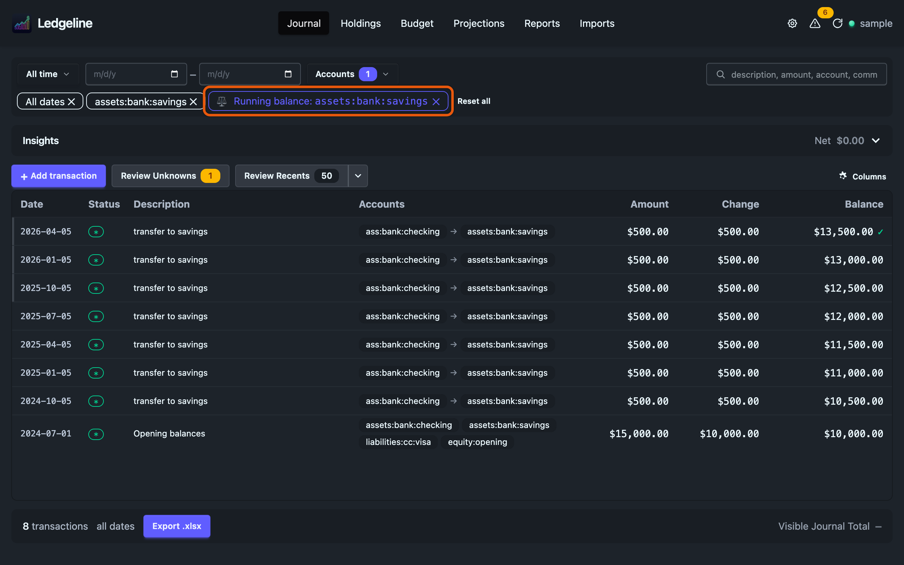
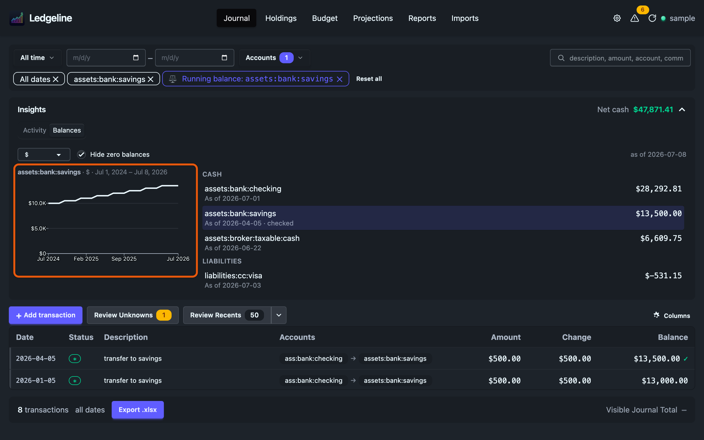

# Running balances

Pin an account and the journal table gains two columns: **Change**, what each transaction did to that account, and **Balance**, the account's balance after it. Use them to check the journal against a bank or brokerage statement line by line, and to find the entry that broke a balance assertion.

## Pinning an account

You can pin an account from three places:

- **The Balances tab** of the insights panel. Click an account, or tab to it and press <kbd>Enter</kbd>. The journal filters to that account and pins it. The date range stays as it was.
- **An account chip** under the filter bar. Each chip has a small ⚖ button that pins that account and leaves the filter alone.
- **Reports and Holdings.** <kbd>Enter</kbd> on an account row in the Balance Sheet or Net Worth [report](../reports/index.md), or on a holding in [Holdings](../holdings/index.md), opens the journal over all dates with the account already pinned. A stock pins its share count rather than dollars. A holding spread over two accounts opens filtered to both and pins neither. The P&L and Cash Flow open the journal over their own period and don't pin.

With exactly one account in the filter, <kbd>b</kbd> pins it. With a pin set, <kbd>b</kbd> removes it.

A pinned account gets its own chip in the chip row:

> ⚖ Running balance: assets:bank:savings &nbsp; ✕

The ✕ on that chip removes the two columns. The account filter stays. **Reset all** removes the pin along with every filter.

## The pin is not a filter

Pinning sets the account filter, but after that the two are independent. Change the account filter, say to `income:dividends`, and the columns stay, now showing the pinned account's balance beside transactions that may not touch it at all.

No filter changes the numbers. The balance is worked out once over the whole journal, and the date range, account filter and search only choose which rows you see. The first visible row's balance includes everything before it, so a balance never starts from zero because of the date range.

## The columns

**Change** is the pinned account's net change on that row. It can differ from the Amount column. For a dividend that is reinvested, the Amount column shows the size of the whole transaction, while Change shows only what landed in the pinned account. A wrong sign shows up here. A change of zero means money moved between two accounts inside the pinned one. Hover it to see "Internal".

**Balance** is the pinned account's balance after the row. Amounts are quantities as written. Costs are ignored, which is also how statements and balance assertions count.

A row that doesn't change the pinned account has a blank Change, and its Balance is the balance carried from the row before, dimmed. The column still reads top to bottom as a timeline, whatever the filters show.

## Parent accounts and commodities

Pinning a parent account includes everything under it, as the account filter does. Pinning `assets:brokerage` covers its cash account and every holding account beneath it.

The columns show one commodity at a time. Ledgeline starts with the commodity the account has the most postings in. When the account holds more than one, the chip has a picker:

> ⚖ Running balance: assets:brokerage &nbsp; [$ ▾] &nbsp; ✕

Switch it to check the share count of a single holding, then switch back for the cash line.

## Balance assertions

A row whose posting in the pinned account carries a [balance assertion](https://hledger.org/hledger.html#assertions-and-ordering) shows a mark after the balance:

- **✓** when the assertion holds.
- **✗** when it fails. Hover it to see the expected amount, what hledger found and the difference.

When the assertion is on an account below the pinned one, the mark names it, as in "✓ checking:joint". Pass and fail are hledger's verdict on the assertion itself, not a comparison with the Balance column. A plain `=` on a child account checks only that child, while the column sums the whole pinned account, so the two figures can differ when both are right.

Only assertions in the commodity on screen are marked, except a failing `==`, which always shows. It means some commodity that should be zero isn't.

### First failure

When an assertion in the pinned account and commodity fails, the chip says so:

> ⚖ Running balance: assets:bank:checking &nbsp; ✗ first failure 2026-03-31 &nbsp; ✕

Click it to scroll to that transaction. The date range widens only if it has to, the same way the [Problems](problems.md) drawer does.

### Narrow to the gap

Click a ✗ mark to set the date range to the window where the mistake must be. The range runs from the day after the previous assertion that passed to the date of the failing one. If no earlier assertion passed, the range is open at the start. The account filter and search stay as they are.

Inside that window, look down the Change column for an amount with the wrong sign, an entry that appears twice, or a transaction that belongs to a different account.

## Balance over time

While an account is pinned, the **Balances** tab of the insights panel shows a line of that account's balance in place of the cash pie, and hides the cash on hand, short-term liabilities and net cash totals, which describe the whole journal rather than the pinned account. The column gives the exact figure on each row. The line shows the shape, so a sudden dip, a step that happens twice, or a slow drift away from your statements is easy to spot before you start reading rows.

- **Any pinned account gets a line,** including one that isn't in the Balances list, such as a brokerage account pinned from a report. The heading names the account, the commodity and the dates shown. Pinning doesn't switch tabs. Open **Balances** to see the line.
- **The line covers the journal's date range.** The Balances list ignores the filter bar, but the line describes the rows you're looking at, so **Narrow to gap** narrows the chart and the table together. **All time** runs from the account's first posting to today. As in the column, every value includes everything before the range. The range only sets which part you see.
- **One commodity, the chip's.** The line follows the pin chip's commodity picker.
- **Values as written, with zero always in view.** A liability plots below zero, matching its Balance column.
- **Each point is the balance at the end of its period.** The period is days for a short range, weeks for a few months, and months for a longer one, the same choice the Holdings value chart makes.
- **A failing assertion is marked** with a diamond on the line, and a hollow dot where the line would be if the books matched the assertion. The distance between them is the amount it's off by. Hover a period to see its date, its balance and, for a failure, what was asserted, what hledger found and the difference. Passing assertions aren't drawn. The column already shows them.
- **Click a period** to scroll the table to the newest transaction in it. If the filter hides that transaction, nothing happens.

Like the pie, the line is hidden on narrow windows, so the table keeps its height. Remove the pin with its ✕ and the pie and totals come back.

## Postings with their own date

hledger counts a posting with a `date:` tag on that date, not the transaction's. If a transaction dated 2026-03-28 moves money out of checking with `; date:2026-04-02`, its row stays at 03-28 in the table, but its Change cell says "posts 2026-04-02". Its Balance is the total after that day's posting. The column can then look out of order around that row, which is correct.

## For hledger users

The Balance column is `hledger reg -H <account> cur:<commodity>` laid beside the journal. The rows are in the same order, the figures are the same, and filtering the table is like adding query terms to `reg -H`: it hides rows without changing the running total.

## Sharing a pinned view

The pin goes into the page URL with the filters:

| Parameter | Meaning |
| --- | --- |
| `bal` | The pinned account. |
| `balc` | The commodity, when you picked one. Without it, Ledgeline uses the account's main commodity. |

For example, `?preset=all&acct=assets:bank:savings&bal=assets:bank:savings` opens savings over all dates with its running balance. A link that names an account the journal doesn't have shows the chip with "not in this journal" and no columns.

## Exporting

With an account pinned, the [export](export.md) adds Change and Balance columns, filled in on each transaction's `Total for` row, and the date line names the pinned account.

## Related pages

- [Filtering the journal](filtering.md)
- [Problems](problems.md)
- [Keyboard shortcuts](keyboard.md)
- [Exporting the journal](export.md)
