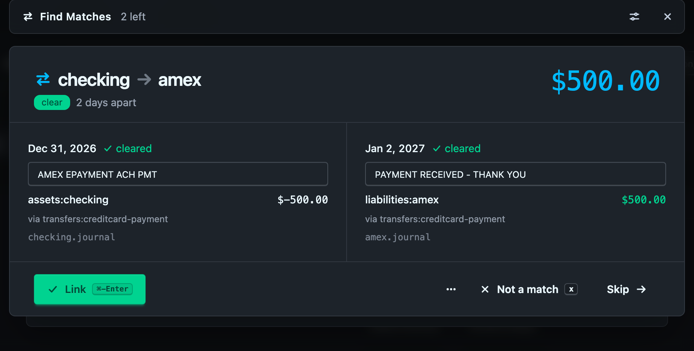
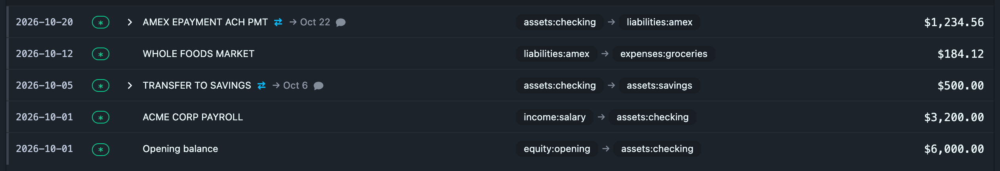
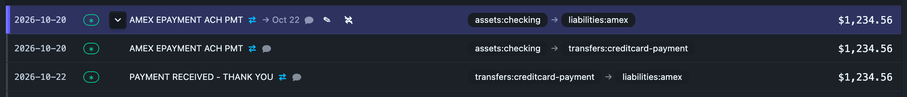

# Transfer matching

A transfer between two of your own accounts shows up on both statements. Checking says "AMEX EPAYMENT −$500" and the card says "PAYMENT THANK YOU $500". If you import both feeds, you get two transactions for one transfer.

Ledgeline handles this the way accountants do. Each import sends its side to a **clearing account**, Find Matches pairs the two sides, and the journal then shows each pair as one row: *Checking → Amex*. Nothing is merged or rewritten. Both transactions stay in the file as the imports wrote them. A link adds one `match:` tag to each side.

## Clearing accounts

A clearing account is a holding account that money passes through on its way between two of your accounts. Write your import rules so that each side of a transfer lands there:

```journal
2026-12-31 * AMEX EPAYMENT ACH PMT
    assets:checking                    $-500.00
    transfers:creditcard-payment        $500.00

2027-01-02 * PAYMENT RECEIVED - THANK YOU
    liabilities:amex                    $500.00
    transfers:creditcard-payment       $-500.00
```

Each rules file only needs to know its own side. The checking rules send "AMEX EPAYMENT" to `transfers:creditcard-payment`, and the Amex rules send "PAYMENT RECEIVED" there too. Neither has to guess what the other feed will say.

This is standard bookkeeping practice, and it keeps your reports right:

- When both sides have arrived, the clearing account nets to zero, and every report reads as if you had entered one transfer.
- A balance left on a clearing account is money in transit, a missing import, or a rule that sent something to the wrong place. It's the to-do list.
- A transfer sent on December 31 and received on January 2 really was in transit over the year end. The clearing account shows $500 on December 31, which is correct. Merging the two sides into one transaction would lose that.

Use one clearing account per kind of transfer, such as `transfers:internal-bank` between bank accounts and `transfers:creditcard-payment` for card payments. Find Matches only pairs postings on the same clearing account.

### Declaring a clearing account

Mark the account with a `clearing:` tag on its `account` directive:

```journal
account transfers                     ; clearing:
account transfers:internal-bank
account transfers:creditcard-payment
```

As in hledger, subaccounts inherit the tag, so tagging `transfers` makes both subaccounts clearing accounts.

You can also do it in **Settings › Accounts**: pick the account and tick **Clearing account**. A subaccount of a clearing account shows the box ticked and greyed out, with "inherited from `transfers`". See [Accounts](../settings/accounts.md).

Ledgeline doesn't guess clearing accounts from their names. With none declared, **Find Matches** is disabled, and a **How?** link beside it leads here.

## Find Matches

**Find Matches** sits in the journal toolbar next to Review Unknowns and Review Recents. Its badge counts the pairs Ledgeline proposes. Click it, or press <kbd>m</kbd>.

The ▾ beside it holds the [settings](#settings): how many days apart two halves may be, and how far back to look. The lookback has four presets, **90 days**, **1 year**, **2 years** and **All time**, next to its number. Changing either reads the proposals again. When older pairs are left out by the lookback, the button's tooltip says how many, for example "12 more older than the lookback".



### What makes a pair

Two clearing postings are proposed as a pair when:

- they are in different transactions, on the same clearing account;
- their amounts are exactly opposite, in the same commodity, with no tolerance;
- their dates are at most 10 days apart (the posting's own `date:` counts if it has one);
- neither is already linked or ignored, and the pair hasn't been rejected.

A posting with a cost (`@`) or a balance assertion is never proposed.

When one half could pair with several others, Ledgeline takes the pairs with the smallest date gap first, across the whole journal, rather than the first fit in file order. So a $500 transfer to savings on the 1st of every month pairs each month's halves with each other.

Each pair is labelled:

- **clear**: no other half fits as well, and the accounts on each side look like a transfer, such as checking to a card.
- **check**: another half fits equally well, or something looks off, such as the same account on both sides or an expense account feeding the clearing account.

### Payments split into several postings

Some payments leave one account in one piece and arrive in several, or the other way round. A bill-payment service such as Bill.com is the usual case: on February 19 your bank shows one debit of $2,247.50, and the service records it as two bills paid, $2,000.00 and $247.50.

```journal
2019-02-19 * BILL.COM PAYABLES
    assets:checking                   $-2,247.50
    transfers:billpay                  $2,247.50

2019-02-20 * ACME INV 12
    expenses:services                  $2,000.00
    transfers:billpay                 $-2,000.00

2019-02-21 * BOLT INV 7
    expenses:software                    $247.50
    transfers:billpay                   $-247.50
```

No single posting cancels the $2,247.50, so a pair can never clear it. When a posting is left without a partner, Ledgeline looks at the opposite postings on the same clearing account within the window, nearest first, for two to four that add up to exactly its amount. If exactly one such set exists, it's proposed as a **combination**. If several sets would fit, none is proposed, because picking one would be a guess. You can still link them yourself with [Find match](#find-match-for-one-transaction).

A combination is always labelled **check**, and it's never part of Link all.

### The first screen

The overlay opens on the counts, for example "6 clear, 2 to check". **Link all 6 clear matches** (<kbd>a</kbd>) links every clear pair at once, after asking. It's there for the first run on a journal with years of clearing postings. **Review one at a time** (<kbd>Enter</kbd>) goes through every pair as a card, the pairs to check included.

When the lookback leaves older pairs out, the first screen says how many, for example "12 more older than the lookback", with a **Show all** button. Show all sets the lookback to All time and reads the proposals again.

### The card

Each card names the transfer, such as **checking → amex $500.00**. Each side is the end of its account name, with just enough of the name to tell it apart from your other accounts: with two checking accounts, they read *bank1:checking* and *bank2:checking*. The card says whether it's clear or to check, and how many days apart the halves are. Below that are both halves side by side, each with its date, status, description, real account and amount, the clearing account it went "via", and the file it's in.

The descriptions are editable, with the same completion as the review card. The transfer row in the journal shows the outgoing half's description, so that's the one worth tidying. A pair to check lists the other halves that fit as choices, nearest first. <kbd>c</kbd> moves to the next choice.

The footer:

- **Link** (<kbd>y</kbd> or <kbd>Enter</kbd>) writes the link. After you edit a description it reads **Link and Save**, and saves the descriptions in the same write. **Revert** (<kbd>z</kbd>) puts the descriptions back.
- **Not a match** (<kbd>x</kbd>) remembers that these two are not a pair. It's never proposed again, but each half can still pair with something else.
- **Skip** (<kbd>→</kbd>, <kbd>n</kbd> or <kbd>l</kbd>) moves on without writing anything. The pair comes back the next time you open Find Matches.
- **⋯ › Ignore this side** marks one half as never to be matched, after asking. Use it for a real one-sided item, such as an opening balance moved through the clearing account.

Every write from one card is a single save: the tags and the descriptions together, or nothing. The full key list is under [Keyboard shortcuts](keyboard.md#find-matches).

A combination's card shows the single posting on the left, with its editable description, and the postings that add up to it on the right, each with its date, description, account, amount and file. The header shows how many more there are, as in *checking → services +1*. **Link** writes one `match:` id on all of them. There's no **Not a match**, because a rejection is between two postings, and **⋯ › Ignore this side** applies to the single posting.

## Find match for one transaction

Find Matches works through the whole journal. **Find match** works on one transaction: the one you're looking at. It finds partners that Find Matches won't propose, because they're older than the lookback, more than the window apart, or split into several postings.

You can open it from four places, whenever a transaction has a clearing posting that isn't linked or ignored:

- the **transaction editor**: **⇄ Find match**, below the card's header. Save or revert your changes first.
- the **journal row**: hover the description and click the ⇄ button.
- the **keyboard**: <kbd>Shift</kbd>+<kbd>M</kbd> with the cursor on the row.
- the **Problems drawer**: **Find match** under an [In transit](problems.md#in-transit) finding.

It opens the Find Matches overlay, marked **one transaction**, with three lists for the clearing posting:

- **Exact amount, any date**: postings on the same clearing account with exactly the opposite amount, however far apart, nearest first. The nearest is selected. A partner outside the window or older than the lookback is flagged as such.
- **Combinations that add up**: any [combination](#payments-split-into-several-postings) that includes this posting.
- **Pick several**: the opposite postings on the same clearing account within ± the window, with a checkbox each. The window starts at the ▾ setting. Change the number beside the list to look further, up to 60 days, without changing the setting.

Choosing an exact partner or a combination ticks its postings, and ticking boxes builds a selection by hand. Below the lists a running total compares what you've picked with what this posting needs, for example "$2,247.50 of $2,247.50 ✓". The sum is exact, to the cent.

- **Link** (<kbd>y</kbd> or <kbd>Enter</kbd>) is only enabled when the selection adds up to exactly this posting's amount. One partner links as a pair. Several link as a group, and every posting in it gets the same `match:` id.
- **Not a match** (<kbd>x</kbd>) is there when one exact partner is selected.
- **Ignore this side** (<kbd>i</kbd>) is always there. It asks first.

If nothing fits, Find match says so, for example "No unlinked −$506.55 on transfers:car-payment at any date, and nothing opposite within ±10 days", and offers Ignore this side. That usually means the other side was never imported.

If the transaction is already linked, Find match lists each link with all its postings and an **Unlink** button. The transaction editor shows the link too, with its own **Unlink**. Unlink asks first, then removes the `match:` id from every posting in the link.

After a link or an ignore, Find match closes if the transaction has nothing more to match. Opened from the editor, the editor comes back with the transaction as it now reads.

### After an import

When you **Write changes** on an import, and some of its new transactions have a partner, the result screen says how many pairs have a half in that import and offers **Find Matches**. It opens the same overlay, marked **this import**, with only those pairs. After a QuickBooks import, or once you have re-sorted the file, the offer covers every pair in the journal instead, because the new transactions are no longer together at the end of the file.

## What each answer writes

A link writes the same new six-character id on both clearing postings, as a posting tag:

```journal
2026-12-31 * AMEX EPAYMENT ACH PMT
    assets:checking                    $-500.00
    transfers:creditcard-payment        $500.00  ; match:k7f3a2

2027-01-02 * PAYMENT RECEIVED - THANK YOU
    liabilities:amex                    $500.00
    transfers:creditcard-payment       $-500.00  ; match:k7f3a2
```

Not a match writes a shared `nomatch:` id the same way:

```journal
    transfers:internal-bank             $300.00  ; nomatch:r4x9q2
```

A posting can carry several `nomatch:` ids. When a posting is later linked or ignored, Ledgeline removes its `nomatch:` ids, and the matching ones on the other side of each rejection, since they can no longer matter.

A group link writes the same id on every posting in the group, here a combination of three:

```journal
2019-02-19 * BILL.COM PAYABLES
    assets:checking                   $-2,247.50
    transfers:billpay                  $2,247.50  ; match:b7c2x9

2019-02-20 * ACME INV 12
    expenses:services                  $2,000.00
    transfers:billpay                 $-2,000.00  ; match:b7c2x9

2019-02-21 * BOLT INV 7
    expenses:software                    $247.50
    transfers:billpay                   $-247.50  ; match:b7c2x9
```

Ignore this side writes `match:ignore` on that one posting.

Nothing else changes: not the description (unless you edited it on the card), not the amounts, not the layout. Amounts left blank stay blank. Unlinking removes the tag from every posting that carries it, and the file reads byte for byte as it did before the link.

## Linked transfers in the journal

Each linked pair shows as one **transfer row** with a ⇄ icon. The row shows the date and description of the half it sits at, "→ Jan 2" when the other half has a different date, and its two real accounts in the accounts column (*assets:checking → liabilities:amex*), shortened the same way as any other row's when the column is narrow. They're read-only there, because they belong to two different transactions; expand the row to edit either half.



- Click ▸ beside the row, or press <kbd>l</kbd> on it, to show both transactions as ordinary rows underneath. Each opens in the editor like any other row. Press <kbd>l</kbd> again to collapse it.

  
- Hover the description and click the unlink icon to unlink the pair. A bar above the table confirms first: both halves stay, and only their `match:` tags go.
- A posting with a `nomatch:` id shows a small ≠. Click it to forget the rejection, after confirming, and let the pair be proposed again.

With no account filter, the row sits at the earlier half. Filtered to one account, it sits at that account's half and shows that side's amount, so the Amex register reads in Amex's own order. If only one half passes the filter, the row still appears there and still expands to both. Searching for either description finds it.

Totals, charts and reports are unchanged: the clearing postings cancel within a pair, and every report adds up postings, not rows. While any pair is collapsed, the footer counts **rows** instead of transactions.

A transaction in two links at once, such as a transfer and a fee through the same clearing account, isn't collapsed. Nor is a group link of three or more postings. Their transactions show as ordinary rows, each with the ⇄ icon. Open one in the editor to see or unlink its link.

## Problems

Three [Problems](problems.md) checks watch the clearing accounts:

| Check | Severity | What it means |
| --- | --- | --- |
| In transit | info | A clearing posting more than 10 days old has no partner or combination to propose. Usually a missing import, a wrong rule, or a partner older than the lookback. Its fix is **Find match**. |
| Broken match | warning | A `match:` id is on only one posting, on postings in different clearing accounts or in one transaction, on a posting outside a clearing account, or on postings that no longer add up to zero, usually because one was edited after linking. Its fix is **Unlink**; then match again. |
| Unusual clearing posting | info | A clearing posting has a cost or a balance assertion, so it can never be matched. |

A clearing posting that really has no other half, such as an opening balance, should be marked with Ignore this side, so it stops showing as in transit.

## Settings

The ▾ beside **Find Matches**, the ▾ beside **Review Recents** and the sliders button in the Find Matches bar hold three settings, saved for this ledger (see [Settings files](../settings/settings-files.md)):

| Setting | Default | What it does |
| --- | --- | --- |
| Halves at most | 10 days | How far apart the two halves' dates may be (1–60). |
| Look back | 365 days | How far back to look for halves to propose: 90 days, 1 year, 2 years, All time, or any number. 0 means no limit. Linked pairs collapse however old they are, and Find match for one transaction looks at any date. |
| In transit after | 10 days | Saved with the others, but not used yet. The In transit check always uses 10 days and a 10-day window. |

## The in-transit balance at month end

The balance of a clearing account on a date is the money in transit on that date. At a month or year end, read it with a balance report ending the day after:

```sh
hledger bal tag:clearing -e 2027-01-01
```

On the example above, that shows $500 on `transfers:creditcard-payment`: the payment left checking on December 31 and reached Amex on January 2. Both sides are in the journal, and they are linked, but on December 31 the money was in transit. Linking doesn't change that, which is the point of linking rather than merging.

## From the command line

Everything here is plain hledger, so the tags work in any hledger query:

```sh
# Clearing postings not yet linked or ignored: what Find Matches works on
hledger bal tag:clearing not:tag:match
hledger reg tag:clearing not:tag:match

# Both halves of one link
hledger reg tag:match=k7f3a2

# Everything linked, and everything ignored
hledger reg tag:match
hledger reg tag:match=ignore

# Pairs rejected with Not a match
hledger reg tag:nomatch
```

`tag:clearing` matches postings on clearing accounts because hledger passes an account's tags down to its postings. hledger matches a tag's value as a regular expression, so `tag:match=ignore` finds the ignored postings.

## Related pages

- [The journal](index.md)
- [Problems](problems.md)
- [Keyboard shortcuts](keyboard.md#find-matches)
- [Accounts](../settings/accounts.md)
- [Importing statements](../imports/index.md)
