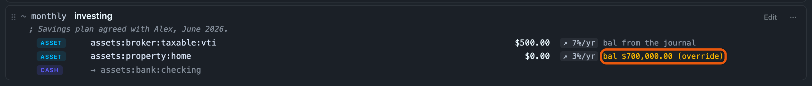

# Asset rows: a balance, a rate, and what you put into it

Every other posting in a scenario is a per-period *flow*. An asset row states a
*stock*: what you hold, what rate it compounds at, and what you add to it —
enough to model a brokerage account, a 401k or a house in one line.

```journal
~ monthly  investing
    assets:brokerage           $0  ; growth: 7%/yr
    assets:savings          $2000  ; growth: 4%/yr
    assets:house               $0  ; growth: 3%/yr, opening: 640000
    assets:checking
```

**A posting is an asset row when it carries a `growth:` tag AND its account is
typed as an asset.** Both halves matter. `growth:` alone is not enough —
`expenses:rent  $4200  ; growth: 2%/yr` is a growing flow, and it is in the
[file format example](file-format.md). An asset account alone is not enough either: **a posting with no
`growth:` is a flow line whatever its account**, so a transfer into
`assets:savings`, or a one-off purchase booked to `assets:cash`, means exactly
what it always did. The type is the one the journal *declares*
(`account assets:brokerage  ; type: A`), falling back to hledger's own name
inference — never a guess about the word "assets".

## Four rules, and the first is the one that surprises people

**1. The row never contributes its opening balance.** Your net worth already
contains it: the projection's opening figure is a real net-worth report over
your real journal, and your brokerage account is in there. An asset row adds its
**appreciation** and its **contributions** and nothing else. A row with a zero
rate and no contribution changes not one number on the page — which is the
correct behaviour and is exactly what the engine's own regression test asserts.

**2. Appreciation moves net worth and only net worth.** On an account held in
your own currency (a house, a private stake) each growth step is a posting from
the asset to the row's gains account, `equity:unrealized gains` unless you name
another with `gains:`. Equity is neither income nor cash, so paper gains do not
reach net income or the runway. Point `gains:` at an income account if you
want them counted as income. On an account holding **priced** commodities (a
brokerage of stocks or funds), the rate grows those commodities' **prices**
instead, starting from each one's latest price, and the holding is revalued.
Those prices exist only in memory: nothing is written to your journal or the
scenario file, so hledger values the holding at its last real price. If two
rows grow the same commodity at different rates, the first row's rate is used
and you are warned, because a price belongs to the commodity, not the account.
The one exception to "never cash": a growing row on an account that IS cash (a
savings account declared `type: C`) is interest in that account, and the
runway counts it. The consequence worth
stating out loud: **a growing asset cannot hide a burn.** The cash chart and the
runway date are exactly what they would be with the asset row deleted.

**3. A contribution is net-worth neutral, and it pays for itself.** `$2,000` a
month into a brokerage is a posting like any other, balanced against the row's
[counter-account](cash.md): cash −2,000, asset +2,000, net worth unchanged.
There is no separate "funding" setting and none is wanted. (If the destination
is itself a cash account — a savings account you have declared `type: C` — then
neither series moves, which is also right: the money did not leave your cash.)

**4. Growth applies to the balance at the START of each growth period, before
that period's contributions.** Some convention is needed and this is the
conservative one: a contribution dated on a step's anniversary does not earn
that step, it earns the next one. When the contribution and the growth share a
period — a yearly contribution on a yearly rate — this is exactly the textbook
`balance × (1 + rate) + contribution`.

> **The rule that will make your spreadsheet disagree with ours, stated
> plainly: a contribution earns nothing until the next growth boundary.**
>
> Growth is stepwise, so the *only* moments a balance changes are the
> anniversaries of the row's anchor. A contribution made at any other moment
> sits in the balance earning nothing until the next one arrives. With a
> **yearly** rate and monthly contributions, January's deposit and November's
> deposit both earn nothing that year, and both take the full bump on the same
> January — so a deposit can wait **up to a full year** before it earns
> anything.
>
> Nothing here is time-weighted, and that is deliberate rather than an
> approximation of something finer. The error runs **conservative** — it
> understates growth on contributions rather than inflating a retirement or
> runway figure — it is one rule rather than two, and it keeps a single balance
> per row, so the balance the list shows is exactly the figure the engine used.
>
> **If you want finer granularity, quote the rate per month rather than per
> year** (`0.5%/mo` rather than `6%/yr`). Twelve boundaries a year means a
> contribution waits at most a month. Note that the two are not the same rate:
> stepwise `0.5%/mo` compounds to about 6.17% a year.

Anniversaries are counted the same way a flow line's are: from the row's `from`
date when it has one, from the start of the projection otherwise, and clamped
into short months (a row anchored on the 31st steps on Feb 28). The balance is
rounded back to the row's own display precision at every step, for the same
reason a flow's amount is.

**One row per account, and the first one in the file owns it.** Each asset row
seeds its own running balance from the journal, so two rows naming the same
account would each start from the *whole* balance and each compound it — the
growth counted twice. Ledgeline does not let that happen. The first such row in
the file is projected; every later one is left out **entirely**, its growth and
its contribution together, and a warning above the chart names the account and
says so.

The same applies when one row's account sits **under** another's —
`assets:broker` and `assets:broker:roth` — because a row's balance is the account
*and everything under it*. The two rows share the roth's money, so the second one
is left out in the same way. Give each row an account that holds money no other
row's does.

This is why an asset rule's menu has no **Add a step change…**: a rate that
changes over time is a single rate covering the span, not one row split into
two dated segments naming one account.

## In the list and the editor

An asset rule's card shows each asset posting with its contribution, its growth
rate, and the balance it compounds: `bal $468,000.00 (journal)` for the
journal's own figure, or `bal $700,000.00 (override)`, in the warning colour,
for one you typed. A gains account other than the default is shown as
`gains → …`.



In the [editor](index.md#the-editor), each posting has an **asset** switch.
Turn it on and the posting gets two more fields:

| Field | What it is |
|---|---|
| **Balance** | empty, with the journal's own figure beside it, until you type over it |
| gains account | where the growth is booked; `equity:unrealized gains`, greyed, until you name another |

The posting's amount is the **contribution**: what you add each period. The
growth rate and its unit, and the rule's **Repeats**, **From** and **To**, are
the same fields a flow has. **+ Add → Asset** starts a new asset rule.

**A posting is an asset row because it says so.** The switch, written to the
file as the `growth:` tag on an asset account, decides it. A recurring transfer
to `assets:savings` with the switch off stays a flow. The two are different
things. One compounds, and the other moves a fixed amount each period.

**A contribution of `0` is the normal case**, not an unfinished row. It means
"this balance only compounds" — a house, a brokerage account you are not paying
into — and it is what the file writes as a `$0` posting.

**Growth here is unrealised.** It moves net worth and nothing else: not cash,
not net income, not your runway date. On the Balance sheet tab it is visible
as equity: the gains account's line for an unpriced asset, and the valuation
adjustment for priced holdings, whose grown prices revalue them.

## The opening tag restates the balance and says so

By default the row compounds the balance your journal actually shows for that
account **and everything under it** — `assets:broker` means the whole subtree,
valued into the same commodity the net-worth report uses. When you type over it,
the tag records what you said:

```journal
    assets:house   $0  ; growth: 3%/yr, opening: 640000
```

Only the **difference** between your figure and the journal's reaches the chart,
applied once in the first period, and the projection **warns** about it by name.
Nothing silently restates your balance sheet. Cash is never adjusted: an
override says what an asset is worth, not what is in the bank, so a house
valuation can never move your runway.

An overridden balance is not a quiet edit either. In the editor the Balance box
turns the warning colour, and **✕ use the journal's** beside it names the
ledger's own figure and puts it back (as does clearing the box). On the card the
balance reads "(override)", in the warning colour. A valuation you typed six
months ago should never be mistakable for what your ledger says today.

The journal's figure shown is the one the projection actually used, so it
appears once a projection has run. Until then the card says "bal from the
journal" and the editor's Balance box shows a dash. You also get these for a
row the engine declined to model. It is never a zero standing in for an
unknown.

## What hledger makes of an asset row

Everything, except the growth. Verified against hledger 1.52:

```console
$ hledger -f projection-investing.journal balance --budget -M --layout=bare
                || Commodity       Jan       Feb
================++===============================
 assets:savings || $          0 [2000]  0 [2000]
 expenses:rent  || $          0 [4200]  0 [4200]
```

`assets:brokerage` is **absent**, and that is the honest answer rather than a
gap: its contribution is `$0`, and a growth rate is not a goal — hledger has no
way to express one. `assets:savings` shows its contribution and only its
contribution. `print --forecast` round-trips the `$0` posting with its tags
intact, and `tag:growth` matches all of them.

The `$0` is deliberate and is not a trick. A posting needs an amount, the
contribution *is* the amount, and zero is what "no contribution" is worth.

## What is NOT modelled, on purpose

- **Liabilities.** An asset row's shape would extend to them, but a mortgage
  needs principal-versus-interest, which the journal cannot supply. A row whose
  account is not an asset is **warned about** rather than modelled.
- **Per-holding or per-lot growth.** A row is one account, not a portfolio, and
  one rate covers the subtree.
- **Tax on gains, and rebalancing.**
- **Inferring a rate from price history**, which would make a projection quietly
  depend on whether `P` directives happen to exist.
- **Liability amortisation.** A mortgage payment cannot be split into principal
  and interest from anything the journal says, and guessing the split would
  silently invent a net-worth curve.
- **Retirement modelling**, per-account balance projection, and any
  distribution over outcomes (Monte Carlo and friends).

The engine tells you when it could not do something: a period it cannot
enumerate, a growth rate that overflows, a commodity no price converts into
the one your opening balances are valued in. A projection that quietly drops a line is worse than one that
says so, so every one of those appears in the warnings above the charts.
