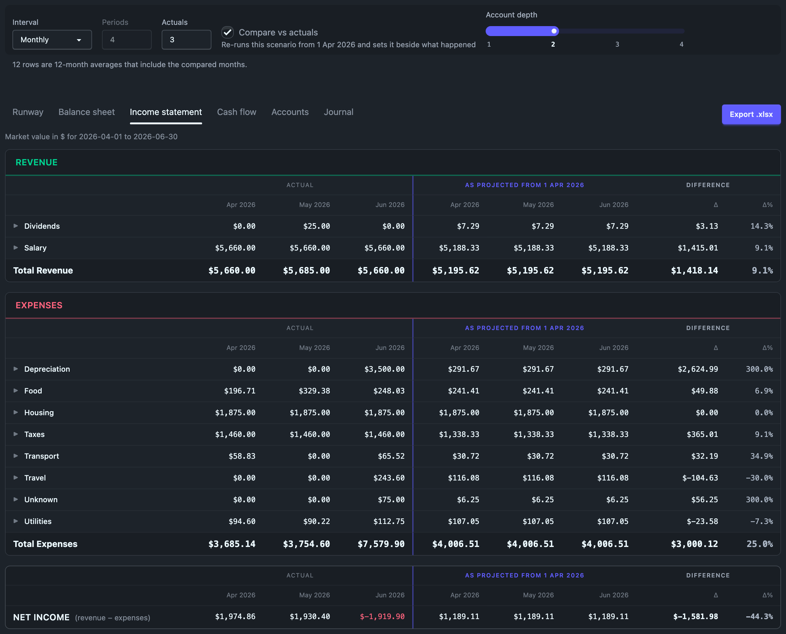
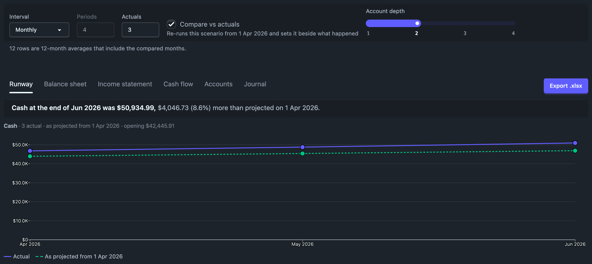

# Comparing with actuals

A projection is a model. **Compare vs actuals** shows how well the model would
have done over periods that have already happened, and where the two differ.
Use it to improve the model: a rule set too low, a growth rate that did not
hold, a cost you never wrote down.



## What the checkbox does

**Compare vs actuals** sits after **Actuals** in the controls bar. When it is
ticked, no reading projects forward. Every reading shows the Actuals periods
twice:

1. as they happened, exactly as the Reports tab shows them;
2. as the scenario on screen would have projected them, if you had run the
   projection on the first day of those periods;

then two columns, **Δ** and **Δ%**, with the difference over the whole window.

The projection is anchored once. It starts from your real balances on the
first actual day, which this page calls **F**, and runs forward over all the
Actuals periods with the scenario as it is on screen, unsaved edits included. It
is not re-anchored each period, so a difference in the first month carries
into the balances of the later ones. That is how a forecast made on F would
actually have behaved.

The box applies to every reading at once, because the window, the anchor and
the run are shared. It needs at least one actual period: at **Actuals** 0 it is
greyed out with "Set Actuals to 1 or more to compare". It stays ticked in the
URL (`compare=1`), so raising Actuals again brings the comparison back.
**Periods** is dimmed while comparing, because nothing is projected past
today.

## The scenario runs exactly as written

The comparison tests the scenario you have, so it never adjusts it to suit the
window. It does not re-seed averages, re-infer anything the file states, or
skip entries that look like hindsight. Each entry behaves as its dates say:

- a rule whose `from` is before F fires on its own schedule, and the
  occurrences inside the window count. One whose `from` is inside the window
  starts then. One that starts after the window, or ends before F, never fires.
- a rule with no `from` (`~ every 2 weeks`) is phased from F, the way
  `hledger --forecast` phases it from the start of the forecast. Its dates can
  therefore differ from the forward run's.
- a dated one-off or event inside the window fires, even though the forward
  run, which starts later, never shows it. Events before F or after the window
  never fire.
- a step change (a `to D` / `from D` pair) uses whichever segment covers each
  date.
- turned-off entries are left out, and `=` automatic postings apply to the
  generated transactions only, as in the forward run.
- `growth:` on a flow or an unpriced asset row is anchored at the row's `from`,
  or at F when it has none, just as a projection made on F would anchor it.
- `growth:` on a priced holding grows the price from the last real `P`
  directive **before F**.

A line with no counter-account takes the default the editor shows greyed now,
the same one a save would write. It does not use a default re-inferred at F.
So the comparison tests what you would save.

### Opening overrides are ignored

An asset row's `opening:` tag says what the account holds **today**. It
corrects the starting point; it is not a rule about what happens over time.
The comparison's starting point is the real balances on F, so it starts every
account from the journal's balance on F and ignores the override. The row's
contribution, growth and gains account still run as written. Nothing in your
file changes, and the forward run, the editor and the file all keep the
override. A priced holding with an override grows through its price while
comparing, because nothing restates its balance.

## Valuation: the prices you would have had

Both blocks are valued at market in the same commodity the statements use,
each column at its own end:

- the **actual** columns at the real `P` directives up to that column's end,
  exactly as on the Reports tab;
- the **as projected** columns at the real `P` directives dated before F, plus
  the prices a `growth:` rate grows from them.

So a stock that rose faster or slower than its `growth:` rate shows up as a
difference on the balance sheet. The **Accounts** reading is not valued, so it
shows quantities only: a difference there is a difference in what was held or
moved, never in price.

## Reading Δ and Δ%

For each row, Ledgeline first reads one figure per block, the way the row
reads:

- flows (the income statement, the cash flow statement's activities, and the
  Accounts reading's equity, revenue and expense rows) use the **sum** of the
  block;
- balances (the balance sheet, ending cash, and the Accounts reading's asset
  and liability rows) use the block's **last** period;
- beginning cash uses the block's **first** period. Both blocks start from the
  same real cash, so its Δ is always 0.

Then:

- **Δ = actual − projected**, per commodity, exactly.
- **Δ% = Δ ÷ |projected| × 100**, to one decimal place.

A positive Δ means reality came in above the projection, in the row's own
displayed sign. On the income statement, a revenue row with Δ > 0 earned more
than projected; a cost row with Δ > 0 spent more than projected; Net income
with Δ > 0 came in above the projection. Coming in above the projection is as
worth reading as coming in below it, so the cells are not coloured either way.

The Accounts reading shows amounts as written, revenue negative. So there,
earning **more** than projected reads Δ < 0: actual −$12,500 against projected
−$12,000 is Δ −$500, −4.2%.

The percentage is taken over the projection's size, ignoring its sign, so the
sign of Δ% always matches Δ. A projected loss of $100 that turned into a gain of
$50 reads Δ +$150, **+150.0%**.

**Δ%** is a dash (**—**) when:

- nothing was projected, or the projected figure rounds to zero at the
  commodity's display precision (`$0.004` reads `$0.00`);
- either figure holds a commodity the statements could not value into the
  base, such as a holding with no `P` directive. A percentage of the part that
  converted would mislead;
- the journal has no base commodity.

A percentage of 1000% or more is shown as **>999%** (or **<-999%**). Hover
over it for the exact figure; the workbook holds the exact figure too.

### Worked example

The window is Jul–Sep 2026 and the projection is made on 1 Jul 2026.

| Line | Actual (Jul + Aug + Sep) | As projected | Δ | Δ% |
|---|---|---|---|---|
| Salary | 36,500.00 | 36,000.00 | 500.00 | 1.4% |
| Food | 3,003.25 | 2,700.00 | 303.25 | 11.2% |
| Insurance | 1,200.00 | 0.00 | 1,200.00 | — |
| Net income | 18,046.75 | 19,500.00 | −1,453.25 | −7.5% |

Salary came in $500 above the projection and food $303.25 above it. Insurance
was never projected, so it has no percentage. Net income came in below the
projection by $1,453.25.

## The readings

- **Runway** draws two lines over the actual periods, **Actual** and **As
  projected from 1 Jul 2026** (dashed), with a legend. The sentence above them
  reads, for example, "Cash at the end of Sep 2026 was $31,850, $1,850 (5.5%)
  less than projected on 1 Jul 2026."
- **Balance sheet**, **Income statement**, **Cash flow** and **Accounts** show
  the two blocks under the headings **Actual**, **As projected from …** and
  **Difference**. The Total column is replaced by Δ and Δ%. The balance
  sheet's per-column ✓ still checks every column; its tie-out row has no Δ.
- **Journal** lists the transactions the scenario would have generated, under
  "Generated as if projected on 1 Jul 2026". It does not match them against
  your real transactions.



**Export .xlsx** downloads the comparison: the actual columns, the same
columns marked **(as projected)**, then **Δ** as money and **Δ %** as a number
formatted as a percentage. The filename has `-compare` in it.

## Notes and warnings

While comparing, a grey note under the controls counts the rows that are
still the seed's 12-month averages, for example "12 rows are 12-month averages
that include the compared months." That is a fact about how those rows were
made, not a problem: those averages were computed from history that includes
the periods being compared, so they had a head start a projection really made
on F would not have had. The comparison still runs every row exactly as
written; edit or replace those rows if you want a test without that head start.

The page's warnings box adds lines that start with "Comparison:":

- **A different valuation commodity.** If your base commodity first appears
  inside the window, the projection made on F would have valued in another
  one. The as-projected columns are shown in the actual columns' commodity,
  and the warning says so.
- Anything the projection made on F could not model, as the forward run
  reports it.

## Checking it with hledger

The as-projected block is the forward command with F in place of the cutoff
and the forward run's cutoff, C, as the end. For a monthly comparison of Aug–Sep
2026 (F = 2026-08-01, C = 2026-10-01):

```console
$ hledger -f main.journal -f projection-x.journal bs --forecast=2026-08-01..2026-10-01 --auto \
    -M -b 2026-08-01 -e 2026-10-01 expr:"NOT (date:2026-08-01.. AND NOT tag:generated)"
```

Use `is`, `cf`, `balance` or `print … tag:generated` for the other readings, as
[What moves cash](cash.md#where-the-projection-starts) describes for the
forward run. The actual block is the Reports tab's own command over the same
range:

```console
$ hledger -f main.journal bs -M -b 2026-08-01 -e 2026-10-01 --value=end,$
```

### One caveat about prices

hledger cannot leave `P` directives out by date. With `--value=end,$`, a real
`P` dated inside the window values hledger's projected columns at that real
price, which the comparison does not use. So:

- unvalued readings (`balance`, `print`, or anything with `-B`) always agree;
- valued readings agree when no real `P` is dated on or after F. Otherwise they
  agree against a copy of your journal with those `P` lines removed, which is
  the journal as it stood on F.

For a single-file journal, this makes that copy:

```console
$ grep -vE '^P (2026-(0[89]|1[0-2])|202[7-9])' main.journal > main-as-of-F.journal
$ hledger -f main-as-of-F.journal -f projection-x.journal bs --forecast=2026-08-01..2026-10-01 --auto \
    -M -b 2026-08-01 -e 2026-10-01 expr:"NOT (date:2026-08-01.. AND NOT tag:generated)" --value=end,$
```

Adjust the pattern so it matches every date on or after F.

As in the forward run, growth is the other difference: hledger shows `growth:`
amounts at their base and values a grown holding at its last real price, so
both read flat in hledger.
