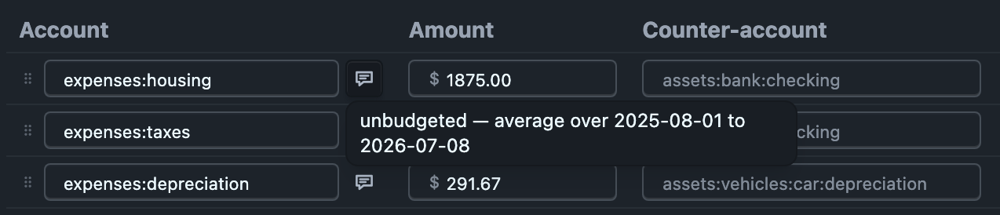

# The scenario file format

This is the whole of it:

```journal
; Ledgeline projection
; projection: Series A with a hiring ramp
; created: 2026-09-18
; updated: 2026-09-20
; cash: assets:checking

account equity:unrealized gains  ; type: E

; Every rule ends with its COUNTER-ACCOUNT, written with no amount: where the
; money lands or comes from. hledger fills the amount in, so each rule is an
; ordinary balanced transaction.
~ monthly  projection
    revenues:salary      $-12000  ; growth: 3%/yr
    revenues:consulting   $-2500
    expenses:rent          $4200  ; growth: 2%/yr
    expenses:software       $900
    assets:checking

; A STEP: payroll jumps in April and grows from the new base. Two bounded rules
; for one account, linked by the `line:` tag so the editor shows one row.
~ monthly to 2027-04-01  projection
    expenses:payroll      $50000  ; line: payroll
    assets:checking

~ monthly from 2027-04-01  projection
    expenses:payroll     $120000  ; line: payroll, growth: 5%/yr
    assets:checking

; A ONE-OFF on the balance sheet: cash and equity, no net-income effect.
~ 2027-03-01  Series A
    assets:checking     $2000000
    equity:preferred

; A ONE-OFF on the P&L, accrued: no cash moves until it is paid.
~ 2027-06-15  legal fees
    expenses:legal        $45000
    liabilities:payable

; ASSET ROWS: a balance, a rate, and what you put into it. The amount is the
; CONTRIBUTION — `$0` when the balance just compounds — and `growth:` is what
; marks the row as a stock rather than a flow. Appreciation is booked to the
; row's gains account.
~ monthly  investing
    assets:house              $0  ; growth: 4%/yr, gains: equity:unrealized gains
    assets:savings         $2000  ; growth: 4%/yr
    assets:checking
```

Every line of it is hledger's own syntax. Nothing here is a Ledgeline format.

Files written before counter-accounts existed use unbalanced virtual postings,
`(expenses:rent) $4200`, with no counter-account. They still load and project
the same numbers, and Ledgeline writes the counter-account it used the next
time you save. [What moves cash](cash.md) explains how it picks one.

## The tag vocabulary

One header tag names the scenario, one names its default cash account, and the
rest go on postings.

| tag | where | means |
|---|---|---|
| `projection: <name>` | a comment at the top of the file | the scenario's display name |
| `cash: <account>` | a comment at the top of the file | the counter-account for a line your history says nothing about |
| `growth: <rate>/<unit>` | a posting comment | the amount grows by `rate` per completed `unit`; on an asset-typed account it ALSO marks the row as a balance |
| `line: <id>` | a posting comment | two bounded rules are two segments of ONE row; written only for a step change |
| `opening: <number>` | an asset row's posting comment | override the journal's balance for that account |
| `gains: <account>` | an asset row's posting comment | where appreciation is booked; `equity:unrealized gains` when absent |

**The gains account is a real, declared account.** If your main journal does
not declare it, Ledgeline declares it in the scenario file
(`account equity:unrealized gains  ; type: E`), so hledger and Ledgeline
classify it the same way and your main journal is not touched.

**`; projection: <name>` is the display name and the only marker.** A file
without it still loads — any journal with budget-like entries can be used as a
projection — and takes its name from its filename. `; created:` and
`; updated:` are the dates Ledgeline stamps when it writes the file; you can
delete them and nothing breaks.

**`growth:` reads `3%/yr`, `2.5%/mo`, `-1%/wk` and `0.03/year`.** The percent
sign is optional and the unit spelling is generous, because this is a tag a
human types into a journal by hand. Anything it cannot read makes the line
**flat** — never a failed file.

**`opening:` is the only tag that is not optional decoration.** It belongs to an
asset row and nothing else, it carries a bare number in the row's own commodity
(hledger ends a tag's value at a comma, so `$200,000` would read back as `$200`),
and [Asset rows](asset-rows.md#the-opening-tag-restates-the-balance-and-says-so) says exactly
what the engine does with it.

**`line:` is what makes a step change one row.** A step is a permanent change to
a recurring line: payroll jumps from `$50k/mo` to `$120k/mo` in April and stays
there, growing from the new base. That is two bounded `~` rules for the same
account, and the shared `line:` tag is what tells the editor to show them as one
row with a "from" on it rather than two unrelated lines. Without the tag they
are still two perfectly good rules; they just appear separately.

**Ledgeline writes `line:` only for a step change.** A row with one segment
needs no tag, so a save writes none, and drops the `line: gap:…` tags older
versions put on every seeded row. A step gets a short id made from its account's
leaf (`expenses:payroll` becomes `payroll`, and a second one `payroll-2`), or
keeps the id you wrote yourself. An id Ledgeline writes never contains a colon.
Untagged rows get positional ids when the file loads, and a written id can never
look like one of those, so reordering the rules can't join two unrelated rows.

## Descriptions and order

**A rule's description is the text after its period**, separated by two spaces:
`~ monthly  unbudgeted — average over 2025-11-01 to 2026-10-22`. In the table it
is the speech-bubble icon beside each row's account. Hover over or focus the
icon to read the description, and click it to edit. Enter saves and Escape
cancels. A description is one line and can't contain `;` or `#`, because hledger
would read the rest of the line as a comment.



The description belongs to the **rule**, not to the row. When several rows are
postings of one rule, such as a budget rule listing rent and utilities, they
share one header, and editing it from any of those rows changes it for all of
them. The tooltip says when this applies.

A seeded row's description says what the estimate was averaged over. If you
change that row's amount, the icon gets a small dot and the tooltip says the
description may be out of date. Ledgeline never rewrites a description itself.

**The table's order is the file's order.** Move up and Move down in a row's
menu, or dragging a row by its handle, reorder the rules in the file and the
postings within a rule. Comments and transactions between rules stay where they
were. A row that shares its rule with other rows moves with that rule, because
the file can't put another rule between two postings of one rule. A step
change's segments always move together.

## Growth is stepwise, not smoothly compounded

A line marked `+3%/yr` holds flat for twelve months and then bumps 3%. That is
how a rent increase or a salary review actually lands. The stepped figure is a
real number you could have typed, so it is rounded back to the amount's own
display precision **at every step** — which is why a `$1,875.00` line is written
with its cents even when the figure is round.

Growth anniversaries are counted from the line's `from` date when it has one,
and from the start of the projection otherwise. That is what makes the second
segment of a step change grow from its **new** base.

## When a rule fires

On the days `hledger --forecast` fires it, from the first projected day:

- A rule with a `from` keeps its own rhythm: `~ monthly from 2027-01-15` fires
  on the 15th of every month.
- A rule with **no** `from` starts on the first projected day. `~ weekly` fires
  on that day's weekday, not on Mondays, and `~ yearly` on that day's
  anniversary, not on January 1st. A monthly, quarterly or yearly projection
  starts on the 1st of a month, so `~ monthly` lands on the 1st. A weekly
  projection starts on a Monday, so there `~ monthly` lands on that Monday's
  day of the month.
- `to` is exclusive: `~ monthly to 2027-04-01` last fires in March.
- `every 15th day of month` and `every tuesday` fire on that day.
- `every weekday`, `every mon,wed,fri` and `every 1st Apr` fire on those
  days. `monthly in 2027q1` and `monthly 2027-01..2027-04` are bounded. The
  full list of forms is in [Budget](../budget.md).
- A dated rule, `~ 2027-03-01` or `~ 2027q2`, fires once.

`hledger balance --budget` places a bare `~ weekly` goal on Mondays instead.
The Budget tab follows that report, and the Projections tab follows
`--forecast`.

## Amounts follow your main journal's commodity styles

A projection file reads its amounts under the main journal's `commodity`
directives, as though it were `include`d. With `commodity $1,000.00` in the
main journal, a hand-typed `$11,344` in a projection file is eleven thousand
dollars. A `commodity` or `decimal-mark` directive in the projection file
itself takes precedence.

hledger does not lend a `commodity` directive across sibling files, so
`hledger -f main.journal -f projection.journal` would read that same
`$11,344` as `$11.344`. When you save, Ledgeline therefore adds the main
journal's directive to the projection file (`commodity $1,000.00`) for each
commodity the file uses but doesn't declare. After that, hledger reads the
file the same way however it's opened.

## Automatic postings (`=` rules)

A projection file can hold hledger's auto-posting rules, so a cost can follow a
revenue or a wage line as a percentage:

```journal
= revenue:sales tag:_generated-transaction
    expenses:people-costs:sales-commission  *-0.03
    assets:mercury:checking

= expenses:people-costs:wages-salaries tag:_generated-transaction
    expenses:people-costs:payroll-tax  *0.1
    assets:mercury:checking
```

Wherever a rule's query matches a posting of a projected transaction, its
postings are added right below that posting. `*0.1` is 10% of the matched
amount, and the posting with no amount balances the others. Ledgeline applies
a projection file's rules to every projected transaction, always, whatever your
`hledger.conf` says about `--auto`. It never applies them to recorded
transactions.

- **`tag:_generated-transaction`** in the query is what tells *hledger* to do
  the same. Without it, `hledger --auto` would also apply the rule to your
  recorded transactions. Ledgeline still keeps the rule to the projection, and
  its warnings say so.
- **A rule on an account also fires for that account's children.**
  `expenses:people-costs:wages-salaries` matches `…:wages-salaries:george`, and
  each child posting gets its own 10%. hledger's queries match anywhere in the
  name, so it also matches a sibling such as `…:wages-salaries2`. To keep to
  the subtree, write `^expenses:people-costs:wages-salaries(:|$)`.
- **If one projected transaction has several matching postings** (two people
  in the same `~` rule), the amountless posting is added once per match.
  Ledgeline balances each one, but `hledger --auto` refuses the file. Write
  that posting with the opposite multiplier, `assets:mercury:checking  *-0.1`,
  and hledger reads it the same way. Putting each person in a `~` rule of
  their own works too. The Projections page warns when this applies.
- A bare number, such as `2`, is written with no commodity, as hledger 1.52
  writes it.
- Queries Ledgeline does not evaluate yet (`expr:`, `type:`, `date2:`) keep the
  rule in the file but it never fires, and the page says why.

The Projections page lists the rules read-only under **Automatic postings**. To
change one, edit the file. Its generated postings are marked **auto** in the
Journal tab. Saving keeps every rule byte for byte, and Save As copies them to
the new file.

To check a projection with hledger, add `--auto` to the commands below.

## What hledger does, and does not, do with this

`hledger` reads these files. Both of these work:

```console
$ hledger -f projection-series-a.journal balance --budget -M
$ hledger -f projection-series-a.journal print --forecast=2026-10-01..2029-10-01
```

**What hledger will not do is apply `growth:`**, and it never sees the future
prices Ledgeline uses to grow a stock holding (see [Asset rows](asset-rows.md)).
Both are shown flat by hledger. hledger has no arithmetic in
amounts — `$1200 * 1.03` is a parse error — so a journal file cannot state a
growing amount. `growth:` is a comment to hledger, and a `balance --budget`
report over a projection file shows the **base** amount in every period, in year
five exactly as in year one. Only Ledgeline expands it.

That was a deliberate trade. The alternative is writing the file out expanded,
one bounded rule per growth step, which plain hledger would read correctly and
which no human could then edit. The compact form won, and this paragraph is the
price of it. (Nothing is lost permanently: the tag is already there, so an
expanded export is possible later without a format change.)

> **Never round-trip a scenario through `hledger print`.** It drops `~` rules
> entirely, so the file would come back with every scenario line gone and
> nothing to say it had happened. Ledgeline writes these files itself.

## Reading a projection file by hand

Everything the tab shows, you can get from `hledger` — minus growth.

```console
# The goals, as written, month by month.
$ hledger -f projection-series-a.journal balance --budget -M -b 2027-01-01 -e 2027-04-01

# The same rules read as future transactions.
$ hledger -f projection-series-a.journal register --forecast=2027-01-01..2028-01-01

# Both files at once — what you plan, beside what you did.
$ hledger -f main.journal -f projection-series-a.journal balance --budget -M

# Every asset row in a file, by the tag that marks one.
$ hledger -f projection-series-a.journal print --forecast=2027-01-01..2027-02-01 tag:growth

# The balance sheet the tab projects, from a cutoff of 2026-10-01: actuals before
# it, forecast from it, and no real transaction after it counted twice.
$ hledger -f main.journal -f projection-series-a.journal bs \
    --forecast=2026-10-01..2027-10-01 -M -b 2026-08-01 -e 2027-10-01 \
    expr:"NOT (date:2026-10-01.. AND NOT tag:generated)"

# The same window as an income statement, other commodities valued as the tab
# values them.
$ hledger -f main.journal -f projection-series-a.journal is \
    --forecast=2026-10-01..2027-10-01 -M -b 2026-08-01 -e 2027-10-01 \
    expr:"NOT (date:2026-10-01.. AND NOT tag:generated)" --value=end,$
```

These agree with the tab account by account and period by period, except where
`growth:` applies. [What moves cash](cash.md#where-the-projection-starts) explains
each part of the command.
