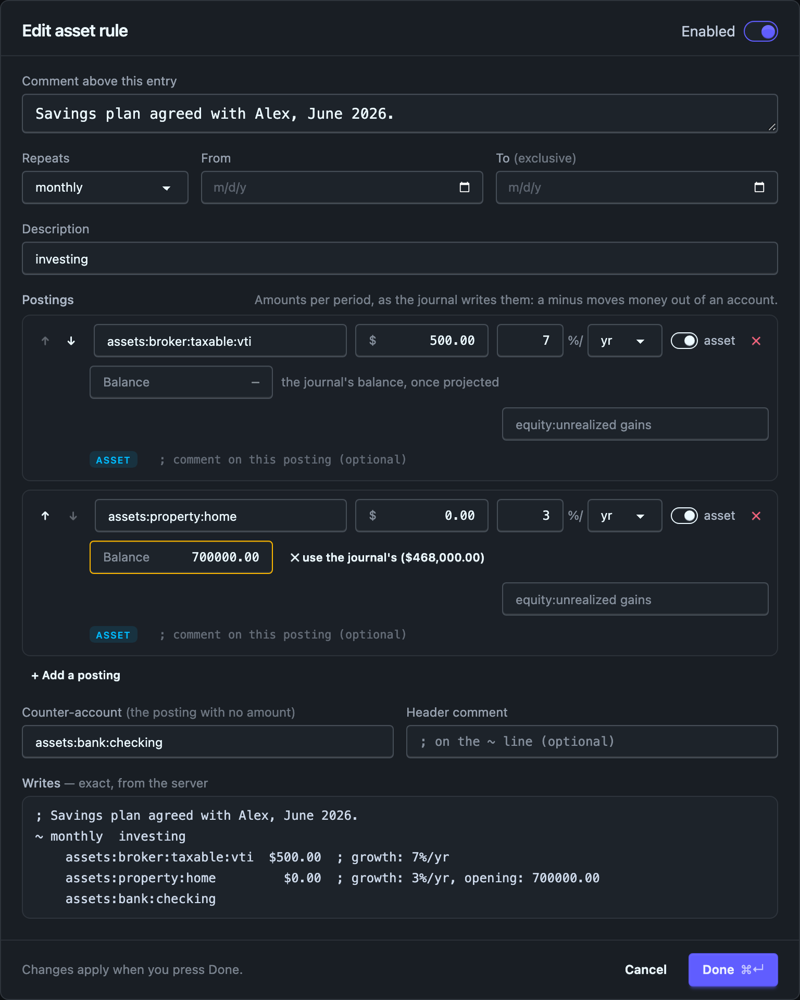

# Projections

The Projections tab asks one question — _if things carry on like this, when does
the cash run out?_ — and lets you argue with the answer. The top half is the
scenario, a list of what you expect, seeded from your budget plus whatever your
budget does not cover. The bottom half is that list read forward in time: the runway, and
the same balance sheet, income statement and cash flow statement the Reports
tab shows, run forward. Press <kbd>g</kbd> <kbd>p</kbd> to get here from
anywhere, and <kbd>1</kbd> to <kbd>6</kbd> to switch between those readings
(see [Keyboard shortcuts](../journal/keyboard.md)).

A scenario is **an ordinary hledger journal file that nothing includes**, so it
can be edited in your own editor, diffed, committed, and read by `hledger`
itself. Playing with a what-if can never damage a plan of record.

This section has four pages:

- this one: the scenario list, the editor, where scenario files live and how saving works;
- [The scenario file format](file-format.md): the `~` rules, the tag vocabulary, growth, and reading a scenario with hledger;
- [What moves cash](cash.md): counter-accounts, the defaults Ledgeline picks, and where a projection starts;
- [Asset rows](asset-rows.md): balances that compound, contributions, and `opening:` overrides.

Design notes and the reasoning behind each decision live in
[`plans/22-projections.md`](https://github.com/zmre/ledgeline/blob/main/plans/22-projections.md).

## The scenario list

The list is the scenario file, top to bottom, in the file's order. Each entry is
one piece of the file, shown the way the file writes it:

- a **rule** (`~ monthly`, `~ yearly from 2027-01-01`) with its postings, their
  amounts, any growth rate, and the counter-account last, after a `→`;
- a **one-off** (`~ 2027-04-15`), badged `one-off`;
- an **automatic posting** (`=`), read as a sentence ("When income:salary is
  projected") and badged `auto`. **rule text** under it shows the rule as the
  file has it;
- a **section heading** or a **note**: comments that stand on their own;
- **file text**: anything else the file holds, such as `account` directives.
  It is read-only here and never moves. Edit it in the file.

A comment directly above a rule is shown on that rule's card, in italics, and
belongs to it. [Comments and section headings](file-format.md#comments-and-section-headings)
has the rules.

**Every posting is badged by its account's type**: income, expense, asset,
cash, liability, equity, gain or conversion. The counter-account line is
badged too. The types are your journal's `account` declarations, with the
scenario file's own declarations on top. An account with no type gets a `?`
badge; hover over it to see how to declare one.

**Amounts are signed as the file writes them.** Income reads `−$5,660.00`,
because hledger writes revenue negative. A minus means money moves out of that
account. It is not a warning, so it is not red.

**A rule with no `→` line balances on its own.** Its postings sum to zero, as
a transfer from checking to savings does, so nothing goes to a counter-account.
A rule that doesn't balance shows its counter-account. Ledgeline's default is
shown greyed with "(default)" after it. [What moves cash](cash.md) explains how
Ledgeline picks one.

A turned-off entry is dimmed, its first line struck through, and badged `off`.
A step change is two cards, each with a `step 1 of 2` chip. The chip jumps to
the other step, and hovering one card outlines the other.

### Filters

The chips above the list count the entries of each kind in the file. There is
one chip per account type present, then One-off, Auto, Off and Notes. A chip with
nothing under it is hidden. Choosing one shows only the matching entries.
Section headings stay, so you can still see where you are. An entry matches a
type when any of its postings has that type, the counter-account included, so a
deferred-revenue rule is under both Income and Liability. The chip you choose is
kept in the address bar (`?show=liability`).

While a filter is on, entries can't be moved, because moving an entry past ones
you can't see would be a guess. Choose **All** to reorder.

### Changing the list

Each card has an **Edit** button and a `⋯` menu with Edit, Duplicate,
Duplicate as alternative, Turn off (or Turn on), Add a step change…, Merge with
the other step, Move up, Move down and Delete. Double-clicking a card opens it
too. Drag a card by its grip (`⠿`) to move it anywhere in the file.

**+ Add** adds a recurring flow, an asset, a one-off, an automatic posting, a
note or a section heading. The new entry goes below the selected entry, or at
the end of the list.

- **Duplicate** opens the editor on a copy, placed directly below the original.
- **Duplicate as alternative** does the same and turns the original off when
  you press Done. [Duplicate as alternative](file-format.md#duplicate-as-alternative)
  shows what that is for.
- **Turn off** comments the entry out in the file, so neither Ledgeline nor
  hledger uses it. **Turn on** puts it back exactly as it was.
- **Add a step change…** asks for a date and splits the rule there. The rule
  as it is runs up to that date. The new step starts on it and opens in the
  editor, so you can change its amount. An asset rule has no step change.

### The editor

The editor is a dialog over one entry. It edits a draft. Nothing in the list or
the readings below changes until you press **Done** (or <kbd>⌘</kbd> <kbd>Enter</kbd>),
and then the whole change is one edit and one new projection. **Cancel**,
<kbd>Escape</kbd> or a click outside the dialog throws the draft away. Cancel on
a duplicate leaves no copy, and Cancel on Duplicate as alternative leaves the
original turned on.

For a rule, the editor has:

- **Enabled**, the same switch as Turn off;
- **Comment above this entry**, the comment that sits above the rule in the
  file and moves with it. Type it without `;` prefixes;
- **Repeats**, **From** and **To** (exclusive). A period these controls can't
  state is shown as hledger text, which you can edit;
- **Description**, the text after the period;
- the **postings**: account, amount, growth rate, and the **asset** switch. An
  asset posting also has **Balance** and a gains account ([Asset
  rows](asset-rows.md)). Each posting has an optional comment, and ↑ and ↓
  reorder them;
- **Counter-account**, the rule's posting with no amount;
- **Header comment**, a comment on the `~` line.

Type amounts as the file writes them, with a minus for money out of an account:
`-5660` on `income:salary`, `1150` on `expenses:taxes:federal`. Changing an
account never changes its amount's sign. When the postings balance, the
Counter-account box says "None needed", and none is written unless you type
one.

A one-off has a date, a description, postings and a counter-account. An
automatic posting has the rule form described in [Automatic
postings](file-format.md#editing-rules-on-the-projections-page). A note or
section heading is a text box, with a switch between the two.

**Writes** shows the exact text a save puts in the file for this entry. Until
you change something, it is the entry's text from the file. After a change, the
engine renders the draft with the same code a save uses, so the box and the
saved file can't disagree. If the engine refuses the draft, the box says why in
red and Done stays disabled until you fix it.

### Keys

With focus outside any text box, these keys work on the list (<kbd>?</kbd>
lists them all):

| Keys | Action |
|---|---|
| <kbd>j</kbd> / <kbd>↓</kbd>, <kbd>k</kbd> / <kbd>↑</kbd> | next or previous entry |
| <kbd>g</kbd> <kbd>g</kbd> / <kbd>G</kbd> | first or last entry |
| <kbd>Enter</kbd> or <kbd>e</kbd> | edit the entry (expand it, for file text) |
| <kbd>J</kbd> / <kbd>K</kbd> | move the entry down or up |
| <kbd>c</kbd> | duplicate |
| <kbd>C</kbd> | duplicate as alternative |
| <kbd>t</kbd> | turn off or on |
| <kbd>x</kbd> then <kbd>x</kbd> | delete (the first press asks) |
| <kbd>n</kbd> | open the **+ Add** menu |
| <kbd>Escape</kbd> | cancel a delete, or clear the selection |

## The six readings

| Tab | What it shows |
|---|---|
| **Runway** | when your cash runs out, in a sentence, above a chart of your cash balance. Cash accounts only; investments are not runway. |
| **Balance sheet** | the Reports tab's balance sheet at the end of every period, side by side |
| **Income statement** | the Reports tab's income statement, one column per period plus a Total |
| **Cash flow** | the Reports tab's statement of cash flows over the same periods |
| **Accounts** | every account, one row each, one column per period: balances for assets and liabilities, what moved for the rest |
| **Journal** | the transactions the scenario generates, in date order, one block per transaction |

The statements are computed by the same code as on the Reports tab, with the
same groups, sections, valuation and balance check, over your real
transactions up to the projection's start and the scenario's projected
transactions after it. They begin with a few **actual** periods, so you can see
where the forecast starts from: the **Actuals** control sets how many (two by
default; `0` shows the forecast alone). A rule and the word **Projected** mark
the first projected column. The projection starts at the first period that is
not yet complete; [What moves cash](cash.md#where-the-projection-starts) says
exactly where.

**Interval** and **Periods** set the columns for every reading. The depth
slider rolls up the income statement's and cash flow statement's lines and the
Accounts rows.

**Export .xlsx**, beside the tabs, downloads the reading you're looking at as an
Excel workbook. In the statements and Accounts, every projected column's heading
says **(projected)**, so the file can't pass a forecast off as an actual. The
Runway workbook starts from the real opening balance. The Journal downloads in
the same accountant-ready layout as the Journal tab's own export, holding exactly
the transactions your search lists.

### Accounts

The plain ledger the statements are built from, over the same columns, with
the same Actual and Projected marking. Accounts are grouped by type, and each
group reads the way that kind of account is read:

| Section | Each period's column | The last column |
| --- | --- | --- |
| Assets, Liabilities | the **balance** at the end of the period, everything before it included | **Δ**: how much the balance changed from the start of the first period to the end of the last, every figure marked "Δ" |
| Equity, Revenue, Expenses | what **moved** in the period | **Total**: the sum of the periods |

Each section has a total row. There's no grand total, because adding balances
to movements means nothing. Every account is a row in a tree, cut off at the
depth slider. Amounts are shown as written, one line per commodity, and are not
valued into one currency. Signs are hledger's: revenue and liabilities read
negative. A short note above the table says all this on the page.

**Show empty accounts** adds the accounts nothing touches in these periods:
every account the journal declares or has ever posted to, and every account the
scenario books to. They show as zero rows, which is how to see what the
projection leaves out. This is `-E --declared`, plus any undeclared account
your journal used outside these periods, which hledger leaves out.

The **Accounts** dropdown narrows the table to the accounts you tick, and the
arrow on a parent row folds its accounts away, as on the [Accounts tab on
Reports](../reports/accounts.md#controls).

The same report, over your recorded transactions only, is the
[Accounts tab on Reports](../reports/accounts.md).

[What moves cash](cash.md#where-the-projection-starts) gives the exact hledger
commands for both readings and for the Journal, and the three ways they differ.

### Journal

Only the generated transactions, never your real ones. This is
`hledger print --forecast=<cutoff>..<end> tag:generated`, in hledger's order:
by date, then by where each rule sits in the file. Each transaction shows
its date, its description (the rule's note, or `projection`), and a badge for
what produced it: the rule's period (`~ monthly`), `event` for a dated event,
or `growth` for an asset row's appreciation. Every posting follows on its own
line with its account and amount. The list is read-only and shows 100
transactions per page. Over a very long horizon it stops at the first 5,000 and
says so.

The Accounts and Journal readings are computed only while their tab is open.
Switching to one runs the projection again.

The depth slider also sets how finely a **new** scenario is seeded. At depth 2
you get `expenses:housing`, and at depth 3 you get `expenses:housing:rent`. Once
the seed exists, it's only a starting point. You can put rows on any account
you like, mixing a parent such as `expenses:food` with leaves such as
`expenses:travel:flights`. The statements show a parent's own projected amount
as its own row, next to its children. Moving the slider later doesn't re-seed
the list. If you haven't edited the seed yet, and it didn't come from a file,
a **Re-seed at depth N** button appears beside the slider.

A link to an older `tab=net` or `tab=worth` reading opens Runway.

## Where the files live, and what Ledgeline will write

### The scan

Ledgeline looks for `*.journal` files **in your main journal's own directory
tree** — the same root an `include` is confined to. Files named
`projection-<something>.journal` are listed first, under "Projections"; every
other journal is listed under "Other journals" so you can load a budget file or
last year's ledger and project from it.

The scan is deliberately narrow, and every one of these is a refusal you may
notice:

- **Symbolic links are skipped**, files and directories alike, and the listing
  says so. Stricter than `include`, which resolves them — a walk that follows
  links has to contend with cycles and with a target swapped between the walk
  and the write, and refusing them removes all three at once.
- **Hidden entries are skipped** (`.git/`, `.direnv/`, `.anything.journal`), as
  are `node_modules/`, `target/`, `vendor/`, `dist/`, `build/` and
  `__pycache__/`.
- **It descends eight directories** and lists at most 200 files, examining at
  most 20,000 directory entries. If a cap trips, the picker says the list is
  incomplete rather than showing a subset that looks complete.
- **No path outside the journal directory is ever reachable**, and no absolute
  path ever appears in the app or in an error message.

### Saving

**Saving is always Save As.** The Projections tab never writes to
`budget.journal`, to your main journal, or to anything reachable by `include`
from it — those files are offered for **loading** and are marked read-only.
Playing with a what-if cannot damage a plan of record.

The name governs both the display name and the file name. `Series A with a
hiring ramp` becomes `projection-series-a-with-a-hiring-ramp.journal`: lowercase,
runs of non-alphanumerics collapsed to `-`, the ends trimmed. The dialog shows
you the resulting path **before** it writes.

- **Ledgeline never creates a directory.** The dialog offers the folders the
  scan already found a journal in; making a new one is your job, in your own
  file manager or shell.
- **It never overwrites on a create.** The file is opened with `O_EXCL`, so the
  refusal is the kernel's and is decided atomically — you get "a file already
  exists there" and nothing is touched.
- **A save rewrites only what changed.** Your own comments, `account`
  directives, transactions, blank lines, tabs, column alignment and CRLF line
  endings all survive. An entry you did not edit comes out the bytes it went in
  as, even if you moved it, and a save that changes nothing writes nothing at
  all.
- **The header is rewritten on every save**: `created:` is carried forward from
  the file, and `updated:` is set to today by the engine's clock, not your
  browser's.
- **If the file changed on disk** since you opened it, the save is refused with
  a conflict and nothing is written. Re-open it and re-apply your change.

A `; projection:` name may not contain a comma, because hledger ends a tag's
value at one and the name would read back truncated. Ledgeline refuses the save
rather than silently shortening it.

### One normalization to know about

A single-date rule, `~ 2027-03-01  Series A`, is a **one-off**, and the list
badges it so. A recurring rule you give a single-date period loads back as a
one-off after a save. The engine treats the two the same, so no projected
figure moves.
