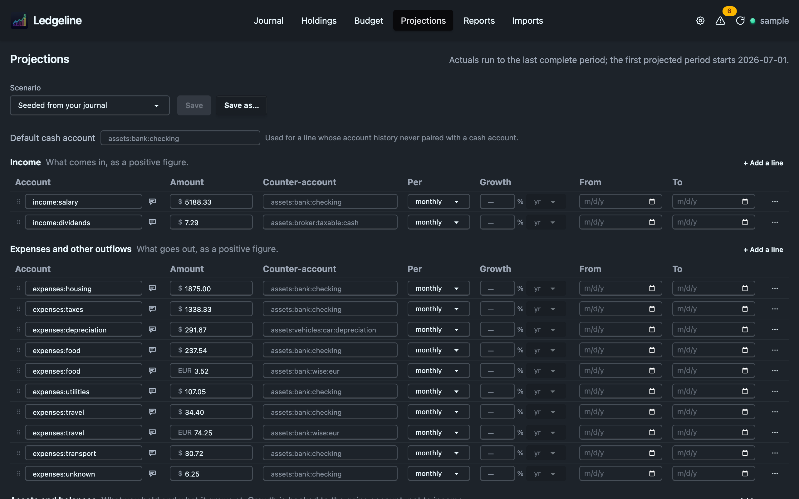
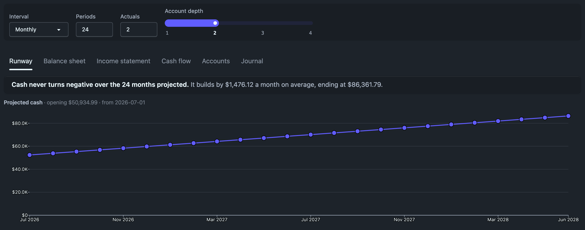
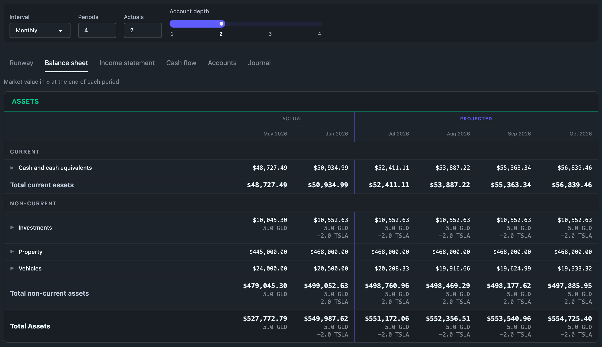
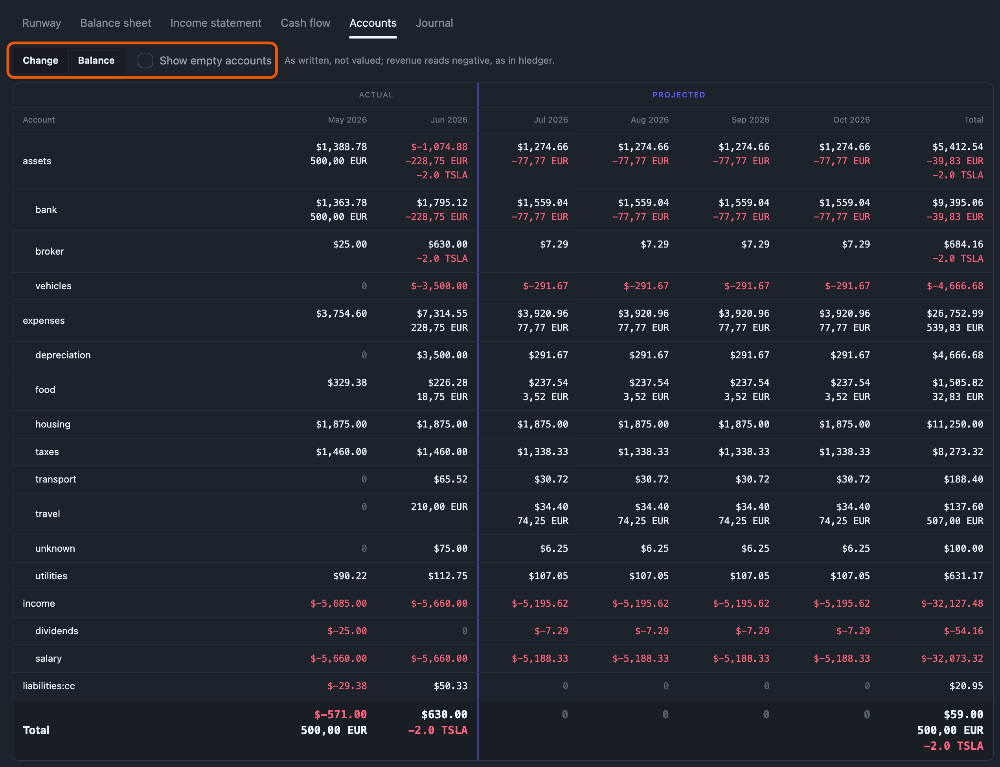
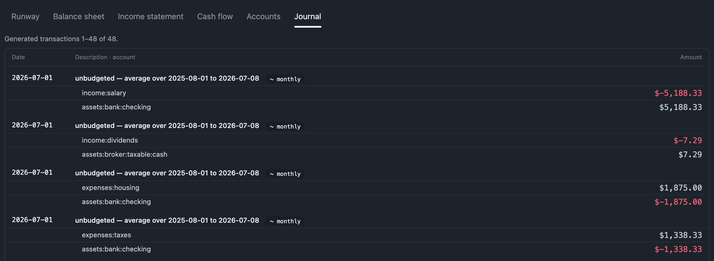

# Projections

The Projections tab asks one question — _if things carry on like this, when does
the cash run out?_ — and lets you argue with the answer. The top half is an
editable what-if table, seeded from your budget plus whatever your budget does
not cover. The bottom half is that table read forward in time: the runway, and
the same balance sheet, income statement and cash flow statement the Reports
tab shows, run forward. Press <kbd>g</kbd> <kbd>p</kbd> to get here from
anywhere, and <kbd>1</kbd> to <kbd>6</kbd> to switch between those readings
(see [Keyboard shortcuts](../journal/keyboard.md)).

A scenario is **an ordinary hledger journal file that nothing includes**, so it
can be edited in your own editor, diffed, committed, and read by `hledger`
itself. Playing with a what-if can never damage a plan of record.

This section has four pages:

- this one: where scenario files live and how saving works;
- [The scenario file format](file-format.md): the `~` rules, the tag vocabulary, growth, and reading a scenario with hledger;
- [What moves cash](cash.md): counter-accounts, the defaults Ledgeline picks, and where a projection starts;
- [Asset rows](asset-rows.md): balances that compound, contributions, and `opening:` overrides.

Design notes and the reasoning behind each decision live in
[`plans/22-projections.md`](https://github.com/zmre/ledgeline/blob/main/plans/22-projections.md).

## The six readings

| Tab | What it shows |
|---|---|
| **Runway** | when your cash runs out, in a sentence, above a chart of your cash balance. Cash accounts only; investments are not runway. |
| **Balance sheet** | the Reports tab's balance sheet at the end of every period, side by side |
| **Income statement** | the Reports tab's income statement, one column per period plus a Total |
| **Cash flow** | the Reports tab's statement of cash flows over the same periods |
| **Accounts** | every account, one row each, one column per period: what changed, or the balance at each period's end |
| **Journal** | the transactions the scenario generates, in date order, one block per transaction |

The statements are computed by the same code as on the Reports tab, with the
same groups, sections, valuation and balance check, over your real
transactions up to the projection's start and the scenario's projected
transactions after it. They begin with a few **actual** periods, so you can see
where the forecast starts from: the **Actuals** control sets how many (two by
default; `0` shows the forecast alone). A rule and the word **Projected** mark
the first projected column. The projection starts at the first period that is
not yet complete; [What moves cash](cash.md#where-the-projection-starts) says
exactly where.

**Interval** and **Periods** set the columns for every reading. The depth
slider rolls up the cash flow statement's lines and the Accounts rows.

### Accounts

The plain ledger the statements are built from, over the same columns, with
the same Actual and Projected marking. Every account is a row in a tree, cut
off at the depth slider. Amounts are shown as written, one line per commodity,
and are not valued into one currency. Signs are hledger's: revenue and equity
read negative.

- **Change** (the default) shows what moved in each period, with a Total
  column. This is `hledger balance -M --forecast`.
- **Balance** shows each account's balance at the end of each period,
  including everything before the first column. It has no Total column,
  because adding up balances means nothing. This is `hledger balance -M -H`
  (`--historical`).
- **Show empty accounts** adds the accounts nothing touches in these periods:
  every account the journal declares or has ever posted to, and every account
  the scenario books to. They show as zero rows, which is how to see what the
  projection leaves out. This is `-E --declared`, plus any undeclared account
  your journal used outside these periods, which hledger leaves out. Without
  it, a row is shown only if it, or an account under it, is non-zero in some
  column.

[What moves cash](cash.md#where-the-projection-starts) gives the exact hledger
commands for both modes and for the Journal, and the three ways they differ.

### Journal

Only the generated transactions, never your real ones. This is
`hledger print --forecast=<cutoff>..<end> tag:generated`, in hledger's order:
by date, then by where each rule sits in the file. Each transaction shows
its date, its description (the rule's note, or `projection`), and a badge for
what produced it: the rule's period (`~ monthly`), `event` for a dated event,
or `growth` for an asset row's appreciation. Every posting follows on its own
line with its account and amount. The list is read-only and shows 100
transactions per page. Over a very long horizon it stops at the first 5,000 and
says so.

The Accounts and Journal readings are computed only while their tab is open.
Switching to one runs the projection again.

The depth slider also sets how finely a **new** scenario is seeded. At depth 2
you get `expenses:housing`, and at depth 3 you get `expenses:housing:rent`. Once
the seed exists, it's only a starting point. You can put rows on any account
you like, mixing a parent such as `expenses:food` with leaves such as
`expenses:travel:flights`. The statements show a parent's own projected amount
as its own row, next to its children. Moving the slider later doesn't re-seed
the table. If you haven't edited the seed yet, and it didn't come from a file,
a **Re-seed at depth N** button appears beside the slider.

A link to an older `tab=net` or `tab=worth` reading opens Runway.

## Where the files live, and what Ledgeline will write

### The scan

Ledgeline looks for `*.journal` files **in your main journal's own directory
tree** — the same root an `include` is confined to. Files named
`projection-<something>.journal` are listed first, under "Projections"; every
other journal is listed under "Other journals" so you can load a budget file or
last year's ledger and project from it.

The scan is deliberately narrow, and every one of these is a refusal you may
notice:

- **Symbolic links are skipped**, files and directories alike, and the listing
  says so. Stricter than `include`, which resolves them — a walk that follows
  links has to contend with cycles and with a target swapped between the walk
  and the write, and refusing them removes all three at once.
- **Hidden entries are skipped** (`.git/`, `.direnv/`, `.anything.journal`), as
  are `node_modules/`, `target/`, `vendor/`, `dist/`, `build/` and
  `__pycache__/`.
- **It descends eight directories** and lists at most 200 files, examining at
  most 20,000 directory entries. If a cap trips, the picker says the list is
  incomplete rather than showing a subset that looks complete.
- **No path outside the journal directory is ever reachable**, and no absolute
  path ever appears in the app or in an error message.

### Saving

**Saving is always Save As.** The Projections tab never writes to
`budget.journal`, to your main journal, or to anything reachable by `include`
from it — those files are offered for **loading** and are marked read-only.
Playing with a what-if cannot damage a plan of record.

The name governs both the display name and the file name. `Series A with a
hiring ramp` becomes `projection-series-a-with-a-hiring-ramp.journal`: lowercase,
runs of non-alphanumerics collapsed to `-`, the ends trimmed. The dialog shows
you the resulting path **before** it writes.

- **Ledgeline never creates a directory.** The dialog offers the folders the
  scan already found a journal in; making a new one is your job, in your own
  file manager or shell.
- **It never overwrites on a create.** The file is opened with `O_EXCL`, so the
  refusal is the kernel's and is decided atomically — you get "a file already
  exists there" and nothing is touched.
- **A save rewrites only what changed.** Your own comments, `account`
  directives, transactions, blank lines, tabs, column alignment and CRLF line
  endings all survive: a rule you did not edit comes out the bytes it went in
  as, and a save that changes nothing writes nothing at all.
- **The header is rewritten on every save**: `created:` is carried forward from
  the file, and `updated:` is set to today by the engine's clock, not your
  browser's.
- **If the file changed on disk** since you opened it, the save is refused with
  a conflict and nothing is written. Re-open it and re-apply your change.

A `; projection:` name may not contain a comma, because hledger ends a tag's
value at one and the name would read back truncated. Ledgeline refuses the save
rather than silently shortening it.

### One normalization to know about

A single-date rule — `~ 2027-03-01  Series A` — is loaded back as a **one-off
event**, which is the row the tab shows it as. If you had it as a recurring row
with a single-date recurrence, it will come back in the "One-off events" section
after a save-and-reload. The engine treats the two identically, so no projected
figure moves.
