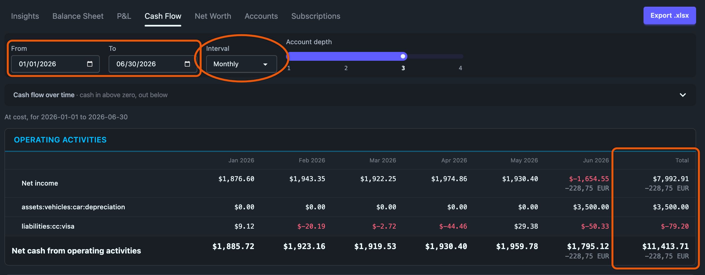

# The statement of cash flows, and the `cfsection:` / `cfgroup:` tags

The Cash Flow tab is a statement of cash flows, laid out the way QuickBooks and an accountant's spreadsheet lay one out (the *indirect method*). It starts from net income and adjusts it by how much each non-cash balance-sheet account changed, sorted into three sections:

```text
Operating activities
    Net income
    assets:receivable                       $-5,000.00
    liabilities:deferred-revenue             $2,200.00
    …
    Net cash from operating activities
Investing activities
    assets:equipment                        $-3,000.00
    Net cash from investing activities
Financing activities
    liabilities:note                         $8,000.00
    Net cash from financing activities
Net change in cash
Beginning cash
    assets:bank:checking …
Ending cash
    assets:bank:checking …
```

Every line shows the account's **effect on cash**. An asset that grew used cash, so it reads negative: invoices you haven't been paid for yet, equipment you bought. A liability that grew supplied cash, so it reads positive: bills you haven't paid yet, a customer paying in advance, a loan.



## It always reconciles

Every transaction balances, so net income plus every line adds up exactly to the change in your cash accounts, in every column and every currency. **Net change in cash** is computed that way, and **Ending cash** minus **Beginning cash** must equal it. If a column ever disagreed, a note at the bottom of the statement would say so rather than hide it. The one thing that can cause that is a posting date that puts one side of a transaction in a different period from the other; the Total column still agrees.

Three rules keep it reconciling:

- **Figures are at cost, never at market value.** Buying 10 shares for $1,500 moved $1,500 of cash, so the brokerage line reads −$1,500, not "10 AAPL".
- **Cash stays in the currency you hold.** Changing $571 into 500 EUR moves both balances, and the difference between the two currencies shows on its own line, **Effect of exchange rates on cash**, as on a GAAP statement.
- **Closing entries are left out.** A transaction whose postings are all to revenue, expense and equity accounts is a year-end close. It moves net income into retained earnings without touching cash, so counting it would show net income twice. It is recognised by account types, never by name, so `equity:retained-earnings` needs no tag.

Unbalanced virtual postings (`(account)` in parentheses) are left out for the same reason: they don't balance with the rest of their transaction.

## Controls

| Control | What it sets | Default |
| --- | --- | --- |
| **From** | First day of the report, inclusive | The 1st of the month 11 months before today |
| **To** | Last day of the report, inclusive | Today |
| **Interval** | **Total**, **Monthly**, **Quarterly** or **Yearly** | Monthly |
| **Account depth** | How deep an untagged account's line rolls up | 3 |

With an interval, there is one column per period and then **Total**. For the flows (net income, every line, the section totals, net change) the Total is the sum of the periods. For **Beginning cash** it is the first period's beginning balance, and for **Ending cash** the last period's ending balance, because adding up month-end balances means nothing. With Interval set to **Total** there is one column, headed **Amount**.

A saved link from before Cash Flow had From and To (`?tab=cf&end=2026-06-30&count=6&interval=monthly`) still opens the same columns, and the address bar switches to the From/To form.

## Which section an account lands in

Revenue and expense accounts are never lines of their own: they are net income. Every other account is placed by these rules, first match wins:

1. A `cfsection:` tag on the account, or on its nearest declared parent.
2. Type Cash (`type: C`): the account is cash, shown under Beginning and Ending cash.
3. A `valuation:` adjustment tag (`depreciation`, `unrealized`, `mark`, `adjustment`): **Operating**. Accumulated depreciation is the usual case. The depreciation expense is already in net income, and this line adds it back because no cash moved.
4. An asset that is non-current: **Investing**. Non-current means `bsterm: noncurrent` on it or a parent, or, with no `bsterm:`, an asset that has held a commodity other than your base currency (shares, a fund), which is the balance sheet's Investments rule.
5. A liability tagged `bsterm: noncurrent`: **Financing**.
6. Any other asset or liability: **Operating**. That covers receivables, prepaid expenses, payables, credit cards, payroll payable and deferred revenue.
7. Equity: **Financing**.
8. An account with no type at all: **Operating**.

Types come from `type:` declarations, or from hledger's name inference when an account declares none. See [Accounts](../settings/accounts.md).

### `cfsection:` moves an account

| Value | Section |
| --- | --- |
| `operating` | Operating activities |
| `investing` | Investing activities |
| `financing` | Financing activities |
| `cash` | Counts as cash: shown in the cash balances, not as an adjustment |

```journal
account liabilities:long-term                   ; type: L, bsterm: noncurrent, cfsection: operating
account assets:fixed:accum-depreciation         ; type: A, valuation: depreciation, cfsection: investing
account assets:treasury-bills                   ; type: A, cfsection: cash
```

`cash` lets an account count as cash or a cash equivalent without changing its hledger `type:`, which other hledger tools read.

There is no value that leaves an account out. Leaving out a balance-sheet account would make the statement stop adding up to your cash without saying so.

A misspelt value is ignored, the account falls back to the rules above, and [Problems](../journal/problems.md#unknown-account-tag-value) names it. A `cfsection:` or `cfgroup:` on a revenue or expense account is also ignored and reported, because those accounts count only through net income.

### `cfgroup:` names the line

Without a tag, each account is its own line, rolled up to the **Account depth**, which matches QuickBooks' one-line-per-account layout. A line that stands for more than one account has an arrow that opens it to the accounts behind it.

`cfgroup:` collapses accounts into one named line, even from different parts of the tree, for the "∆ in AR" style of a hand-built spreadsheet:

```journal
account assets:receivable           ; type: A, cfgroup: ∆ in AR
account liabilities:payable         ; type: L, cfgroup: ∆ in AP
account liabilities:cards           ; type: L, cfgroup: ∆ in AP
```

The tag inherits to sub-accounts. It works on cash accounts too: tag several bank accounts with the same `cfgroup:` and they roll up into one line under Beginning and Ending cash.

## The cash balances

**Beginning cash** and **Ending cash** list every cash account with a balance or a movement in the range, by line, and start open so the per-account detail is on screen. Opening or closing a line under one opens or closes it under the other, so the two lists always line up.

## Keyboard

<kbd>j</kbd>/<kbd>k</kbd> move through the visible rows. <kbd>Enter</kbd> opens a line, or shows an account's postings in the journal for the report's date range.

## The chart

Above the statement, one stacked bar per period for each section: **Operating**, **Investing**, **Financing**, and **Exchange rates** when there is any. Cash in is above zero and cash out below it, and the **Net change in cash** is the line across the bars. Every bar segment is a section total in the statement below. Each section's bars are the colour of its heading in the statement, so Operating, Investing and Financing match from chart to table whatever their sizes. Exchange rates is grey.

The chart draws one currency. Anything else is named under it ("Charted in $ only; EUR not shown"), and the statement still shows it. With Interval set to Total there is one column, so the chart asks for a wider range instead of drawing a single bar.

## Export

**Export .xlsx** writes the statement as on screen with every line opened: a column per period and Total (or one Amount column), amounts in your main currency as real numbers, and anything in another currency in an **Other commodities** column. The file is `cash-flow-<from>-to-<to>-<interval>.xlsx`.

## API

```
GET /api/reports/cashflow
      ?from=YYYY-MM-DD        (no default; switches to the range form)
      &to=YYYY-MM-DD          (default: today; both ends inclusive)
      &interval=total|monthly|quarterly|yearly
                              (default: monthly; daily and weekly also work)
      &depth=N                (default: 2)
```

Without `from`, the older `end`, `count` and `interval` parameters name the same columns as before and are converted to the range they cover.
