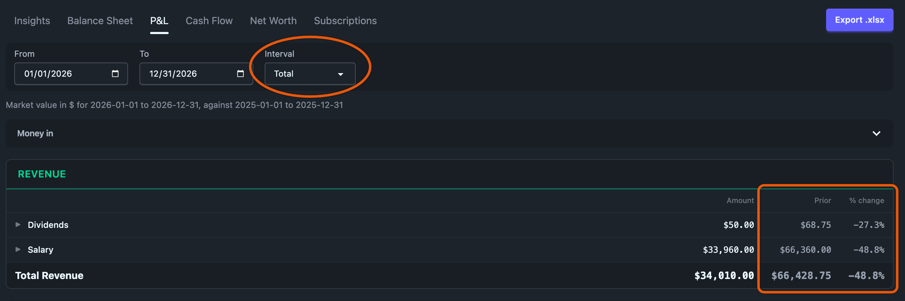
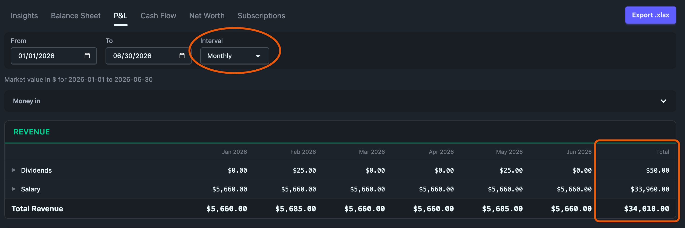

# The income statement, and the `issection:` / `isgroup:` tags

The P&L is a stack of boxes — **Revenue**, **Expenses** — whose lines are *groups*
rather than raw accounts, valued into a single currency so every line is one
number. Below the boxes sits net income.

By default the statement covers one date range and sets it beside the range of
the same length just before it, with a % change for every line. Pick Monthly,
Quarterly or Yearly instead and you get one column per period plus a Total, the
way QuickBooks lays out a P&L.

Tag your accounts and the statement grows into the full GAAP multi-step form:
Cost of revenue, Gross profit, EBITDA, Operating income, Income before taxes. Tag
nothing and none of that appears. A personal journal never sees a line it has no
use for.

Design notes and the reasoning behind each decision live in
[`plans/13-income-statement-redesign.md`](https://github.com/zmre/ledgeline/blob/main/plans/13-income-statement-redesign.md)
and, for the intervals and Total column,
[`plans/24-report-intervals-and-totals.md`](https://github.com/zmre/ledgeline/blob/main/plans/24-report-intervals-and-totals.md).

## The controls

| Control | What it sets | Default |
| --- | --- | --- |
| **From** | First day of the statement, inclusive | January 1 of the current year |
| **To** | Last day of the statement, inclusive | December 31 of the current year |
| **Interval** | **Total**, **Monthly**, **Quarterly** or **Yearly** | Total |

Total gives one column for the whole range, compared with the range before it.
The other three split the range into periods. The next two sections cover each
mode.



## Why groups instead of accounts

The same reason as the [balance sheet](balance-sheet.md): a chart of accounts is
organised for bookkeeping, a statement is organised for reading. You want to know
what you spent on *housing*, not the split between `expenses:housing:rent` and
`expenses:housing:insurance`. Each line is a group, collapsed by default; expand
one to see the accounts behind it, at full depth.

It also fixes the thing that made the old report hard to scan. It used to print a
rolled-up `income` row, then every account under it, then a `Total Revenues`
footer holding that same figure a third time. Groups replace the ancestor rows
outright, and no number is printed twice.

There is no depth control on this tab, for the reason it left the balance sheet:
groups are the reading, and the accounts inside one are a drill-down.

## The two tags

**`issection:` picks the box.** It takes one of seven codes and nothing else:

| Code | Box |
|----------------|--------------------------------|
| `revenue` | Revenue |
| `cogs` | Cost of revenue |
| `opex` | Operating expenses (or just "Expenses" — see below) |
| `depreciation` | Depreciation & amortization |
| `interest` | Interest |
| `tax` | Income taxes |
| `other` | Other income & expense |

**`isgroup:` names the line inside that box.** It is free text, in any language:

```journal
account cogs                  ; type: X, issection: cogs
account cogs:hosting          ; type: X, isgroup: Cloud hosting
account cogs:payments         ; type: X, isgroup: Payment processing
account expenses:salaries     ; type: X, issection: opex
account expenses:depreciation  ; type: X, issection: depreciation
account expenses:interest     ; type: X, issection: interest
account expenses:taxes:income  ; type: X, issection: tax
account income:grants         ; type: R, issection: other
```

Both tags **inherit to sub-accounts**, exactly like `type:` does, so tagging
`cogs` covers everything beneath it unless a child overrides. Accounts that share
an `isgroup:` value share a line, even if they live in unrelated parts of the
tree.

**Balance-sheet accounts never appear here**, whatever they are tagged. An
account whose type is asset, liability or equity (declared or inferred from its
name) is left off the income statement even with an `issection:` or `isgroup:`
tag, and [Problems](../journal/problems.md#unknown-account-tag-value) warns about
each tag. If the account's name says expense or revenue and only its `type:`
says otherwise, the type is probably the typo, and Problems
[says that instead](../journal/problems.md#a-type-that-looks-like-a-typo).
The usual case is a contra-asset such as accumulated depreciation. Its credits
mirror the depreciation expense, so showing it in the same box would cancel that
expense out of net income. Tag the expense account; the balance sheet shows the
contra-asset.

An `issection:` value that isn't one of the seven codes is ignored, and the
account falls to its default section. It is not ignored silently:
[Problems](../journal/problems.md#unknown-account-tag-value) names the account,
the value you wrote and the seven codes it could have been, because a mistyped
classification tag is how an account ends up in the wrong box.

### Two gotchas, both inherited from hledger's tag syntax

**A tag value ends at the next comma.** This bites `isgroup:` because group names
are prose:

```journal
account cogs:ops  ; type: X, isgroup: Servers, bandwidth     ; ✗ group is "Servers"
account cogs:ops  ; type: X, isgroup: Servers and bandwidth  ; ✓ the whole phrase
```

**The tag name is the last word before the colon**, so don't put a space inside
it — `; income section: cogs` declares a tag called `section`, not `issection`.

## What happens with no tags at all

Everything of declared type `R` lands in Revenue, everything of type `X` lands in
Expenses, and that is the whole statement: two boxes and a net income figure.

There is deliberately **no guessing** for `cogs`, `tax`, `interest` or
`depreciation`. Every rule that could produce them from an untagged journal would
have to match English account names, and when name-matching classification goes
wrong the symptom is a section that reads **zero**. A journal rooted at `cogs:`
with `type: X` lands in Expenses and reads correctly; splitting it out is one tag.

## How a line is chosen when there is no `isgroup:`

Untagged accounts still group sensibly, by **dropping the prefix every account in
that box shares** and taking the next segment:

| Accounts in the box | Shared prefix | Lines |
|---|---|---|
| `income:salary`, `income:dividends` | `income` | Salary, Dividends |
| `expenses:food:groceries`, `expenses:housing:rent` | `expenses` | Food, Housing |
| `cogs:materials`, `expenses:rent` | *(none)* | Cogs, Expenses |

The shared prefix carries no information — if every expense is under `expenses:`,
saying so on every line is noise. Drop it and the next segment is the one you
actually chose as a category. When a box holds accounts from genuinely different
roots, nothing is shared, so the roots themselves become the lines.

This is the same rule the balance sheet uses; on a chart where everything sits
under one root it reduces to exactly the balance sheet's "second path segment"
behaviour, so the two statements group alike.

Like there, grouping never matches account *names* — it is position in the tree
and nothing else — and the same small cosmetic alias table may prettify a label
without ever moving an account to a different line.

## The subtotal ladder

Boxes appear in this order, and a box with nothing in it is omitted entirely.
Each subtotal appears only when the sections that give it meaning exist:

```
Revenue
Cost of revenue                          if any cogs
    Gross profit                         if any cogs
Operating expenses
    EBITDA                               if any depreciation
Depreciation & amortization              if any depreciation
    Operating income                     if the statement is multi-step
Other income & expense                   if any other
Interest                                 if any interest
    Income before taxes                  if any tax
Income taxes                             if any tax
                                Net income
```

EBITDA sits **above** D&A and Operating income **below** it, which is the order a
real statement uses and which makes every subtotal a running total of everything
printed above it. EBITDA is suppressed when there is no D&A box, because it would
then be the same number as Operating income — and printing one number twice is
the complaint this redesign exists to fix.

The `opex` box is titled **"Expenses"** on a simple statement and **"Operating
expenses"** once the statement goes multi-step. It is the same box either way;
only the label moves, so no account changes box when your journal grows its first
`cogs:` tag.

### Signs

Every box prints as a positive magnitude and the ladder does the subtracting —
except **Other income & expense**, which is genuinely mixed. A grant and a lawsuit
settlement can share it, so it is presented as a net contribution to income and is
allowed to print negative, in the parenthesised style a real statement uses.

## Total mode: Amount, Prior and % change

With Interval set to **Total**, every box has three figure columns:

- **Amount** is the line's total over From to To.
- **Prior** is the same line over the window of equal length that ends the day
  before From. For a full calendar year that is the year before. For any other
  range it is the same number of days, and the line above the boxes names both
  sets of dates. Each window is valued at its own end, matching `hledger is -V`
  run over that range, so the Prior column agrees with the report you ran last
  year. A currency move between the two ends shows up as part of the change.
- **% change** is `(Amount − Prior) / |Prior|`, to one decimal place. Ledgeline
  computes it from the exact decimal amounts, not from the rounded figures on
  screen. Dividing by the absolute value of Prior makes the sign give the
  direction: a line that goes from −$100 to −$50 reads `50.0%`, because it
  went up. When Prior is zero or the line has no prior figure, the cell shows
  `—`.

The net income panel under the boxes shows the same three figures, in the same
order: this range, the prior range, and the % change.

## Interval mode: one column per period

Set Interval to **Monthly**, **Quarterly** or **Yearly** and the statement
splits From to To into periods, one column each, followed by a **Total**
column. The first and last periods are cut at From and To, so a range that
starts mid-month gives a partial first month. Column headers read like
`Jan 2026`. Hover over one to see its exact dates.



Interval mode has no Prior column and no % change. Net income becomes a row
under the boxes with a figure for every period and for the Total.

**The Total is the sum of the period columns**, which is what QuickBooks does.
Under market valuation each period is valued at its own end date, so the Total
can differ from what Total mode prints for the same range, where everything is
valued once at To. That difference is expected. On `fixtures/sample.journal`,
Yearly from 2025-01-01 to 2026-12-31 puts Travel at a Total of `$1,405.50`,
while Total mode for the same two years shows `$1,446.36`. Cost is the same on
every date, so `?value=cost` on the API makes the two agree.

Ledgeline decides which lines and groups exist from all the periods together.
A line that only had activity in March still appears in every column, with
zeros in the months it was quiet.

The Money in and Money out diagrams do not split by period. In both modes they
cover the whole From to To range.

## Valuation

Lines are **valued at market in your base currency** by default, so foreign
spending and dividends read as money rather than as a column of currencies. Prices
come from the journal's `P` directives only, matching `hledger is -V`.

A commodity with no usable `P` directive is **not** silently dropped: it stays on
its line as a secondary figure and is named in a warning banner above the report.

`?value=cost` and `?value=none` are available on the API for the cost basis and
for raw, unvalued commodities.

### Why net income here isn't Retained earnings there

The balance sheet's **Retained earnings** line is computed at *cost*; this
statement's net income is valued at *market*. On `fixtures/sample.journal` that is
`$42,998.91` against `$41,916.34`. Both are right. The difference is exactly what
the balance sheet's **Valuation adjustment** line absorbs, which is why that line
exists and why `assets = liabilities + equity` still ties out. Ask for
`?value=cost` and the two figures agree.

## The money-flow diagrams

Two Sankey diagrams sit in the statement: **Money in** immediately above the Revenue box, **Money out** immediately above the first cost box that prints. Each is a *decomposition* of the side of the statement below it, not a second statement.

**Money in** puts the revenue lines on the left and the accounts the money landed in on the right, so you can see that a salary arrived partly as cash in the bank and partly as tax withheld before you ever saw it. **Money out** swaps the columns: the accounts that funded the spending are on the left and the cost lines on the right, so you can see which card or account each category was actually paid from.

### How a posting is attributed

A statement line is one side of a transaction; the other side is where the money came from or went to. With two postings that is unambiguous. With more, each statement posting is allocated across the postings on the **opposite side of the ledger in its own transaction**, in proportion to their size. A paycheck:

```journal
2026-01-27 * Acme Corp | January salary
    income:salary             $-5,660.00
    expenses:taxes:federal     $1,150.00
    expenses:taxes:state         $310.00
    assets:bank:checking       $4,200.00
```

draws Salary to Taxes: Federal at `$1,150.00`, to Taxes: State at `$310.00` and to Bank: Checking at `$4,200.00` in **Money in**, and Salary to Taxes at `$1,460.00` in **Money out**. The withheld tax was funded by gross pay and not by the cash account, and both diagrams say so.

Allocating the *statement* side rather than the account side is what makes each statement posting split exactly (integer mantissa arithmetic, last share takes the remainder) and what makes market valuation harmless: a transaction balances at cost, not at market, so a valued transaction's debits and credits may differ, and allocating a known statement amount across proportions is indifferent to that.

**Other income & expense is in neither diagram.** It is the one box the statement lets print negative, because a grant and a lawsuit settlement can share it, so it has no single direction to flow in.

### When the picture is not the whole story

Links whose net over the window is zero or negative are not drawn. A category refunded more than it was charged has no width, and a Sankey cannot render a negative one; the same goes for a statement posting with no counterparty to attribute it to.

Whatever that removes shows up as a line under the diagram reading **`Showing $X of $Y`**: `$X` is what the ribbons carry, `$Y` is the statement figure they decompose. On an ordinary journal the two agree and the line is absent entirely. It is never hidden, because the gap is the only place that missing money can be seen.

### Reading the picture

Colour identifies the **account**, and an account keeps its colour in *both* diagrams: `assets:bank:checking` is the same blue wherever it appears. The palette has fourteen colours in the default theme, handed out biggest account first (by its combined total across both diagrams); only accounts past the last colour fold into one grey `(other)` bar, with their links merged. Statement lines never fold and never take a colour, because folding them would hide exactly the spending categories the diagram exists to show; the panel grows taller instead. Every bar carries its own label and figure, and a legend under each diagram names every account, so identity is never colour alone.

Both panels are collapsible and each remembers its own state across reloads. A collapsed panel is not merely hidden: the diagrams are a separate endpoint and a second pass over every posting in the window, so with both panels shut nothing is fetched at all. Expanding one fetches immediately.

A **shut** panel prints its graph total beside the title, since that figure is the whole of what the panel can still say and the reason the arrow is worth clicking. An **open** one does not: the bars carry the detail and the box directly below carries the total, so a header figure there would be the same string printed twice on one screen, which is the complaint this report exists to fix. Where the ribbons and the statement disagree, the open panel says so in `Showing $X of $Y` instead.

## Export

The **Export .xlsx** button writes what the screen shows: filled section
headers, bold group rows, indented accounts, ruled subtotals, then net income.
Every line is valued into one commodity, so the amount cells hold real numbers
with a number format rather than text, and the workbook is arithmetic you can
build on. Groups are written expanded whatever is collapsed on screen.

The columns depend on the Interval:

| Interval | Columns |
| --- | --- |
| Total | Account, Amount, the prior window (headed with its dates), % change, Other commodities, and Other commodities for the prior window |
| Monthly, Quarterly, Yearly | Account, one column per period, Total (in the base commodity), and Other commodities for the Total |

In Total mode the % change cell is left empty where the screen shows `—`, so the
column never claims a 0.0% that nobody measured.

The title line names the range and the interval, for example
`2026-01-01 to 2026-06-30, monthly`, and so does the file name:
`income-statement-2026-01-01-to-2026-06-30-monthly.xlsx`. Two exports of the
same range at different intervals cannot overwrite each other.

The two diagrams are deliberately **not** in the workbook. A picture of the flows is not arithmetic anyone can build on, and the numbers behind it are already in the boxes it decomposes.

## API

```
GET /api/reports/incomestatement/grouped
      ?from=YYYY-MM-DD        (default: Jan 1 of the current year)
      &to=YYYY-MM-DD          (default: today; both ends inclusive)
      &value=market|cost|none (default: market)
      &valueIn=$              (default: the journal's base commodity)
      &compare=previous|none  (default: previous)
      &interval=total|monthly|quarterly|yearly
                              (default: total; daily and weekly also work)
```

`interval=total` returns the same bytes it always did. Any other interval
returns interval mode:

- `buckets` lists the columns as `[{key, from, to}]`.
- `prior` is `null`.
- Every figure is `{current, values}`, where `values` has one entry per bucket
  and `current` is their sum, the Total.

Interval mode refuses some requests with a `400`:

- `compare=previous`. Leave `compare` out or send `compare=none`.
- `from` after `to`.
- A range that needs more than 1,200 columns (a daily interval over four
  years, for example).

`valueIn` is checked against each bucket's end date, so it has to price
something in at least one of the windows the report values.

The older `GET /api/reports/incomestatement` returns the flat, unvalued, `hledger is`-shaped report and is unchanged, backing the hledger parity golden.

```
GET /api/reports/incomestatement/flows
      ?from=YYYY-MM-DD        (default: Jan 1 of the current year)
      &to=YYYY-MM-DD          (default: today; both ends inclusive)
      &valueIn=$              (default: the journal's base commodity, else the
                               single commodity the window is written in)
```

No `value=` and no `compare=`: a link's width is one number, so the widths are always market-valued, and neither diagram has a comparison column. The response carries both graphs, each with its `nodes`, its `links`, the `total` they carry and the `sectionTotal` they decompose. `base` is `null` when the journal has several commodities and nothing prices them against each other, and both graphs are then empty.
