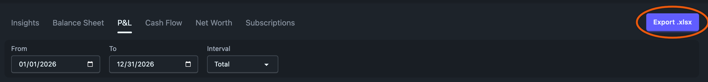

# Reports

Reports holds six tabs. Ledgeline computes every figure in its Rust engine with exact decimal math, so the totals match what hledger prints for the same journal.

| Tab | Shortcut | What it answers | Page |
| --- | --- | --- | --- |
| Insights | <kbd>1</kbd> | How did this period compare with the one before it? | [Insights](insights.md) |
| Balance Sheet | <kbd>2</kbd> | What do I own and owe on a given date? | [The balance sheet](balance-sheet.md) |
| P&L | <kbd>3</kbd> | What came in and went out over a date range? | [The income statement](income-statement.md) |
| Cash Flow | <kbd>4</kbd> | Where did cash come from and go: operations, investing or financing? | [Cash flow](cash-flow.md) |
| Net Worth | <kbd>5</kbd> | How have assets and liabilities moved over time? | [Net worth](net-worth.md) |
| Subscriptions | <kbd>6</kbd> | Which charges recur every month or year? | [Subscriptions](subscriptions.md) |

Insights is the tab that opens first. The digit shortcuts work only while the Reports page is showing, and <kbd>?</kbd> lists them with the rest of the page's keys. See [Keyboard shortcuts](../journal/keyboard.md).

## The controls bar

The grey bar under the tabs shows only the controls the current tab reads. Settings carry over when you switch tabs, so a setting you change on one tab is still there when you come back. The one exception is the end date, which every tab shares (see [One end date across tabs](#one-end-date-across-tabs)).

- **As of** sets the date for the Balance Sheet. The date is inclusive.
- **From** and **To** set the date range for the P&L and for Cash Flow. Both ends are inclusive. Each tab keeps its own range.
- **Interval** on the P&L and Cash Flow is **Total**, **Monthly**, **Quarterly** or **Yearly**. Total gives one column for the whole range. The others give one column per period plus a Total column. On the P&L, Total also adds a Prior column and a % change.
- **End**, **Interval** and **Periods** set the columns for Net Worth. End picks the date whose period is the last column, Interval picks monthly, quarterly or yearly periods, and Periods sets how many columns to show (up to 120). Net Worth has no Total option, because its columns are balances on a date.
- **Account depth** limits how many levels of the account tree Cash Flow and Net Worth show.

The defaults come from today's date. The Balance Sheet starts at today. The P&L covers the current calendar year at Interval Total. Cash Flow runs monthly from the 1st of the month 11 months back to today, which is 12 columns. Net Worth shows the last 5 years.

Insights and Subscriptions don't use this bar. Insights has its own comparison picker, and Subscriptions always scans the last 24 months.

The Balance Sheet and P&L have no depth control. They group accounts into lines, and you expand a line to see the accounts inside it. Their pages explain how the grouping works.

### One end date across tabs

The last end date you set on any tab becomes the end date of the next tab you open, so you can line reports up without picking the date on each one. Set the Balance Sheet's As of to 2026-09-30, open the P&L, and it covers 2026-01-01 to 2026-09-30. Open Cash Flow and it ends on 2026-09-30 too.

The end date is As of on the Balance Sheet, To on the P&L and Cash Flow, End on Net Worth, and End in the Insights comparison picker. Subscriptions has no date, so it neither sets nor takes one.

Start dates aren't shared. When a tab's end moves, its start is set like this:

1. If the start is still at its default distance from the old end, it keeps that distance from the new one. On the P&L that means January 1 of the end's year, so the range is year to date. On Cash Flow it's twelve monthly columns. On Insights it's the length of the comparison preset, which then shows as Custom.
2. If you picked the start yourself, it stays as long as it's on or before the new end.
3. If it would come after the new end, it goes back to the tab's default for the new end. A range is never left backwards.

A link that names the tab's end date opens on that date, and that date becomes the shared one. The shared date lasts while the app is open, including when you leave Reports and come back. It isn't saved, so after a restart or a reload each tab starts from its defaults again, apart from the dates in the address bar of the tab you reload.

## Valuation and missing prices

The Balance Sheet, P&L and Net Worth value holdings in your base currency using the journal's `P` price directives and the prices implied by `@` and `@@` costs. If a commodity has no price, a yellow banner above the report names it ("Some holdings are not valued"), and that commodity is left out of the valued totals.

To fix it, add a `P` directive for the commodity, or fetch prices from the Holdings page. See [Holdings](../holdings/index.md).

## Sharing a report

The URL records the tab and every control the tab uses. Copy the address and anyone with the same journal sees the same report, even after the today-based defaults have moved on.

Links saved before Cash Flow switched to From and To, and before the P&L had an Interval, still work. A P&L link with no `interval` opens at Total. A Cash Flow link with `end` and `count` but no `from` opens on the same columns it used to show, and the address bar switches to the From/To form. See [Cash flow](cash-flow.md).

An old bookmark that points at the Budget tab, which used to live here, forwards to the [Budget](../budget.md) page with its dates and depth carried over.

## Exporting to Excel

The **Export .xlsx** button sits to the right of the tabs on the Balance Sheet, P&L, Cash Flow and Net Worth tabs. Insights and Subscriptions have no export.

The workbook holds the report you are looking at, with a title and a line stating the parameters:

| Tab | Parameters line | File name |
| --- | --- | --- |
| Balance Sheet | `as of 2026-07-08` | `balance-sheet-2026-07-08.xlsx` |
| P&L | `2026-01-01 to 2026-12-31, total` | `income-statement-2026-01-01-to-2026-12-31-total.xlsx` |
| Cash Flow | `2025-08-01 to 2026-07-08, monthly, depth 3` | `cash-flow-2025-08-01-to-2026-07-08-monthly.xlsx` |
| Net Worth | the period span and depth | `net-worth-<end>.xlsx` |

The button appears only once the report on screen matches the current controls. That stops a file named for one report from holding another report's figures while a refetch is in flight.

The Balance Sheet and P&L exports use a conventional statement layout meant for sharing. The in-app view rolls lines up and lets you drill in. The export code is in [`web/src/lib/export/xlsx.ts`](https://github.com/zmre/ledgeline/blob/main/web/src/lib/export/xlsx.ts).

## Where the figures come from

Each tab calls an engine endpoint under `/api/reports/` (or `/api/insights` and `/api/subscriptions`). The tab pages describe how each report classifies accounts. Most of them read the declared `type:` on your `account` directives first and fall back to guessing from the account name. [Settings → Accounts](../settings/accounts.md) shows those types and lets you set them.
