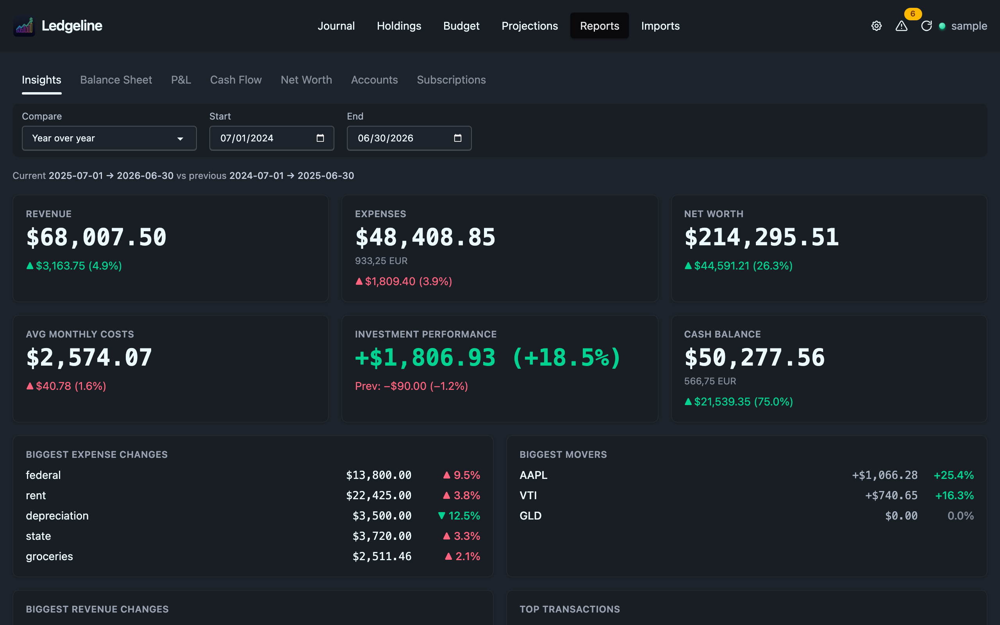

# Insights

Insights is the first tab on the Reports page. It compares a current period with the previous one of the same length and shows the result in up to ten boxes: six headline figures and four short lists. Boxes that don't apply to your journal are hidden (see [When boxes hide](#when-boxes-hide)). When the journal holds the books of a subscription business, a section of [startup metrics](startup-metrics.md) appears under the headline boxes.



## Picking the comparison

The bar at the top has a **Compare** dropdown and **Start** and **End** dates. The dates cover the whole span, and the engine splits it at its midpoint: the first half is the previous period and the second half is the current one.

| Preset | Span | Each half |
| --- | --- | --- |
| Year over year (default) | 24 months | 12 months |
| Half over half | 12 months | 6 months |
| Quarter over quarter | 6 months | 3 months |
| Month over month | 2 months | 1 month |

Each preset ends with the last complete month, so the month you are in doesn't count. If you type your own dates, the dropdown shows **Custom**. A span with an odd number of days can't split evenly, so the extra day goes to the previous period.

The line under the bar states both periods, for example `Current 2025-07-01 → 2026-06-30 vs previous 2024-07-01 → 2025-06-30`.

If your journal starts after the previous period begins, a yellow warning says so. Six months of history measured against twelve reads as a doubling, so treat the deltas with care until you have enough history.

## The six headline boxes

Each box shows a big figure for the current period and a smaller line with the change from the previous period, in amount and percent. Green and red follow whether the change is good for you: rising revenue is green, rising expenses are red.

Each box and list has an (i) icon after its title. Hover over it, tab to it or tap it to see what the figure means and how it is worked out, or what the list ranks. Escape closes it.

### Revenue

Total income over the current period.

### Expenses

Total expenses over the current period.

### Net Worth

Assets minus liabilities at the end of the current period, valued in your base currency.

### Avg Monthly Costs

Expenses divided by the number of months in the period. Accounts under `expenses:tax` and `expenses:taxes` are left out, so the figure reflects what it costs to live rather than what you owe the government.

### Investment Performance

The change in market value of your holdings over the current period, with the percent gain. The small line shows the previous period's own performance, not the difference between the two.

### Cash Balance

The total of your cash accounts at the end of the current period.

Figures are in the base currency, which is the commodity your price directives most often price things in (`$` if you have none). When a box also holds other commodities, they appear on a smaller line under the big figure.

## The four lists

Each list shows up to five rows from the current period.

### Biggest Expense Changes and Biggest Revenue Changes

The accounts whose totals moved the most compared with the previous period, ranked by the size of the move in money. Swings under 10 in the base currency are ignored. An account that had no activity in the previous period has nothing to compare against, so it isn't listed. An account that stopped entirely shows an **ended** badge. When a parent account has postings of its own as well as subaccounts, its own postings appear as a separate row labelled `(own)`.

### Biggest Movers

Your stocks ranked by their percent move over the current period, with the gain in money alongside. The move is measured from the market value at the start of the period. If there is no `P` price before that date, Ledgeline falls back to the purchase cost, marks the symbol with an asterisk, and says so under the list. In that case the figure is closer to an all-time gain, and adding `P` directives fixes it.

### Top Transactions

The transactions in the current period with the biggest effect on income and expenses. Each transaction is scored by its revenue and expense postings only, valued in your base currency: add up those postings' debits, add up their credits, and take the larger of the two. The amount shown is that score.

A transaction that touches no revenue or expense account scores zero and drops out. So do closing entries. That leaves out the entries that only move money you have already counted:

| Transaction | Shows as |
| --- | --- |
| A card purchase: `expenses:food` $84.20, `liabilities:card` | $84.20, the expense |
| A paycheck: `revenue:salary` −$5,660.00, withholding to `expenses:tax`, the rest to the bank | $5,660.00, the gross pay, not pay plus withholding |
| An invoice: `assets:receivable`, `revenue:subscriptions` −$1,500.00 | $1,500.00, the revenue |
| The card payment: `liabilities:card`, `assets:bank` | Nothing: no revenue or expense leg |
| A customer's payment: `assets:bank`, `assets:receivable` | Nothing |
| A transfer between your own accounts | Nothing |

Revenue debits in a transaction that credits a deferred revenue account (`kpi: deferred-revenue`) are moves to deferred revenue, not income, and don't count. A pure move to deferred revenue therefore drops out, and an entry that recognises revenue and moves some of it in one go shows only what it recognises. See [Deferred revenue books](startup-metrics.md#deferred-revenue-books).

## When boxes hide

A box that has nothing useful to say is hidden, and the boxes after it move up to fill the gap:

| Box | Hidden when |
| --- | --- |
| Net Worth | It is negative at the end of the current period, or the journal is a business: any `account` directive carries a `kpi:` tag. |
| Investment Performance | No holdings exist in either period. |
| Biggest Movers | It would have no rows, for example when you hold no stocks. |

A household journal with a positive net worth and stocks keeps all ten boxes.

### Runway

When Net Worth is hidden and the current period holds at least one complete calendar month, a **Runway** box takes its slot. Net worth is a household measure. For a business that is spending its way to growth, the question is how long the cash lasts.

**Runway = cash ÷ average burn.** Cash is the total of the `type: C` accounts at the end of the current period's last complete calendar month. Net burn is the cash used in a month, leaving out financing, averaged over the last three complete months, or fewer if the journal is younger:

```text
net burn = −(change in cash − financing cash flow)
```

Financing is the financing section of the [cash flow statement](cash-flow.md), so a funding round or a new loan doesn't make the business look as if it were earning cash. Tag those accounts `cfsection: financing` if they don't land there already.

When the journal has a deferred revenue account (`kpi: deferred-revenue`) or a receivable, runway uses net burn **adjusted for prepayments** instead. A customer who pays a year up front raises cash in one month, and plain net burn would read that month as a windfall. The adjusted burn reads it as if every customer paid when they were served:

```text
adjusted burn = net burn + change in deferred revenue − change in receivables
```

An annual prepayment raises cash and deferred revenue by the same amount, so it nets to zero; each month's recognition then counts as that month's income. An unpaid invoice counts when it's issued, and its later payment nets to zero.

The big figure is the runway in months, such as **117 months**. The small line gives the month the cash would run out at that rate and the burn used. On cash burn it reads like `cash-out ~2031-12 · burn $7,000/mo (3-mo avg)`. On adjusted burn it gives both burns, like `cash-out ~2036-03 · burn $3,693.33/mo adjusted for prepayments · $6,543.33/mo cash (3-mo avg)`. When the burn the runway uses averages zero or less, the box says **Not burning** and shows cash on the small line instead.

The three-month average smooths out a one-off month, but it doesn't forecast. A planned hire or a price rise isn't in it. For that, use [Projections](../projections/index.md).

## How accounts are classified

Revenue, expenses and cash are decided by each account's declared `type:` first, then by its nearest declared parent, and only then by guessing from the name. A chart of accounts that books costs outside an `expenses:` root, or uses names in another language, still lands in the right box once the types are declared. See [Settings → Accounts](../settings/accounts.md).

Startup metrics add a `kpi:` account tag for the roles no other tag covers, such as recurring revenue and deferred revenue. See [Startup metrics](startup-metrics.md#setting-up).

Net worth, the movers and investment performance all use the same set of prices: your `P` directives plus the prices implied by `@` and `@@` costs. A position can't show two different values on the same screen.

## The journal's own summary box

The Journal page has a smaller, collapsible box at its top with two views. Activity follows the journal's filter bar and summarises the filtered transactions. Balances shows cash and short-term liabilities as of today across the whole journal. It is a different tool from this dashboard. See [The journal](../journal/index.md).
