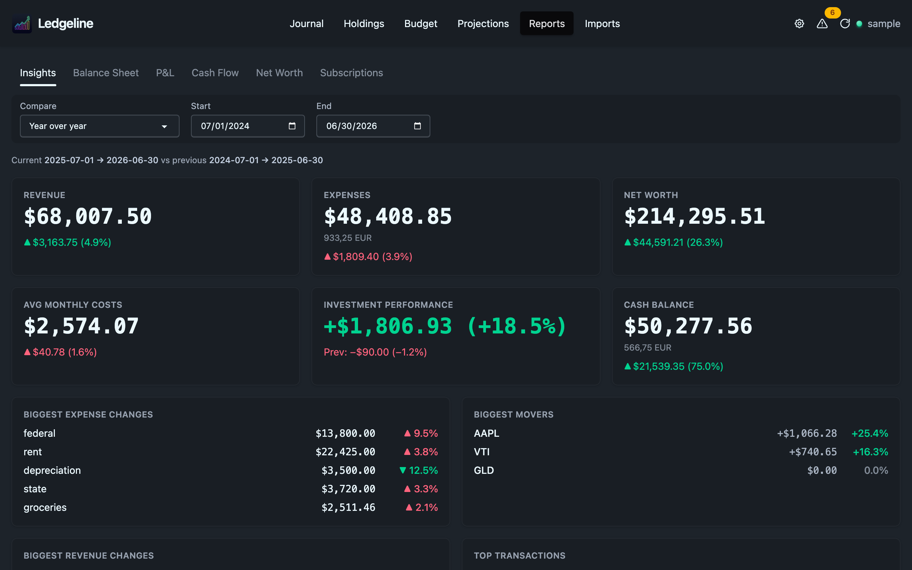

# Insights

Insights is the first tab on the Reports page. It compares a current period with the previous one of the same length and shows the result in ten boxes: six headline figures and four short lists.

## Picking the comparison

The bar at the top has a **Compare** dropdown and **Start** and **End** dates. The dates cover the whole span, and the engine splits it at its midpoint: the first half is the previous period and the second half is the current one.

| Preset | Span | Each half |
| --- | --- | --- |
| Year over year (default) | 24 months | 12 months |
| Half over half | 12 months | 6 months |
| Quarter over quarter | 6 months | 3 months |
| Month over month | 2 months | 1 month |

Each preset ends with the last complete month, so the month you are in doesn't count. If you type your own dates, the dropdown shows **Custom**. A span with an odd number of days can't split evenly, so the extra day goes to the previous period.

The line under the bar states both periods, for example `Current 2025-07-01 → 2026-06-30 vs previous 2024-07-01 → 2025-06-30`.

If your journal starts after the previous period begins, a yellow warning says so. Six months of history measured against twelve reads as a doubling, so treat the deltas with care until you have enough history.

## The six headline boxes

Each box shows a big figure for the current period and a smaller line with the change from the previous period, in amount and percent. Green and red follow whether the change is good for you: rising revenue is green, rising expenses are red.

### Revenue

Total income over the current period.

### Expenses

Total expenses over the current period.

### Net Worth

Assets minus liabilities at the end of the current period, valued in your base currency.

### Avg Monthly Costs

Expenses divided by the number of months in the period. Accounts under `expenses:tax` and `expenses:taxes` are left out, so the figure reflects what it costs to live rather than what you owe the government.

### Investment Performance

The change in market value of your holdings over the current period, with the percent gain. The small line shows the previous period's own performance, not the difference between the two.

### Cash Balance

The total of your cash accounts at the end of the current period.

Figures are in the base currency, which is the commodity your price directives most often price things in (`$` if you have none). When a box also holds other commodities, they appear on a smaller line under the big figure.

## The four lists

Each list shows up to five rows from the current period.

### Biggest Expense Changes and Biggest Revenue Changes

The accounts whose totals moved the most compared with the previous period, ranked by the size of the move in money. Swings under 10 in the base currency are ignored. An account that had no activity in the previous period has nothing to compare against, so it isn't listed. An account that stopped entirely shows an **ended** badge. When a parent account has postings of its own as well as subaccounts, its own postings appear as a separate row labelled `(own)`.

### Biggest Movers

Your stocks ranked by their percent move over the current period, with the gain in money alongside. The move is measured from the market value at the start of the period. If there is no `P` price before that date, Ledgeline falls back to the purchase cost, marks the symbol with an asterisk, and says so under the list. In that case the figure is closer to an all-time gain, and adding `P` directives fixes it.

### Top Transactions

The largest transactions in the current period by the amount of money they moved. Opening and closing balances, equity adjustments and other bookkeeping entries with no income or expense leg are skipped, because they would otherwise sit at the top permanently.

## How accounts are classified

Revenue, expenses and cash are decided by each account's declared `type:` first, then by its nearest declared parent, and only then by guessing from the name. A chart of accounts that books costs outside an `expenses:` root, or uses names in another language, still lands in the right box once the types are declared. See [Settings → Accounts](../settings/accounts.md).

Net worth, the movers and investment performance all use the same set of prices: your `P` directives plus the prices implied by `@` and `@@` costs. A position can't show two different values on the same screen.

## The journal's own summary box

The Journal page has a smaller, collapsible box at its top with two views. Activity follows the journal's filter bar and summarises the filtered transactions. Balances shows cash and short-term liabilities as of today across the whole journal. It is a different tool from this dashboard. See [The journal](../journal/index.md).
