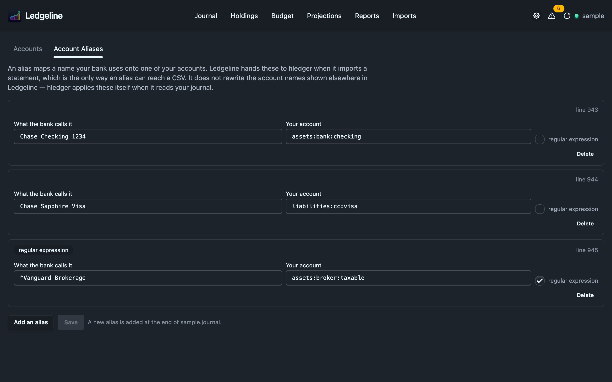

# Account aliases

A bank's export often names accounts in its own words. A Morgan Stanley statement says `PW Roth IRA - 3077` where your journal says `assets:morganstanley:pw-roth-ira`. A rules file that copies that column into the account (`account1 %acct`) writes the bank's words straight into your books.

An hledger `alias` directive fixes the name:

```journal
alias PW Roth IRA - 3077 = assets:morganstanley:pw-roth-ira
```

Settings → Account Aliases lists and edits the `alias` lines in your journal. Ledgeline passes them to hledger when it imports a statement.



## Why Ledgeline forwards your aliases

hledger applies an `alias` directive when it reads a journal. It does not apply one to a CSV being imported. An `alias` line in your journal therefore has no effect on `hledger import`, and the account arrives unmapped. The `--alias` command-line option does reach the CSV.

So Ledgeline reads the `alias` lines from your journal and passes each one to hledger as `--alias` on every import. You write the mapping once, in hledger's own syntax, and it works for imports too.

Ledgeline does not rewrite account names anywhere else. The journal view and the reports show account names exactly as your transactions spell them. hledger applies your aliases itself when it reads the journal from a terminal, so a report there can show a mapped name where Ledgeline shows the original. Ledgeline makes one narrow exception for [QuickBooks imports](#quickbooks-mappings).

## Using the editor

The tab shows the root journal, plus any other file that already holds `alias` lines. When there is more than one, pick the file from the row of buttons above the list.

Each alias has two fields, "What the bank calls it" and "Your account", and a **regular expression** box. Leave the box clear for a plain alias. A plain alias matches the whole account name, or a leading part of it that ends at a `:`. `alias a = b` renames `a` and `a:sub` and leaves `abc` alone. Tick the box for hledger's `/REGEX/ = replacement` form.

- **Add an alias** adds a new row. On save it goes right after the file's last `alias` line, or at the end of the file if there is none.
- **Delete** marks a row for removal. **Keep** undoes that before you save.
- **Save** writes the file. If the file changed on disk since Ledgeline read it, nothing is written, and **Reload and discard my changes** lets you start again from the current file.

You can't reorder aliases. hledger tries them in order, so moving one can change which alias wins, and the editor keeps their order as written.

A row can carry three badges:

| Badge | Meaning |
| --- | --- |
| not used for imports | Ledgeline will not pass this alias to an import. The row says why |
| read-only | Ledgeline will not rewrite this line. The row shows it as written, with the reason |
| regular expression | A `/REGEX/` alias |

## Aliases that are not used for imports

An alias stays in your journal and on screen but is not passed to an import when:

- an `end aliases` line later in the same file closes it. hledger's aliases apply from their line to the end of the file, or until `end aliases`. `--alias` applies everywhere and can't express a scope that stops, so Ledgeline leaves a closed alias out instead of applying it too widely
- one side is empty
- it contains a control character
- it is too long to put on a command line
- the journal declares more than 200 aliases, which is the most Ledgeline passes to one import

Every alias that is not closed by `end aliases` is passed on, whichever file it lives in.

## Lines the editor won't rewrite

Some `alias` lines are shown read-only because rewriting them would mean guessing what their author meant.

| Reason | Example | Why |
| --- | --- | --- |
| It contains `;` or `#` | `alias a = b ; note` | hledger reads this as an account literally named `b ; note`. It is not a comment |
| One side is empty | `alias a =` | There is nothing to rewrite |
| A delimiter inside the pattern | `alias a=b = c`, or `\/` in a regex | hledger splits at the first `=`, so the line doesn't say what it seems to. Re-escaping it would be a guess |
| A control character, or too long | | Ledgeline won't write those bytes |

The same rules apply to what you type. The editor tells you, before you save, if a pattern or account:

- is empty, or starts or ends with a space (hledger trims it, so it wouldn't be saved as typed)
- contains `;` or `#`
- is a plain pattern that starts with `/` (tick the regular expression box instead) or contains `=`
- is a regular expression with an unescaped `/`, or with a backslash in the pattern. A `\1` in the replacement is fine

## Seeing what an alias did to an import

When you import a statement on [New Transactions](../imports/new-transactions.md), the preview reports which accounts your aliases rewrote, with each rename next to the alias that caused it when Ledgeline can tell which one did. Ledgeline measures this by running the same import once without aliases and comparing the results, so the list is hledger's own answer. When no alias matched anything in the statement, the section is hidden.

## Matching the command line with hledger.conf

Because Ledgeline passes your aliases to hledger and a plain `hledger import` in a terminal does not, the same statement can land under different account names depending on which tool you used. The import preview checks for this. When the two would disagree, it says so: "Run from the command line, this same import would file N accounts differently". It lists each account as a terminal would file it, next to the account Ledgeline uses.

The fix is an `hledger.conf` file beside your journal. hledger reads `--alias` options from that file on every command, including `import`. The notice shows the exact lines it would add, and a button installs them. The button reads "Create hledger.conf beside your journal" when there is no config yet, or "Add these to …" when there is one. Ledgeline:

- only writes `hledger.conf` in your journal's own directory. It never writes the one in your home directory or the XDG config directory
- adds the lines to the file's general section, before any `[command]` section, so they apply to every command
- warns you when a config above your journal's directory is in force. hledger uses only the nearest file, so a new one beside your journal will stop the outer one from applying
- refuses when something at `hledger.conf` is not an ordinary file

### Spaces in hledger.conf

hledger splits each line of a config file at spaces and ignores quotes, so there is no way to write a space in an option. `--alias=PW Roth IRA - 3077=…` breaks, quoted or not.

Ledgeline works around this when it writes the file:

- An alias with no spaces is written as it is.
- A regular expression with spaces gets a `.` (match any one character) for each space.
- A plain alias with spaces becomes the equivalent regular expression, with its other special characters escaped first. For example, `PW Roth IRA - 3077` becomes `/^PW.Roth.IRA.-.3077($|:)/=assets:morganstanley:pw-roth-ira\1`.
- An alias whose account name contains a space can't be written at all, and the notice says so.

A converted alias can match slightly more than the original. A `.` matches any character, not only a space, and hledger's regex aliases ignore case where plain ones don't. That is why the notice shows you the lines before it writes them.

## QuickBooks mappings

The [QuickBooks Journal import](../imports/quickbooks.md) asks you to map each QuickBooks account to one of yours. Each mapping you enter there is saved as a plain `alias` line, through the same save this tab uses, so it appears here afterwards. You can edit or delete it like any other alias. A mapping on a parent account also covers its QuickBooks sub-accounts.

This is the one place Ledgeline applies an alias itself, because a QuickBooks Journal export can't go through `hledger import`. It only uses plain aliases there. A regular expression alias never maps a QuickBooks account, and the account is reported as unmapped instead.

For the full reasoning behind these rules, and the hledger behaviour each one was checked against, see [Account aliases](../development/imports-internals.md#account-aliases) in the import internals.
