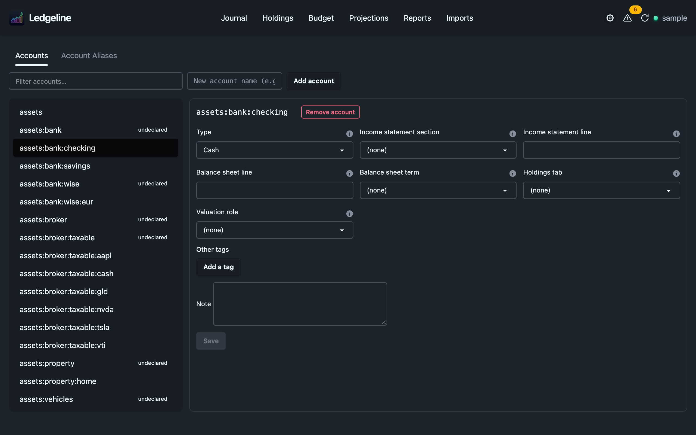

# Accounts

Settings → Accounts edits your chart of accounts: the `account` directives in your journal. Each directive names an account and can carry tags in its comment:

```journal
account assets:bank:checking  ; type: C, bsgroup: Cash and cash equivalents, opened 2019
```

Ledgeline's reports read several of those tags. This tab puts each one in a labelled field, so you don't have to remember the spelling or the allowed values.



## The account list

The list on the left holds every account the journal knows about. That is every account a posting uses, plus every account an `account` directive declares even if nothing posts to it yet. Type in the filter box to narrow it.

An account that only appears in postings carries an **undeclared** badge. hledger accepts such accounts, but they have no directive, so they have no tags and no declared type.

To add an account nothing uses yet, type its full name in the "New account name" box and press **Add account**. That opens the same editor as clicking a row. Nothing is written until you press **Save**.

## Editing an account

Select an account to open its editor. It has three parts.

The first part is a field for each tag a Ledgeline report reads. Most take a fixed set of values from a dropdown. The free-text ones suggest common values but accept anything.

| Field | Tag | Values | Read by |
| --- | --- | --- | --- |
| Type | `type:` | Asset (`A`), Liability (`L`), Equity (`E`), Revenue (`R`), Expense (`X`), Cash (`C`), Conversion (`V`), Gain (`G`) | Every report. See [account types](#account-types) below |
| Income statement section | `issection:` | `revenue`, `cogs`, `opex`, `depreciation`, `interest`, `tax`, `other` | [Income statement](../reports/income-statement.md) |
| Income statement line | `isgroup:` | Free text | [Income statement](../reports/income-statement.md) |
| Balance sheet line | `bsgroup:` | Free text, with suggestions such as "Cash and cash equivalents" and "Investments" | [Balance sheet](../reports/balance-sheet.md) |
| Balance sheet term | `bsterm:` | `current`, `noncurrent` | [Balance sheet](../reports/balance-sheet.md), [Cash flow](../reports/cash-flow.md) |
| Cash flow section | `cfsection:` | `operating`, `investing`, `financing`, `cash` | [Cash flow](../reports/cash-flow.md) |
| Cash flow line | `cfgroup:` | Free text | [Cash flow](../reports/cash-flow.md) |
| Holdings tab | `holdings:` | `stock`, `other`, `none` | [Holdings](../holdings/index.md) |
| Valuation role | `valuation:` | `cost`, `unrealized`, `depreciation`, `adjustment`, `mark` | [Holdings](../holdings/index.md), [Cash flow](../reports/cash-flow.md) |

Each field has a help icon with a one-line explanation. Pick "(none)" or clear the text to remove the tag.

The second part is **Other tags**, a name and value row for every other tag on the account, such as `yahoo:` or a tag of your own. Use **Add a tag** for a new row.

The third part is a free-text **Note**, written after the tags in the same comment.

If a fixed-value tag in your file holds a value the dropdown doesn't know, such as `holdings: shares`, the dropdown shows "(none)" and the tag appears under Other tags instead. A save keeps it there, so nothing in your file disappears because the editor didn't recognise it.

## What a save writes

Saving an existing account rewrites only that line's comment, from the `;` to the end of the line. The account name and anything before the comment stay exactly as they were. The new comment lists the dropdown and text-field tags first, in the table's order, then your other tags, then the note, all joined by commas:

```journal
account assets:brokerage:vti  ; type: A, holdings: stock, yahoo: VTI, bought through work
```

This means hand formatting inside a comment, such as extra spaces or a different tag order, is normalised the first time you save that account from here. Lines you don't touch are left byte for byte.

Saving an undeclared account adds a new `account` line. It goes right after the last `account` line in the target file, or at the end of the file if that file has none.

**Remove account** deletes the declaration line when you save. Transactions that use the account are not touched, so the account goes back to being undeclared.

## Where declarations live

Ledgeline finds the files that already hold `account` directives and lists only those. It never guesses from file names.

When your journal declares no accounts yet, the tab offers to create `accounts.journal`. Pressing **Create accounts.journal** writes that file next to your main journal, with a short comment header, and then appends `include accounts.journal` to the end of the main journal. The file is written first, so a failure on the second step leaves an unused file rather than a journal that can't be read. Ledgeline won't create the file if your journal already declares accounts, and it never overwrites an existing `accounts.journal`.

A new declaration goes into the last file in the list. Right after you create `accounts.journal`, that is the new file. When no file holds declarations and you haven't created one, new declarations go into a file that holds no transactions, or into the root journal if there is no such file.

## What the editor refuses

The editor checks your input as you save, and the engine checks it again before writing. It refuses:

- an account name that is empty, starts or ends with a space, contains a control character, contains `;` or `#`, or contains two spaces in a row (hledger reads two spaces as the end of the name)
- a comma in a free-text tag value such as Balance sheet line, because tags are separated by commas
- a tag name with a space, a comma or a colon in it, or a tag value with a comma
- an ordinary tag row that uses a special tag's name, such as `type`. Use the field for it instead
- a note that would read back as a tag. A note like `see: invoice 12` contains a colon, so hledger would read it as a tag named `see`. Remove the colon or the comma before it

If the file changed on disk after Ledgeline read it, the save is refused and nothing is written. Use **Reload and discard my changes**, then make the edit again.

## Account types

hledger's account types are what reports use to decide whether an account is an asset, a liability, income and so on. Ledgeline works out an account's effective type in this order:

1. The account's own `type:` tag.
2. The `type:` tag of its nearest declared parent. A `type: L` on `liabilities` covers `liabilities:visa`.
3. A guess from the name, the same convention hledger uses. A top-level name starting with `asset`, `liabilit`, `equity`, `revenue` or `income`, or `expense` gives that type. An asset account with a segment named `cash`, `bank`, `checking`, `chequing`, `savings`, `saving` or `current` is treated as Cash.
4. For a parent row that a depth limit creates, the type its declared children agree on.

An account none of these places has no type, and the type-based reports leave it out. If a report shows zero where you expect money, check the account's type here first. This matters most for charts of accounts that don't use English root names, such as `activo` or `gastos`. Those get nothing from step 3 and need a `type:` tag.

Cash (`C`) counts as an Asset, Gain (`G`) as Revenue and Conversion (`V`) as Equity, matching hledger.

The dropdown writes the single-letter codes. If you edit the file by hand, hledger also accepts the singular words (`Asset`, `Liability`, `Expense` and so on). Ledgeline also reads the plurals and `income`, which hledger rejects, so it classifies them sensibly rather than dropping them. Use the single letters if you also run hledger from a terminal.
